<!-- _class: lead -->
<!-- _paginate: false -->

# YZM 513 – High-Performance Programming for AI

### Week 5: Beyond One Machine
### Decomposition, Coordination, and the Cost of Distribution

**İstanbul Medeniyet Üniversitesi**
AI Engineering M.Sc. – Fall 2026

Ammar Daşkın

---

## The Week in concept

- Every parallel system — threads, MPI, Dask, Ray, GPU kernels, DDP — answers the same questions. 
 
How do we **split** the work?  
Who **does** what?  
What **moves**, and what does it cost?  
Who **waits** for whom?

> The answers change but questions are similar.

---

|Question | Week 3–4 answer | This week's answer |
|----------|----------------|-------------------|
| How do we **split** the work? | Chunk an array / split documents | Partitioning strategies |
| Who **does** what? | Thread pool / process pool | Schedulers, work-stealing |
| What **moves**, and what does it cost? | Shared memory (free) / pickle (expensive) | Object stores, networks |
| Who **waits** for whom? | Locks, barriers, queues | Task graphs, all-reduce |

> You already answered these for one machine. Today: the same questions, bigger scale.
> At cluster scale a fifth appears: **what if a worker dies?**

---

## Where are we in the course...

```text
Week 1–2:  One core, made fast     (vectorise, JIT, BLAS)
Week 3–4:  One machine, many cores (threads, processes, async, pools)
Week 5:    Many machines           ← TODAY
Week 6–8:  One GPU, many cores     (SIMT, CUDA, memory hierarchy)
Week 9:    Feeding the GPU         (DataLoader pipelines)
Week 10–11: Many GPUs              (DDP, model parallelism)
Week 12–13: Making it efficient    (mixed precision, torch.compile)
```

> Week 5 fills the "many machines" slot. But the *concepts* are the same
> ones you'll see in Week 10 (DDP = partitioning + all-reduce + barriers).

---

<!-- _class: lead -->

# Part I
# The Universal Questions of Parallelism

---

## Question 1: How Do We Split the Work?

From Week 3, you know two fundamental forms:

**Data parallelism:** same operation, different data.
- Matrix addition: each element independent.
- Tokenizing a corpus: each document independent.

**Task parallelism:** different operations, same or different data.
- Pipeline: load → preprocess → train → log.
- Hyperparameter sweep: 8 different experiments.

---
### In time frame
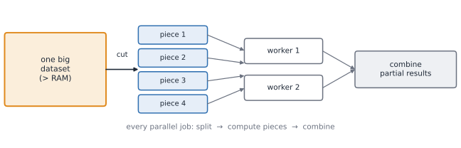

> At any scale — 2 threads or 200 machines — you must choose
> *what* to split and *where* to cut.

---

## Question 2: Who Does What? (Assignment)

From Week 4, you saw the **buffet analogy**:

- **Static split:** "You do docs 0–999, you do docs 1000–1999."
  Simple. Breaks if one chunk is 10× slower.
- **Shared queue (pull-based):** workers grab the next task when free.
  This is what `ProcessPoolExecutor.map` does. Good load balancing.
- **Work-stealing:** idle workers steal queued tasks from busy ones.
  Dask's distributed scheduler does this. Ray's per-node schedulers
  send tasks to nodes that have free resources and the data.

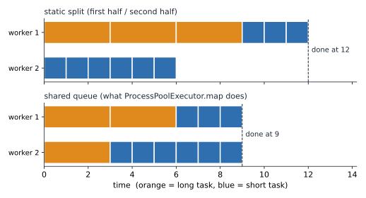

> The principle is identical at any scale.
> Only the mechanism changes (OS scheduler → framework scheduler → cluster manager).

---

## Question 3: What Moves, and What Does It Cost?

From Week 3: threads share memory → communication is "free" (just read the variable).
From Week 4: processes don't share → pickle/unpickle.

**This week:** workers on different machines don't share memory at all.

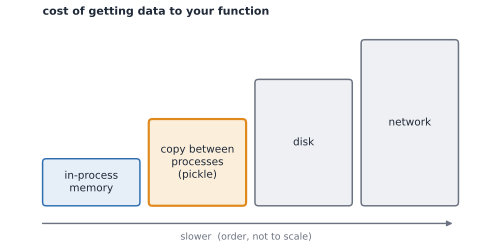

| Where | Cost |
|-------|------|
| Same thread / shared heap | ~ns |
| Other process, same machine (pickle or shared memory) | ~µs–ms |
| Other machine (network: TCP, gRPC) | ~ms |

> The further the data must travel, the more it dominates.

---

## Question 4: Who Waits for Whom? (Synchronization)

From Week 3: locks, semaphores, barriers, condition variables.

At distributed scale, the same patterns appear under different names:

| Week 3 concept | Distributed equivalent | AI example |
|----------------|----------------------|------------|
| Lock / Mutex | Distributed lock (rare, expensive) | — |
| Barrier | Synchronous phase boundary | DDP: all GPUs finish backward before step |
| Condition variable | Event / future resolution | `ray.get()`, `dask.compute()` |
| Producer-consumer queue | Task queue / object store | DataLoader, Ray object store |
| Semaphore | Resource limiter | `num_gpus=1` in Ray |

> You already know the patterns. The vocabulary changes; the logic doesn't.

---

## New at Cluster Scale: What If a Worker Dies?

One machine: if it dies, everything dies together. Nobody is left to care.

> 100 machines × a 10-hour job = 1,000 machine-hours.
> If a machine fails once per 1,000 hours, expect **about one failure per job**.

| Strategy | Idea | Works well when |
|----------|------|-----------------|
| **Retry** | run the lost task again | the task is a pure function |
| **Recompute** | rebuild lost data from its recipe (Spark's *lineage*) | the graph was recorded |
| **Checkpoint** | save progress to storage | the state is expensive to rebuild |

> **Stateless** tasks are easy to retry. **Stateful** workers (an actor, a training
> process) lose their state when they die, so they must checkpoint.

---

<!-- _class: lead -->

# Part II
# The Cost Model: Why Distribution Is Hard

---

## The Overhead Hierarchy

Every parallel operation pays:

```text
Task creation:     ~µs (threads) to ~ms (processes, remote tasks)
Data serialization: ~ms per MB (fast for NumPy arrays, slow for Python objects)
Data transfer:     ~ms per message (network)
Synchronization:   ~µs (local lock) to ~ms (distributed barrier)
Result collection:  ~µs per result × number of results
```

**A simple cost model:**

$$T_{parallel} = T_{overhead} + T_{communication} + \frac{T_{compute}}{N}$$

Distribution helps only when the saving, $T_{compute}\left(1-\frac1N\right)$, exceeds $T_{overhead} + T_{communication}$.

---

## Amdahl's Law with Communication

Standard:
$$S(N) = \frac{1}{f_{serial} + \frac{1 - f_{serial}}{N}}$$

With communication:
$$S(N) = \frac{1}{f_{serial} + f_{comm} + \frac{1 - f_{serial} - f_{comm}}{N}}$$

- $f_{serial}$: the reduce step, the narrow waist, the final merge.
- $f_{comm}$: task overhead + serialization + transfer, as a fraction of the total.
- Ceiling: as $N \to \infty$, $S \to \dfrac{1}{f_{serial} + f_{comm}}$. If they sum to 0.1, **no number of workers gives more than 10×**.
- If $f_{comm}$ **grows** with $N$ (more workers → more messages), speedup can **decrease**.

> Next question: what controls $f_{serial}$ and $f_{comm}$? The **size of a task**.

---

## Granularity: The Dial Behind the f's

> **Granularity** = how much work is in one task.
> With $D$ documents and $g$ documents per task, there are $D/g$ tasks.

| | Too fine ($g$ small) | Too coarse ($g$ large) |
|---|---|---|
| **Tasks** | thousands | fewer than workers |
| **$f_{comm}$** (cost per task × #tasks) | large | small |
| **$f_{serial}$** (reduce over all partials) | large | small |
| **Workers busy?** | yes, but mostly on overhead | no: idle workers, stragglers |
| **Memory** | fine | a task may not fit |

**The sweet spot:** each task computes much longer than it costs to create, schedule, serialize and collect.

> This one dial explains more distributed performance problems than any other:
> Dask chunks, Ray tasks, DataLoader batches, GPU kernel launches, DDP gradient buckets.

---

## Measured: Granularity Through Amdahl's Lens

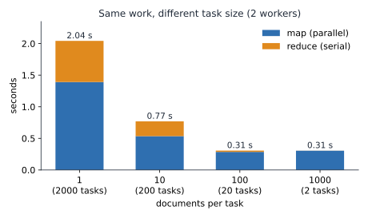

- Same work, same 2 workers. Only the **task size** changes.
- **Left:** the orange and grey parts are $f_{comm}$ and $f_{serial}$. They shrink as tasks grow.
- **Right:** speedup against the **ceiling of 2×**. Small tasks are *slower than not parallelising at all*.

> 📁 `class-examples/week05/01_granularity_sweep.py` (also times the serial version)

---

## Reading the Numbers With Amdahl

Serial version: **0.44 s**. Ceiling with 2 workers: **2×**.

| docs/task | tasks | total | speedup $S$ | effective $f$ |
|----------:|------:|------:|------------:|--------------:|
| 1 | 2000 | 1.82 s | 0.24× | 7.4 |
| 10 | 200 | 0.62 s | 0.70× | 1.8 |
| **100** | **20** | **0.29 s** | **1.52×** | **0.32** |
| 1000 | 2 | 0.32 s | 1.36× | 0.47 |

$f \approx \dfrac{1/S - 1/N}{1 - 1/N}$: the same estimator you use in the lab.
**$f > 1$ means the overhead costs more than the whole job.**

- Best: ~100 docs/task. 1.5× of the 2× ceiling; the rest is pool start-up and pickling.
- 1000 docs/task is slightly worse: only 2 tasks, each ships ~12 MB, and no slack if one worker lags *(likely cause; not isolated)*.

<!-- note:
Ask first: "2000 tasks on 2 workers: faster or slower than one process?" Most students say faster. It is 4x SLOWER.
f_eff is the lab's estimator applied to each row. Values above 1 are not real fractions: they say overhead exceeds the entire serial job.
-->

---

<!-- _class: lead -->

# Part III
# Decomposition: How to Cut
### →  The First Question, Revisited: "How do we split the work?"

---

> **Q1: How do we split the work?**
> At any scale — 2 threads or 200 machines — you must choose
> *what* to split and *where* to cut.

We already know two shapes from Week 3:


- **Data parallelism:** same op, different data
- **Task parallelism:** different ops, same or different data

Today we make this concrete for distributed systems:
*which dimension do we cut along?*

---

## Data Partitioning Strategies

| Strategy | Cut by | Choose when | AI example |
|----------|--------|-------------|------------|
| **Block / chunk** | Contiguous blocks | Arrays, matrices, images | Embedding matrix rows |
| **Row / document** | Whole records | Each record processed independently | Corpus tokenization |
| **Hash** | Hash of a key | Equal keys must meet (joins, groupby) | RAG store by doc ID |
| **Range** | Value range | Sorted data, range queries | Training shards by index |

> **Rule:** match the partition to the *next* operation.
> If the next op is local to each piece → any cut works.
> If the next op needs to see all pieces → you'll pay a reduce or shuffle.

---

## The Right Cut in Code

```python
# Corpus: 20,000 documents → tokenize each one independently
# ✓ GOOD cut: by document (each piece is independent)
chunks = [corpus[i:i+1000] for i in range(0, len(corpus), 1000)]
# 20 chunks, each processed without talking to the others

# ✗ BAD cut: by token position (pieces must talk to reconstruct docs)
# Every operation would need cross-chunk coordination
```

```python
# Embedding matrix: 100,000 × 768 → compute row-wise norms
# ✓ GOOD cut: by row block (each block self-contained)
Xd = da.from_array(X, chunks=(10_000, 768))
norms = da.sqrt((Xd ** 2).sum(axis=1)).compute()   # each block is independent
```

---

## The Shuffle Problem


**Good cut:** documents by ID → tokenize each doc.
→ Each piece independent. **No data moves.** Embarrassingly parallel.

**Bad cut:** documents by date → group by author.
→ Each author's docs scattered across all pieces.
→ Rows must **move** between workers to co-locate. This is a **shuffle**.

---

> Shuffle is the most expensive operation in distributed computing.
> Spark spends most of its time shuffling. Avoid it when possible.

**Not a shuffle:** column mean over row-partitioned data.
Each piece sends `(sum, count)`. One cheap reduce. No rows move.

---

## Task Decomposition: Three Patterns

| Pattern | Structure | AI example |
|---------|-----------|------------|
| **Pipeline** | Stage 1 → Stage 2 → Stage 3 | DataLoader: load → augment → transfer |
| **Data-parallel** | Same op on N chunks | Batch of images through one layer |
| **Task-parallel** | N different ops simultaneously | Hyperparameter sweep: 8 configs |

Real AI systems **combine** these:
- DataLoader = pipeline (stages) + data-parallel (multiple workers)
- DDP = data-parallel (shards) + synchronous barrier (gradient sync)
- Inference server = task-parallel (requests) + pipeline (prefill → decode)

---

## Q1 Summary

> **How do we split the work?**
> - Cut along the dimension the *next operation* touches.
> - If pieces are independent → embarrassingly parallel.
> - If pieces must meet → you'll pay (reduce is cheap, shuffle is not).
> - Real systems combine pipeline + data-parallel + task-parallel.

Now we have pieces. Next: **how do they coordinate?**

---

<!-- _class: lead -->

# Part IV
# Coordination: Task Graphs and Communication
### → Answers Questions 2, 3, 4
### "Who does what? What moves? Who waits for whom?"

---

## Three Questions, One Answer

| Question | What it asks | Today's answer |
|----------|-------------|----------------|
| **Q2: Who does what?** | Assignment of tasks to workers | Schedulers (static, queue, work-stealing) |
| **Q3: What moves?** | Data crossing worker boundaries | Object stores, broadcast, reduce |
| **Q4: Who waits for whom?** | Dependencies between tasks | Task graphs, barriers, futures |

These three questions are inseparable in practice:
the graph (Q4) decides what can move in parallel (Q3),
which decides who is free to take the next task (Q2).

---

## Q4 First: The Task Graph

- **Node** = a task
- **Edge** = data dependency (output of A feeds input of B)
- **Width** = max tasks that can run simultaneously
- **Critical path** = longest dependency chain = minimum possible time

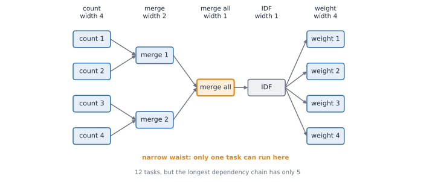

> Width 4 at the start and end; width 1 in the middle.
> 12 tasks, but minimum time = 5 steps (the critical path).
> The **narrow waist** is where Amdahl bites.

---

## A Tiny Graph in Code

```python
import dask
from dask import delayed

@delayed
def count(chunk): ...
@delayed
def merge(a, b): ...

# Build the graph — nothing runs yet
c1, c2, c3, c4 = [count(i) for i in range(4)]   # width 4
m1 = merge(c1, c2)                               # width 2
m2 = merge(c3, c4)
total = merge(m1, m2)                            # width 1 (narrow waist)

# Inspect before running
dask.visualize(total, filename="graph.png")

# Now run
result = total.compute()
```

> `delayed` records the graph. `compute()` executes it.
> You can draw the graph, optimise it, inspect it — before any work happens.

---

## Static vs. Dynamic Graphs

| | Static graph | Dynamic graph |
|---|---|---|
| **Built** | Before execution | As the program runs |
| **You can** | Inspect, optimise, visualise | Branch on results, loop until done |
| **Cost** | Rigid shape | No global optimisation |
| **Examples** | Dask collections, `dask.delayed`, Spark | Ray tasks, Dask futures |

```python
# Static: graph is fixed before execution
total = merge(merge(c1, c2), merge(c3, c4))

# Dynamic: graph depends on a result
if ray.get(total) > threshold:             # look at a result...
    extra = expensive_op.remote(total)     # ...then decide what to run (Ray)
```

> **PyTorch connection:** eager mode = dynamic. `torch.compile` (Week 13)
> captures a static graph from eager code. Same concept, different domain.

---

## Q2: Who Does What? (Scheduling)


| Strategy | How it works | When to use |
|----------|-------------|-------------|
| **Static split** | Fixed share per worker upfront | All tasks equal cost |
| **Shared queue (pull)** | Idle workers take next task | Task costs vary |
| **Work-stealing** | Idle workers steal from busy | Highly variable costs |
| **Locality-aware** | Run where data already lives | Data is expensive to move |

```python
# Static: you split
chunks = split_evenly(corpus, n_workers)

# Pull-based: framework splits
futures = client.map(process_doc, corpus)  # Dask
futures = [process.remote(d) for d in corpus]  # Ray
```

> `ProcessPoolExecutor.map` from Week 4 is the pull-based pattern.
> Dask's distributed scheduler and Ray's per-node schedulers extend it to clusters.

---

## Q3: What Moves? (The Cost Ladder)


Every edge in the task graph that crosses workers means data travels:

| Where | Cost |
|-------|------|
| Same thread / shared heap | ~ns |
| Other process, same machine (pickle or shared mem) | ~µs–ms |
| Other machine (network: TCP, gRPC) | ~ms |

> A task computes for 1 ms but its arguments take 5 ms to copy?
> **80% of the time is moving data, not computing.**

---

## Q3 in Code: Pass Reference, Not Data

```python
# BAD: 20 MB matrix pickled with EVERY task
futures = [score.remote(matrix, i) for i in range(20)]
#   → 20 × 20 MB = 400 MB serialized

# GOOD: serialize once, pass a reference
ref = ray.put(matrix)                        # 1 × 20 MB
futures = [score.remote(ref, i) for i in range(20)]
```

```python
# Same idea in Dask
big_ref = client.scatter(big, broadcast=True)  # ship once to every worker
futures = [client.submit(score, big_ref, i) for i in range(16)]
```

> Same fix as Week 4's `process_pool_search.py`. Same principle at any scale.

---

## The Cost of Communication

**Rule of thumb:**
> Move computation to data when data is big.
> Move data to computation when computation is big and data is small.

| Scenario | What to do |
|----------|-----------|
| 500 GB corpus, small operation per doc | Send the code to the data (partition locally) |
| Small query vector, huge index | Send the query to where the index lives |
| Model weights needed by all workers | Broadcast once, not per-task |
| Gradients from all GPUs | All-reduce (Week 10) |

> This is why `ray.put()` and `client.scatter()` exist:
> put big read-only data somewhere once, pass a reference.

---

## Four Communication Patterns

| Pattern | Meaning | Week 3 analog | AI example |
|---------|---------|---------------|------------|
| **Broadcast** | Same data to all workers | — | Send IDF weights to all chunks |
| **Reduce / All-reduce** | Combine results from all | Barrier + merge | DDP gradient sync (Week 10) |
| **Shuffle** | Redistribute by key | — | Repartition dataset by length |
| **Point-to-point** | Send between specific workers | Producer → consumer | Pipeline stages (Week 11) |

```text
All-reduce (DDP Week 10):
  worker 0: g0 ─┐                          ┌─► g0+g1+g2+g3
  worker 1: g1 ─┤   reduce (sum)           ├─► g0+g1+g2+g3
  worker 2: g2 ─┤   + broadcast the sum    ├─► g0+g1+g2+g3
  worker 3: g3 ─┘                          └─► g0+g1+g2+g3
```

> In Week 3 you used locks and queues. At distributed scale,
> these four patterns replace them.

---

## Q3 in Math: Amdahl's Law with Communication

Standard:
$$S(N) = \frac{1}{f_{serial} + \frac{1 - f_{serial}}{N}}$$

With communication:
$$S(N) = \frac{1}{f_{serial} + f_{comm} + \frac{1 - f_{serial} - f_{comm}}{N}}$$

- $f_{serial}$: the reduce step, the narrow waist.
- $f_{comm}$: task overhead + serialization + transfer.
- Ceiling: as $N \to \infty$, $S \to \dfrac{1}{f_{serial} + f_{comm}}$.

> **If $f_{comm}$ grows with $N$ (more workers → more messages),
> adding workers can make things slower.**

---

## Q2 + Q3 + Q4 Summary

| Question | Answer |
|----------|--------|
| **Q2: Who does what?** | A scheduler assigns tasks (static, pull, work-stealing, locality-aware) |
| **Q3: What moves?** | Data crossing workers. Pass references, not values. All-reduce for shared results. |
| **Q4: Who waits for whom?** | The task graph. The narrow waist sets the serial fraction. |

> These three are inseparable. The graph decides what can move in parallel;
> what moves decides who is free to take the next task.

---

<!-- _class: lead -->

# Part V
# The Landscape of Systems
### → How different tools answer the four questions differently

---

## The Spectrum

```text
┌────────────────────────────────────────────────────────────────────┐
│  Scope          Tool                    You manage                 │
├────────────────────────────────────────────────────────────────────┤
│  One core       NumPy / Numba           Nothing (BLAS does it)     │
│  One machine    threading / asyncio     Thread pool, queues        │
│  One machine    multiprocessing         Process pool, pickle       │
│  One machine    Dask (local)            Chunk sizes, scheduler     │
│  Cluster        Dask distributed        Cluster setup              │
│  Cluster        Ray                     Cluster setup, actors      │
│  Cluster        Spark                   Cluster, partitions        │
│  Cluster        MPI                     Everything by hand         │
│  GPU            CUDA / PyTorch          Kernel design              │
│  Multi-GPU      DDP / DeepSpeed         Gradient sync strategy     │
└────────────────────────────────────────────────────────────────────┘
```

> Each row answers the same four questions differently.
> The further down, the more the framework manages for you.

---

## What Are Dask and Ray For?

| | **Dask** | **Ray** |
|---|---|---|
| **What it is** | A Python library that scales NumPy, pandas and plain Python | A Python framework that runs functions and objects on many workers |
| **You write** | Code that looks like NumPy / pandas | `@ray.remote` functions and classes |
| **Used for** | Data larger than RAM, tables and arrays, scientific data, ETL | Many independent runs, hyper-parameter search, serving, distributed training |

> Neither is an arithmetic library. Both are **coordinators** for Python code.

---

## How Dask and Ray Answer the Four Questions

| Question | Dask | Ray |
|----------|------|-----|
| **Q1: Split** | Chunked arrays / DataFrames / bags | You decide; pass chunks as arguments |
| **Q2: Assign** | Central scheduler, work-stealing | Decentralised, resource + locality-aware |
| **Q3: Move** | `client.scatter()` over TCP (or UCX) | `ray.put()` → shared-memory object store |
| **Q4: Wait** | Static graph + `compute()` / dynamic futures | Futures + `ray.get()` / `ray.wait()` |

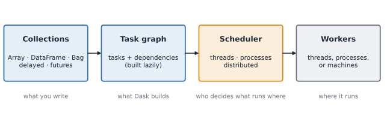

---

## Ray's Model: Visualised

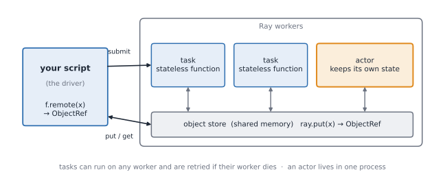

- **Driver** (your script) submits tasks via `.remote()`
- **Workers** execute stateless tasks or host stateful actors
- **Object store** (shared memory on each node) holds `ray.put()` values
- Workers on the same node read big arrays **zero-copy** from the store

---

## Two Memory Models: OpenMP vs MPI

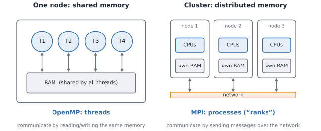

- **Cluster:** nodes (each with **its own** RAM) + a network + a job scheduler (Slurm).
- **OpenMP:** threads sharing one node's memory: `#pragma omp parallel for reduction(+:sum)`
- **MPI:** processes with separate memory that **send messages**. Partial failures: you handle them.

> Dask and Ray work in **both** modes: same code, different backend. Colab = one node.

---

## A Brief History (Vocabulary)

| Year | System | Key idea | Legacy |
|------|--------|----------|--------|
| 1994 | **MPI** | Explicit messages between ranks | Still used for HPC numerics |
| 2004 | **MapReduce** | map → shuffle → reduce; retry on failure | The pattern every framework copies |
| 2012 | **Spark** | In-memory (RDDs), lineage-based recovery | Industry standard for ETL/analytics |
| 2015 | **Dask** | "NumPy/pandas but bigger", PyData ecosystem | Natural fit for Python data science |
| 2018 | **Ray** | Tasks + actors, built for ML | Growing fast in AI infrastructure |

> You will meet **Spark** in industry. You will use **Dask/Ray** in this course.
> The concepts (partition, schedule, communicate, recover) are the same in all of them.

---

## MPI: The Manual Baseline

```c
MPI_Comm_rank(MPI_COMM_WORLD, &rank);   // who am I?       Q2
MPI_Comm_size(MPI_COMM_WORLD, &size);   // how many of us?
for (long i = rank; i < N; i += size)   // my share        Q1
    local += 1.0 / (i + 1);
MPI_Reduce(&local, &total, 1, MPI_DOUBLE,                  Q3, Q4
           MPI_SUM, 0, MPI_COMM_WORLD);
```

**What MPI makes you do by hand:**
- Q1: split the work (`i = rank; i += size`)
- Q3: combine results (`MPI_Reduce`)
- Failure: if one rank dies, the whole job stops (no Q5)

> Dask and Ray automate exactly this bookkeeping.
> That's their value proposition.

---

## The Stack: Who Does the Arithmetic?

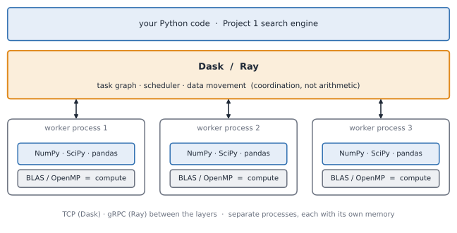

> **Dask and Ray do NOT do the arithmetic.**
> They decide *what runs where* and *move data* (Q2, Q3).
> NumPy / BLAS / your code does the actual computation.

---

## A Hidden Trap: Threads Inside Workers

```text
4 Dask workers × 4 BLAS threads each = 16 threads on 4 cores → oversubscription
```

Fix: `workers × BLAS_threads ≤ cores`. Set `OMP_NUM_THREADS=1` per worker.

| BLAS threads per worker | total threads | time (2 cores, our run) |
|:-----------------------:|:-------------:|:-----------------------:|
| 1 | 2 | 0.73 s |
| 4 | 8 | 0.93 s |

📁 `class-examples/week05/09_blas_oversubscription.py`

---

## What They Are Not

| | MPI | Dask / Ray |
|---|---|---|
| **Good at** | Tightly-coupled numerics, very low latency | Coarse tasks, irregular work, Python workflows |
| **You manage** | Splitting, messages, failure | Almost nothing |
| **Overhead per task** | Microseconds | Around a millisecond (we measure it) |
| **Fault tolerance** | Little | Built in (Q5) |

> Millions of tiny operations → not Dask/Ray tasks.
> We'll see exactly why in the granularity sweep.

---

## Dask vs. Ray: Side by Side

| | **Dask** | **Ray** |
|---|---|---|
| You think in | Chunked arrays / tables / bags | Function calls and objects |
| Mental model | "NumPy/pandas, but bigger" | "`f()`, but on another worker" |
| Graph (Q4) | Static (collections) or dynamic (futures) | Dynamic (tasks, actors) |
| Data sharing (Q3) | `client.scatter()` | `ray.put()` → object store |
| Stateful workers | Possible, not primary | **Actors** (core feature) |
| Fault tolerance (Q5) | Re-run lost tasks | Retry tasks; restart actors |
| Strongest at | Data bigger than RAM | Many independent tasks, ML pipelines |
| Grew from | PyData (NumPy/pandas maintainers) | ML systems research (Berkeley) |

> They overlap. For Project 1, either could work.
> The point is to know **why** you'd pick one.

---

## How They Talk, and Where the Threads Are

| | Between processes | Workers and memory |
|---|---|---|
| **Dask** | **TCP** by default; UCX optional for fast interconnects | Separate worker **processes**, each may run several **threads**; no memory shared **between** workers |
| **Ray** | **gRPC** for control; **shared-memory object store** for data | Separate worker **processes**; workers on one node read large NumPy arrays **zero-copy** from the store |

> Both use their **own** protocols: not MPI, not OpenMP.
> Between machines, data is always serialised and sent.

<!-- note:
dask-mpi / dask-jobqueue only help LAUNCH Dask workers inside an MPI / Slurm job; the data still travels over Dask's own comms.
The Ray object store is per node: moving an object to another node is a network transfer.
-->

---

## Part V Summary

> Different tools answer the same four questions differently:
> - **Q1 (split):** Dask chunks for you; Ray leaves it to you.
> - **Q2 (assign):** Dask = central scheduler; Ray = decentralised + locality.
> - **Q3 (move):** Dask = scatter over TCP; Ray = shared-memory object store.
> - **Q4 (wait):** Dask = static graph + futures; Ray = futures + actors.
> - **Q5 (failure):** Dask retries tasks; Ray retries tasks *and* restarts actors.
>
> The concepts transfer. The API is the easy part.

Next: we'll see the **same DF → IDF problem** solved in both styles.

---

<!-- _class: lead -->

# Part VI
# Dask and Ray in Practice
# (Same Problem, Two Styles)

---

## The Workload: DF → IDF

> The same problem, solved with Dask and with Ray (and compared with serial and ProcessPool in the lab).

```text
1. Split corpus into chunks
2. Count document frequency per chunk        (parallel, width = #chunks)
3. Merge all counts                          (reduce, narrow waist)
4. Compute IDF from merged counts            (serial, tiny)
5. Weight each chunk using IDF               (parallel, width = #chunks)
```

This is the graph from Part IV. Now we implement it.

---

## Dask: Build the Graph, Then Run It

```python
from dask import delayed

counts  = [delayed(df_chunk)(c) for c in chunks]       # width N
m1      = delayed(merge)(counts[0], counts[1])          # tree reduce (4 chunks shown)
m2      = delayed(merge)(counts[2], counts[3])
total   = delayed(merge)(m1, m2)                        # narrow waist
idf     = delayed(make_idf)(total, n_docs)
weights = [delayed(weight_chunk)(c, idf) for c in chunks]  # width N again

# Nothing has run yet. Visualise first:
dask.visualize(*weights, filename="df_idf_graph.png")

# Then execute:
results = dask.compute(*weights)
```

- **Static graph:** built before execution. You can inspect it.
- **Lazy:** nothing runs until `.compute()`.
- **Scheduler:** threads by default (GIL!). Use `scheduler="processes"` for pure Python.

> 📁 `class-examples/week05/02_dask_delayed_graph.py`

---

## Ray: Build the Graph While Running

```python
import ray

@ray.remote
def df_chunk(docs): ...

@ray.remote
def merge(a, b): ...

chunk_refs = [ray.put(c) for c in chunks]          # store once
counts     = [df_chunk.remote(c) for c in chunk_refs]  # width N
total_df   = tree_reduce(counts)                    # merge futures pairwise
idf_ref    = make_idf.remote(total_df, n_docs)      # narrow waist
weights    = [weight_chunk.remote(c, idf_ref) for c in chunk_refs]
result     = sum(ray.get(weights))
```

- **Dynamic graph:** built by ordinary Python loops while running.
- **Eager submission:** `.remote()` returns immediately.
- **Object store:** `ray.put()` stores data once; pass references.

> 📁 `class-examples/week05/16_ray_df_idf.py`

---

## Same Graph, Different Styles

| | Dask `delayed` (local) | Dask distributed | Ray tasks |
|---|---|---|---|
| Graph built | Before execution | Before execution | While running |
| Can you visualise it? | Yes: `dask.visualize()` | Yes (dashboard) | No: you see it execute |
| Branch on a result? | Awkward | Awkward | Natural |
| Shared data | `client.scatter()` | `client.scatter()` | `ray.put()` |
| Default scheduler | **Threads (GIL!)** | **Processes** | **Processes** |
| Best for | Array/table pipelines | Out-of-core, clusters | Many independent tasks, ML |

> The **concepts are identical**: tasks, dependencies, narrow waist, broadcast.
> Only the *style* and the *default scheduler* differ.
> Dask `delayed` on threads will hit the GIL for pure-Python tasks.
> Switch to `scheduler="processes"` or use `distributed` to fix it.

<!-- note:
This is why example 02_dask_delayed_graph says "pure-Python tasks on threads: the GIL limits the speedup."
And why 08_dask_distributed_futures uses LocalCluster(n_workers=2, threads_per_worker=1).
And why Ray tasks do not share a GIL: they run in separate worker processes (reused, not one per task).
The scheduler choice is the SAME decision as Week 4: threads for I/O / NumPy,
processes for pure Python. Nothing new.
-->

---

## The Graph Is Just the Recipe

We've built the same DF → IDF graph in both tools.
The graph tells you **what** runs and **in what order**.

But the graph doesn't move data.

```text
   Graph structure:        Data reality:
   ┌─────────────┐         ┌─────────────────────────────────────┐
   │ count chunk1│         │ 20 chunks × ~300 KB each            │
   │ count chunk2│         │ must arrive at 20 different workers │
   │ count chunk3│         │                                     │
   │     ...     │         │ 1 IDF dict × ~100 KB, grows w/ vocab│
   │ weight all  │         │ must arrive at ALL 20 workers       │
   └─────────────┘         └─────────────────────────────────────┘
```

---

## Free to Draw, Expensive to Move

> **The graph is free to draw. The data is expensive to move.**
>
> In our DF → IDF example:
> - The 20 chunks are used **twice** (count step AND weight step).
> - The IDF dict is needed by **every** weight task.
>
> If we pass them by value, they get serialized with every task call.
> 20 chunks × 2 uses = 40 serializations. Plus 20 copies of the IDF dict.
>
> **The fix:** store once, pass a reference. Both tools have this.

<!-- note:
This is the bridge from "how to express the computation" to
"how to feed it efficiently." The graph was the STRUCTURE lesson.
Data movement is the COST lesson. 
-->


---


## Object Stores: Pass References, Not Data

```python
# BAD: 20 MB array pickled with EVERY task
futures = [score.remote(matrix, i) for i in range(20)]

# GOOD: serialize once, pass a reference
ref = ray.put(matrix)
futures = [score.remote(ref, i) for i in range(20)]
```

| | By value | By reference (`ray.put`) |
|---|---|---|
| Serializations | 20 × 20 MB = 400 MB | 1 × 20 MB |
| Time (your run) | ? | ? |

> Same idea as Week 4's `process_pool_search.py` fix.
> Same idea as Dask's `client.scatter(big, broadcast=True)`.
> **Principle:** put big read-only data somewhere once, pass a reference.

> 📁 `class-examples/week05/11_ray_object_store.py`  (prints both times)

---

## Stateful vs. Stateless: Tasks vs. Actors

| | Stateless task | Stateful actor |
|---|---|---|
| Setup cost | Paid **every** call | Paid **once** per actor |
| State between calls | None | Kept in memory |
| Fault tolerance | Easy: just retry | Hard: state is lost on crash |
| Scaling | Trivial (any worker) | Harder (actor pinned to one process) |
| AI example | Tokenize a document | LLM model loaded once, serves many queries |

```python
@ray.remote
class Predictor:
    def __init__(self):
        self.W = load_model()       # 1 second, paid ONCE
    def predict(self, x):
        return float((self.W @ x).sum())
```

> 📁 `class-examples/week05/14_ray_actors.py`

---

## Granularity in Practice (Both Tools)

| docs/task | tasks | ProcessPool (Week 4) | Dask Bag | Ray |
|----------:|------:|---------------------:|---------:|----:|
| 1 | 2000 | 1.82 s | ? | ? |
| 10 | 200 | 0.62 s | ? | ? |
| **100** | **20** | **0.29 s** | ? | ? |
| 1000 | 2 | 0.32 s | ? | ? |

> **Predict:** does the sweet spot move with the framework?
> The bottleneck is the same: per-task overhead + a serial reduce.
> Frameworks change the ergonomics; the physics stays.

> 📁 `01_granularity_sweep.py` (ProcessPool, Part II) · `05_dask_bag_df_idf.py` · `13_ray_granularity.py`
> *(ProcessPool column: our 2-core sandbox run.)*

---

<!-- _class: lead -->

# Part VII
# Tutorial: Dask and Ray, Step by Step
### create · run · watch · manage · shut down

<!-- note:
~40 min, hands-on. Students run each step on Colab BEFORE you explain it (predict -> run -> explain).
Files: 17_dask_tutorial.py (steps 1-9) and 18_ray_tutorial.py (steps 1-8). Run one step with: python 17_dask_tutorial.py 4
Both files were written to run step by step; run_all_examples.py runs all steps.
-->

---

## How to Follow Along

Two tracks with the same shape: **create → run → watch → manage → close**.

| Track | File | Steps |
|---|---|---|
| **Dask** | `17_dask_tutorial.py N` | 1–9 |
| **Ray** | `18_ray_tutorial.py N` | 1–8 |

```text
!pip install -q "dask[complete]" ray      # Colab: one cell
!apt-get install -y -q graphviz           # only for dask.visualize
!python 17_dask_tutorial.py 4             # run one step
```

Each step: **goal → code → what to observe.** Predict before you run.

> In a **script**, keep clusters inside `if __name__ == "__main__":`. In a notebook you do not need it.

---

## Dask 1 · Start With a Lazy Value

```python
import dask
from dask import delayed

@delayed
def inc(x): return x + 1
@delayed
def add(a, b): return a + b

total = add(inc(1), inc(2))      # builds a graph, runs nothing
print(total)                     # Delayed('add-...')
dask.visualize(total, filename="tutorial_graph", format="png")
print(total.compute())           # 5: now it runs
```

> **Observe:** the first `print` shows no number. Nothing ran until `.compute()`.
> No cluster exists yet: this uses Dask's built-in **threads**.

📁 `17_dask_tutorial.py 1`

---

## Dask 2 · Choose Where It Runs

```python
tasks = [delayed(burn)(1_500_000) for _ in range(8)]   # pure-Python CPU work

dask.compute(*tasks, scheduler="synchronous")            # one thread: debug here
dask.compute(*tasks, scheduler="threads",   num_workers=2)
dask.compute(*tasks, scheduler="processes", num_workers=2)   # dask.multiprocessing

with dask.config.set(scheduler="processes", num_workers=2):  # a whole block
    dask.compute(*tasks)
```

> **Predict:** which of the three is fastest for pure Python? (Week 4: the GIL.)
> `scheduler="processes"` is the string for the `dask.multiprocessing` scheduler.
> No cluster yet: only a choice of **pool**.

📁 `17_dask_tutorial.py 2`

---

## Dask 3 · Pick a Collection

```python
x = da.random.random((4000, 4000), chunks=(1000, 1000))      # Array: chunked NumPy
x.sum().compute()

sq = db.from_sequence(range(10), npartitions=2).map(lambda v: v * v)   # Bag: Python objects
sq.sum().compute()

ddf = dd.from_pandas(pdf, npartitions=4)                      # DataFrame: chunked pandas
ddf.groupby("author")["n"].mean().compute()
```

| Collection | Default scheduler |
|---|---|
| Array, DataFrame, `delayed` | threads |
| Bag | processes |

> **Observe:** `chunks` / `npartitions` is the **granularity dial** from Part II.
> Each result is checked against plain NumPy / pandas in the file.

📁 `17_dask_tutorial.py 3` · `03_dask_array_chunks.py`

---

## Dask 4 · What a LocalCluster Starts

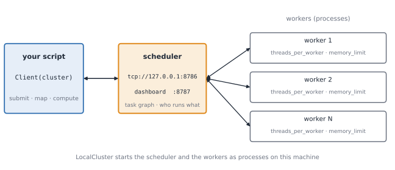

- A **scheduler** process and **N worker** processes, all on your machine.
- A **Client** connects your script to the scheduler.
- Creating a Client makes it the **default**: `.compute()` now runs on the cluster.

---

## Dask 4 · Start It, Use It, Close It

```python
from dask.distributed import Client, LocalCluster

if __name__ == "__main__":
    with LocalCluster(n_workers=2, threads_per_worker=1, memory_limit="1GB") as cluster, \
         Client(cluster) as client:
        print(client)                    # workers=2, threads=2
        print(client.dashboard_link)     # http://127.0.0.1:8787/status
        print(client.submit(sum, [1, 2, 3]).result())    # 6
```

- The `with` block **closes the workers** on exit.
- `memory_limit` is **per worker**.
- `Client()` with no arguments starts a LocalCluster for you.

📁 `17_dask_tutorial.py 4`

---

## Dask 5 · Size the Cluster

| Your tasks are… | Use | Why |
|---|---|---|
| pure Python | `n_workers=cores, threads_per_worker=1` | one GIL per worker |
| NumPy / pandas (release the GIL) | fewer workers, more threads | less copying between processes |
| memory hungry | fewer workers, larger `memory_limit` | each worker holds its chunks |

```python
os.environ["OMP_NUM_THREADS"] = "1"          # BEFORE creating the cluster (Part V trap)
LocalCluster(n_workers=2, threads_per_worker=1)      # 2 GILs
LocalCluster(n_workers=1, threads_per_worker=2)      # 1 GIL
```

> **Rule:** workers × threads × BLAS threads ≤ cores.
> **Predict:** pure-Python tasks, 2 cores: which cluster is faster?

📁 `17_dask_tutorial.py 5`

---

## Dask 6 · Futures: Submit, Map, Wait

```python
futs = client.map(burn, [200_000 * k for k in range(1, 7)])   # starts at once
for f in as_completed(futs):                                   # finish order
    print(f.result())
total = client.submit(sum, futs)                               # futures as arguments
print(total.result())
```

- Unlike `delayed`, a future **starts running immediately**.
- `client.gather(futs)` collects a whole list.
- This is a **dynamic** graph, like Ray's.

📁 `17_dask_tutorial.py 6`

---

## Dask 7 · Move Data Once

```python
big_f = client.scatter(big, broadcast=True)             # ship once to every worker
futs  = [client.submit(row_sum, big_f, i) for i in range(8)]   # tasks carry a reference

x = da.random.random((6000, 6000), chunks=(1500, 1500)).persist()
x.sum().compute()      # computes the chunks and keeps them on the workers
x.sum().compute()      # reuses them: much faster
```

- `scatter` = Part IV's **broadcast**: pass the reference, not the data.
- `persist` = compute **now** and keep the result on the workers.

📁 `17_dask_tutorial.py 7`

---

## Dask 8 · Watch It Run

| Dashboard page | Look for |
|---|---|
| **Status** → Task Stream | **white gaps** = idle workers; **red** = data transfer |
| **Workers** | memory bar near `memory_limit` = trouble |
| **Graph** | the task graph as it runs |
| **Profile** | where the time goes inside tasks |

```python
from dask.distributed import performance_report
with performance_report(filename="dask-report.html"):
    client.gather(client.map(burn, [800_000] * 12))
```

> On Colab the dashboard port is not reachable: use `performance_report` and download the HTML.

📁 `17_dask_tutorial.py 8`

---

## Dask 9 · Manage: Scale, Cancel, Restart, Close

```python
cluster.scale(3)                  # ask for 3 workers
client.wait_for_workers(3)
slow = client.submit(time.sleep, 60)
slow.cancel()                     # give up on one task
client.restart()                  # restart all workers, forget all futures
client.close(); cluster.close()   # always: client first, then cluster
```

| Symptom | Likely cause → fix |
|---|---|
| `KilledWorker` | worker ran out of memory → smaller chunks, fewer workers |
| script hangs at start | missing `if __name__ == "__main__":` |
| leftover processes | cluster never closed → use `with` |

📁 `17_dask_tutorial.py 9`

---

## Dask 10 · Beyond One Machine

Same client code, different **cluster object**:

```text
dask scheduler                           # head node: prints tcp://HOST:8786
dask worker tcp://HOST:8786              # on every worker node
```

```python
client = Client("tcp://HOST:8786")       # connect: everything else is unchanged

from dask_jobqueue import SLURMCluster  # or: let Slurm start the workers
cluster = SLURMCluster(cores=8, memory="16GB")
cluster.scale(jobs=4)
```

> We have no cluster in class. The point: **only the cluster object changes**, not your code.

---

## Ray 1 · Start and Stop

```python
import ray

ray.init(num_cpus=2)                     # starts a local Ray: a one-node cluster
print(ray.is_initialized())              # True
print(ray.cluster_resources())           # {'CPU': 2.0, 'memory': ..., ...}
ray.shutdown()                           # always, when finished
```

- `ray.init()` **starts** Ray (scheduler, object store, workers) inside your script.
- `num_cpus` is what you **declare**, not what the laptop has.
- Unlike Dask, there is no separate "client" object.

📁 `18_ray_tutorial.py 1`

---

## Ray 2 · Tasks and Futures

```python
@ray.remote
def slow_square(x):
    time.sleep(0.5)
    return x * x

refs = [slow_square.remote(i) for i in range(8)]    # returns at once: futures
print(refs[0])                                       # ObjectRef(...)
print(ray.get(refs))                                 # blocks until all are done
```

> **Predict:** 8 tasks × 0.5 s on 2 CPUs: how long? (≈ 2 s)
> **Anti-pattern:** `ray.get` inside the loop waits after every task.

📁 `18_ray_tutorial.py 2`

---

## Ray 3 · Objects and Dependencies

```python
ref = ray.put(np.arange(5))              # store once, get a reference
ray.get(ref)

m = make_matrix.remote(1000)             # the result stays in the object store
s = total.remote(m)                      # passing a ref = a dependency
ray.get(s)                               # only a float comes back

ray.get(add.remote(add.remote(1, 2), add.remote(3, 4)))    # futures as arguments → 10
```

- You build the graph with **ordinary Python**. Call `ray.get` only at the end.
- Same idea as Dask's `scatter` and futures.

📁 `18_ray_tutorial.py 3`

---

## Ray 4 · Resources: Who Gets a CPU?

```python
@ray.remote(num_cpus=1)
def one_core(i): ...

@ray.remote(num_cpus=2)
def two_cores(i): ...

ray.available_resources().get("CPU", 0)           # free CPUs right now
one_core.options(num_cpus=2).remote(0)             # override for one call
```

> **Predict:** 4 × `one_core` and 2 × `two_cores` on 2 CPUs: how long does each batch take?
> Resources are **logical labels**: Ray never runs more tasks than the CPUs you declared.
> For BLAS-heavy tasks, set `num_cpus` to the threads they really use.

📁 `18_ray_tutorial.py 4`

---

## Ray 5 · Waiting, Timeouts, Cancel

```python
ready, pending = ray.wait(refs, num_returns=1, timeout=1.5)   # next finished, or give up
for r in pending:
    ray.cancel(r)                                              # stop a straggler

try:
    ray.get(refs[2], timeout=5)
except ray.exceptions.RayError as e:                           # cancelled or timed out
    print(type(e).__name__)
```

- `ray.wait` is Ray's `as_completed`.
- One slow task never has to hold up the rest.

📁 `18_ray_tutorial.py 5`

---

## Ray 6 · Actors

```python
@ray.remote
class Counter:
    def __init__(self): self.n = 0
    def incr(self):
        self.n += 1
        return self.n

c = Counter.remote()                                   # starts a worker process
[ray.get(c.incr.remote()) for _ in range(3)]          # 1, 2, 3: state is kept

named = Counter.options(name="shared-counter").remote()
ray.get_actor("shared-counter")                        # find it by name
ray.kill(c)                                            # actors live until killed
```

> Each method call is a task on **that one** process. Calls run **one at a time**.

📁 `18_ray_tutorial.py 6`

---

## Ray 7 · Watch It Run

| Tool | Shows |
|---|---|
| **Dashboard** `:8265` (`pip install "ray[default]"`) | jobs, nodes, actors, logs, metrics |
| `ray status` | nodes and resource usage |
| `ray.timeline(filename="t.json")` | when each task ran: load it in `ui.perfetto.dev` |
| `ray.cluster_resources()` vs `available_resources()` | declared vs free |

```python
ray.init(num_cpus=2, include_dashboard=True)        # http://127.0.0.1:8265
```

> Same reading as Dask: **gaps** in the timeline are idle workers.

📁 `18_ray_tutorial.py 7`

---

## Ray 8 · When a Task Fails

```python
@ray.remote(max_retries=2, retry_exceptions=True)
def flaky(path): ...          # raises on attempts 1 and 2, succeeds on 3
```

| Event | Default | Change with |
|---|---|---|
| Worker process dies | retried, `max_retries=3` | `max_retries=0` |
| Your code raises | **not** retried | `retry_exceptions=True` |
| Actor dies | gone | `max_restarts=1` (state is lost) |

📁 `18_ray_tutorial.py 8` · full demo: `15_ray_fault_tolerance.py`

---

## Ray 9 · A Real Cluster

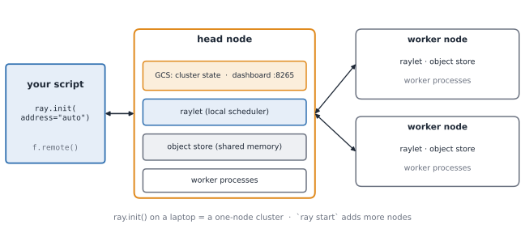

```text
ray start --head --port=6379          # head node (dashboard :8265)
ray start --address=HEAD_IP:6379      # every other node
ray status                            # check the nodes
ray stop                              # when finished
```

In the script: `ray.init(address="auto")`: **join**, do not start.

---

## Lifecycle Cheat Sheet

| Stage | Dask | Ray |
|---|---|---|
| **Create** | `LocalCluster(...)` + `Client(cluster)` | `ray.init(num_cpus=2)` |
| **Submit** | `client.submit(f, x)` / `client.map(f, xs)` | `f.remote(x)` |
| **Get result** | `future.result()` / `client.gather(futs)` | `ray.get(ref)` |
| **Share data** | `client.scatter(x, broadcast=True)` | `ray.put(x)` |
| **First finished** | `as_completed(futs)` | `ray.wait(refs)` |
| **Watch** | dashboard `:8787`, `performance_report` | dashboard `:8265`, `ray.timeline()` |
| **Cancel** | `future.cancel()` | `ray.cancel(ref)` |
| **Close** | `client.close()`; `cluster.close()` | `ray.shutdown()` |
| **Real cluster** | `dask scheduler` + `dask worker` | `ray start --head` / `--address` |

---

## Tutorial Exercises (15 min)

1. **Dask 2:** run it. Which scheduler wins on pure Python? Change `burn` to a NumPy matrix multiply. Does the answer change?
2. **Dask 5:** run `2 × 1` vs `1 × 2`. Then try `n_workers=4` on 2 cores. What happens?
3. **Dask 8:** open the Task Stream (or the report). Find the idle gaps. What caused them?
4. **Ray 4:** predict, then run. Then set `num_cpus=3` on a task in a 2-CPU Ray. What happens?
5. **Both:** break something on purpose (kill a worker, cancel a task). What did the framework do?

> Hand in: one screenshot of a dashboard or timeline, and one sentence on what it shows.

---

<!-- _class: lead -->

# Part VIII
# Choosing: Should You Distribute at All?

---

## The Decision Tree

```text
Which wall are you hitting?

MEMORY: data > RAM
├── array / table          → Dask Array / DataFrame
├── bag of text / records  → Dask Bag, or Ray tasks
└── more than one machine  → Dask distributed

COMPUTE / TIME: data fits in RAM
├── one array operation              → NumPy / BLAS (Week 2). Done.
├── pure-Python CPU-bound            → ProcessPoolExecutor (Week 4). Done.
├── I/O-bound                        → threads or asyncio (Week 4). Done.
└── thousands of independent tasks,
    or workers that must keep state  → Ray (a cluster, if one machine is not enough)
```

> **For Project 1 (5k–20k docs, 2-core Colab):**
> The honest answer is often "plain NumPy or a process pool wins."
> That is a valid, well-justified result.

---

## Project 1 Phase 3: Checklist

When writing your "Why not the others?" section:

1. **Does the data fit in RAM?** If yes, Dask's main benefit disappears.
2. **Work per task vs. overhead?** Use your granularity curve.
3. **How much data moves per task?** Can it be stored once? (`ray.put` / scatter)
4. **Is the serial part (reduce / top-k merge) small?**
5. **Workers × BLAS threads ≤ cores?**

> If you can't justify distribution with numbers, don't distribute.
> A well-reasoned "I chose not to use Dask/Ray because..." scores full marks.

---

## Forward Map: Where These Concepts Reappear

| Week 5 concept | Where it reappears |
|----------------|-------------------|
| Task graph / DAG | `torch.compile` graph capture (Week 13) |
| Partitioning / chunking | DataLoader sharding (Week 9), DDP data shards (Week 10) |
| All-reduce | DDP gradient sync via NCCL (Week 10) |
| Point-to-point | Pipeline parallelism stages (Week 11) |
| Broadcast | Model weights to all GPUs at init (Week 10) |
| Checkpoint / retry | Saving training state (Weeks 9–11) |
| Out-of-core / streaming | WebDataset for massive datasets (Week 9) |
| Granularity | GPU kernel launch overhead (Week 6), DataLoader batch size (Week 9) |

> You now have the vocabulary. When you read a paper on Megatron-LM,
> DeepSpeed, or vLLM, you'll recognise the graph, the partitioning,
> the communication pattern, and the failure strategy.

---

## Key Takeaways

1. **Every parallel system answers four questions:** split, assign, move, synchronise.
   The answers change with scale; the questions don't.

2. **Distribution adds cost.** Only use it when cheaper options (vectorise, JIT,
   local pools) have run out.

3. **Granularity is the master dial.** Too fine → overhead dominates.
   Too coarse → no parallelism. Measure, don't guess.

4. **Moving data is usually the real cost.** Store once, pass references.
   Design partitions to minimise shuffles.

5. **Dask and Ray coordinate; NumPy/BLAS compute.** Watch workers × threads.

6. **At scale, failure is normal.** Retry stateless tasks; checkpoint stateful workers.

7. **Often the right answer is: don't distribute.**

---

<!-- _class: lead -->

# Lab / Homework

---

## Lab: DF → IDF, Three Ways

Run on ≥ 5,000 documents (your Project 1 corpus is fine).

| Version | File | Time | Speedup |
|---------|------|------|---------|
| Serial | `corpus.py` helpers | ? | 1× |
| ProcessPool (Week 4) | reuse | ? | ? |
| Dask `delayed` | `02_dask_delayed_graph.py` | ? | ? |
| Ray | `16_ray_df_idf.py` | ? | ? |

**Answer these:**
1. Draw the task graph. Width? Critical path? Where's the narrow waist?
2. What chunk size did you choose? Evidence?
3. What data moved, roughly how many bytes, and what did it cost?
4. Estimate the serial fraction as on the sweep slide: $f \approx \frac{1/S - 1/N}{1 - 1/N}$ *(an upper bound: it also contains start-up, pickling and the reduce)*

> **Expect the plateau:** Colab has 2 cores. 4 workers won't beat 2.
> The plateau is hardware. The gap below 2× is overhead + serial reduce.

---

<!-- _class: lead -->
<!-- _paginate: false -->

# Thank You

### Next week: GPU Architecture & CuPy (Week 6)

*YZM 513 – İstanbul Medeniyet Üniversitesi – Fall 2026*
