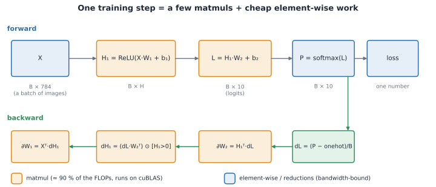
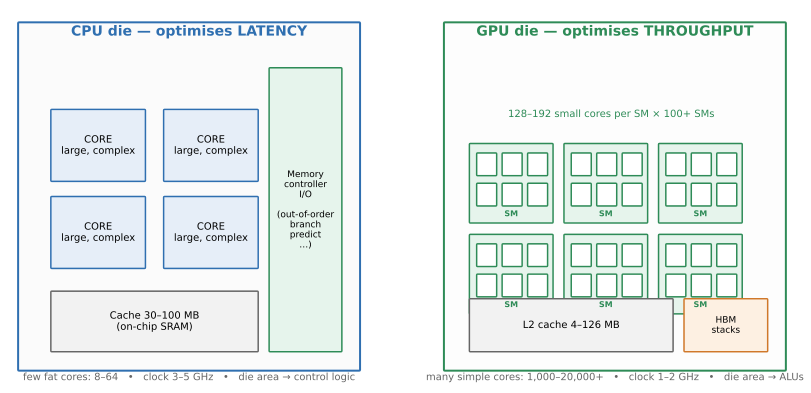
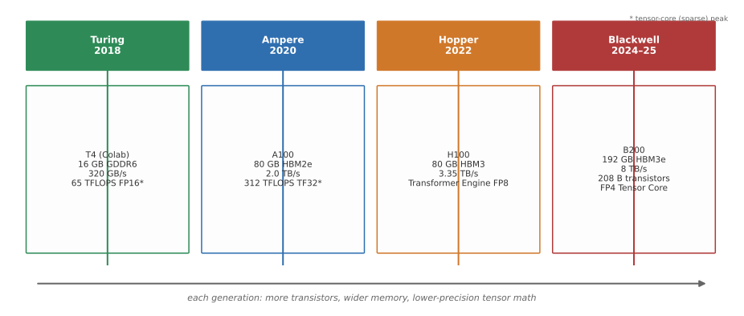
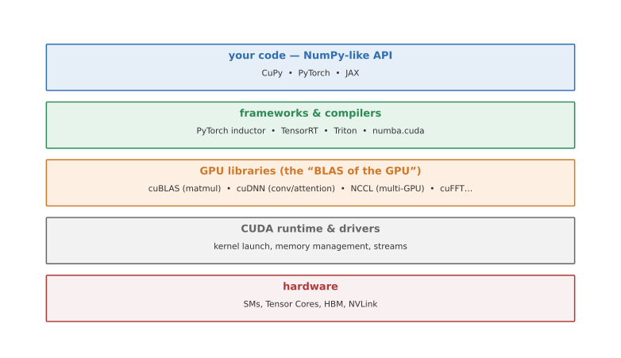
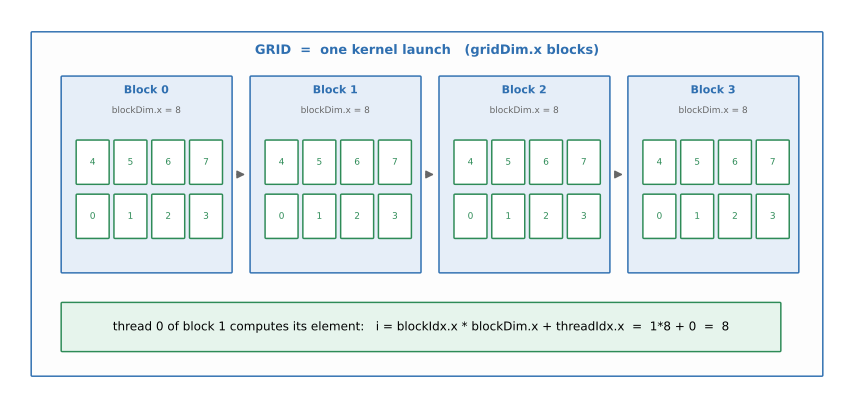
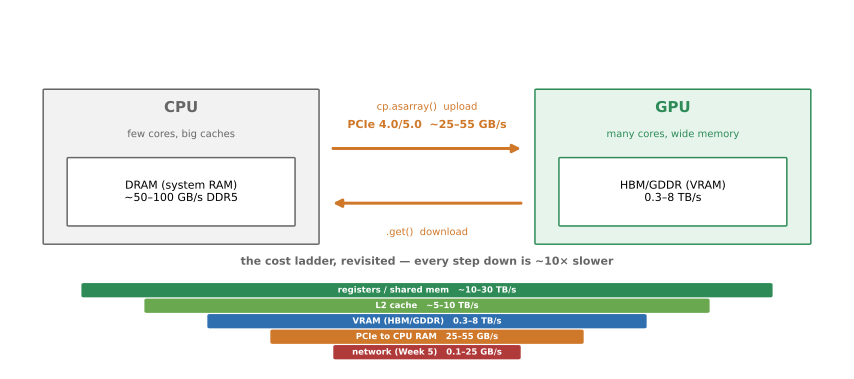
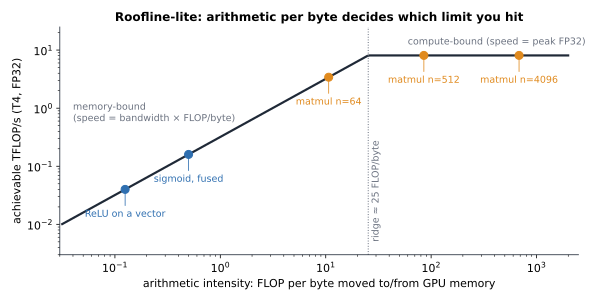
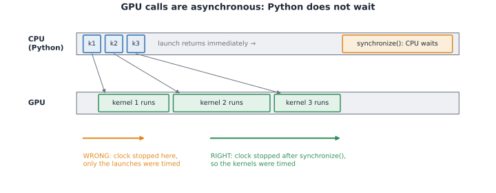

<!-- _class: lead -->
<!-- _paginate: false -->

# YZM 513 – High-Performance Programming for AI

### Week 6: Inside the GPU
### Hardware, the CUDA Stack, and Training a Network with CuPy

**İstanbul Medeniyet Üniversitesi**
AI Engineering M.Sc. – Fall 2026

Ammar Daşkın

---

## Where we are in the course

```text
Week 1–2:  One core, made fast        (vectorise, JIT, BLAS)
Week 3–4:  One machine, many cores    (threads, processes, async, pools)
Week 5:    Many machines              (Dask, Ray, cost of distribution)
Week 6:    One GPU, thousands of cores  ← TODAY: hardware + CuPy
Week 7:    Midterm (covers Weeks 1–6)
Week 8:    Writing GPU kernels        (Numba CUDA)
Week 9:    Feeding the GPU            (DataLoader pipelines)
Week 10–11: Many GPUs                 (DDP, model parallelism)
```

> Every parallel system answers the same four questions — **split, assign, move, wait**.
> The GPU changes the *scale* (thousands of cores, not 8) and the *memory model* (you move data explicitly).

---

## This week: from "why a GPU?" to a trained network

| Part | Question |
|---|---|
| I–II | Why GPUs, and what is inside one? |
| III–V | How does software reach the hardware (CUDA, SIMT) and how does data get there (memory, PCIe)? |
| VI | How do I use a GPU from Python without writing CUDA? (CuPy) |
| VII | **Review of Weeks 1–6** with one MNIST network, taken from NumPy to the GPU in a Colab notebook |

> **No CUDA knowledge needed for this week.**
> We will take **one neural network**, written as matrices in NumPy, and move it to the GPU
> by changing the array library, then measure *when* and *why* it gets faster.

---

## The running example: an MLP that reads digits



- MNIST: 60,000 images → a **60,000 × 784** matrix. MLP 784 → 512 → 10.
- One training step: **5 matmuls** + cheap element-wise work. Epoch = 234 steps (batch 256).

---

<!-- _class: lead -->

# Part I
# Why GPUs?

---

## The three walls, revisited

| Wall | Weeks 1–2 answer | Week 5 answer | **This week** |
|------|-----------------|---------------|---------------|
| **Language wall** | vectorise, Numba | — | still true on GPU |
| **Core wall** | threads, processes | Dask, Ray | **GPU: thousands of cores in one chip** |
| **Memory wall** | cache-friendly code | partitions, object stores | **separate VRAM — data must cross PCIe** |

> AI hit the core wall *hard*: training GPT-class models on CPUs would take millennia.
> GPUs are the industry's answer: a chip built to do one thing — massive parallel arithmetic — extremely well.

---

## Concrete numbers

| | CPU (e.g. Xeon/EPYC) | GPU (Colab T4) | GPU (RTX 4090) |
|---|---|---|---|
| "cores" | 8–64 big | 2,560 CUDA + 320 Tensor | 16,384 CUDA + 512 Tensor |
| Clock | 3–5 GHz | 1.6 GHz | 2.5 GHz |
| Memory | 100 GB/s (DDR5) | 320 GB/s (GDDR6) | 1,008 GB/s (GDDR6X) |
| Peak FP32 | 1–3 TFLOPS | ~8 TFLOPS | ~83 TFLOPS |
| Price class | — | free on Colab | ~$1,600 |

> Individually, each GPU core is *weaker* than a CPU core. The GPU wins by fielding
> **thousands at once**. RTX 4090 vs top CPU: ~30–50× peak FP32.
> Colab's free CPU has only ~2 vCPUs, so our NumPy baseline is modest: speedups against it look larger than against a workstation.


---

## Why AI specifically loves GPUs

Deep learning is, mathematically, mostly **matmul**:

- One linear layer: `Y = XW + b` — a single matmul
- Attention: batched matmul of Q·Kᵀ, then ·V
- Convolutions: matmuls with im2col (cuDNN does this for you)
- Backprop: more matmuls

A matmul of (4096×4096)·(4096×4096) is **137 GFLOP of independent multiply-adds** —
the purest data-parallel workload imaginable. That is exactly what a GPU is built to execute.

<!-- _footer: "FLOP counting reminder from Week 1: 2n³ for n×n matmul." -->

---

## Two design philosophies

**CPU — minimise latency for one thread:**
big cores, deep out-of-order pipelines, branch prediction, 30–100 MB cache.
Spend transistor budget making *one* stream of instructions finish fast.

**GPU — maximise throughput across thousands of threads:**
small cores, shallow pipelines, tiny per-SM cache, no branch prediction.
Spend transistor budget on *more arithmetic units*.

> Same silicon budget, opposite bet: **latency machine vs. throughput machine.**

---



---

<!-- _class: lead -->

# Part II
# Hardware Background

---

## Inside the GPU: the SM (Streaming Multiprocessor)

- The GPU is a collection of **SMs** (T4: 40, A100: 108, H100: 132, RTX 5090: 170)
- Each SM contains:
  - **CUDA cores**: simple FP32/INT ALUs (64 per SM on T4, 128 on recent designs)
  - **Tensor Cores**: fused matmul units (FP16/BF16/FP8/FP4), the "AI" units
  - **Scheduler(s)** that pick warps to run each cycle
  - small **shared memory** + register file (Week 8 territory)
- A hardware **GigaThread engine** assigns blocks to SMs as they become free

<!-- _footer: "NVIDIA CUDA C Programming Guide, ch. 2: https://docs.nvidia.com/cuda/cuda-c-programming-guide/" -->

---

## Reading a spec sheet: the T4 in Colab

| Spec | T4 | What it means for us |
|---|---|---|
| SMs × cores | 40 × 64 = **2,560** CUDA cores | how many multiply-adds per cycle |
| Peak FP32 | **~8 TFLOP/s** | float32 matmul bound (we reach ~half; 70 W throttles) |
| Peak FP64 | ~0.25 TFLOP/s (1/32) | **never use float64 here** |
| Tensor Cores FP16 | **~65 TFLOP/s** | mixed precision, Week 12 |
| Memory | **16 GB**, 320 GB/s | model + activations must fit |
| Link to CPU | **PCIe 3.0 ×16**, ~12 GB/s in practice | every upload/download crosses this |

> 📁 `week06/01_gpu_info.py`: name, memory, SMs, capability

---

## Tensor Cores: why the AI numbers are insane

CUDA cores do one FP32 FMA per cycle. **Tensor Cores do a whole small matmul per cycle.**

| Generation | Flagship | Tensor peak (dense) | New capability |
|---|---|---|---|
| Volta (2017) | V100 | 125 TFLOPS FP16 | 1st Tensor Core |
| **Turing (2018)** | **T4 ← our Colab GPU** | ~65 TFLOPS FP16 | INT8/INT4 inference |
| Ampere (2020) | A100 | 312 TFLOPS FP16/BF16 | BF16, TF32, sparsity |
| Hopper (2022) | H100 | ~990 TFLOPS FP16 | **Transformer Engine (FP8)** |
| Blackwell (2024–25) | B200 | ~2,250 TFLOPS FP16, ~9,000 FP4 | FP4, 208 B transistors |

> Peak tensor throughput ≠ usable throughput — Week 12 (mixed precision) revisits this.
> Vendor headline numbers often quote the *sparse* figure (2× the dense ones above).

---

## GPU generations timeline



---

## GPU memory technology: GDDR vs HBM

| | GDDR (graphics card) | HBM (datacenter) |
|---|---|---|
| Where | RTX 4090/5090, T4 | A100, H100, B200 |
| Trick | very fast signalling, wide-ish bus | **stacked dies** next to GPU (2.5D packaging), 4096+ bit bus |
| Bandwidth | 0.3–1.8 TB/s | 2.0–8 TB/s |
| Cost / capacity | cheap, 16–32 GB | expensive, 80–192 GB |

> For LLM *inference*, memory bandwidth is usually the bottleneck: every generated token
> must stream all weights from VRAM. That is why token/s scales with GB/s, not TFLOPS.

---

## Getting data between chips: PCIe vs NVLink

| Link | Bandwidth | Used for |
|---|---|---|
| PCIe 3.0 x16 | ~12–16 GB/s | CPU ↔ GPU on the **T4 (Colab)** |
| PCIe 4.0 x16 | ~25–32 GB/s | CPU ↔ GPU on RTX 30/40, A100 |
| PCIe 5.0 x16 | ~50–64 GB/s | newer CPU ↔ GPU |
| NVLink 4 (Hopper) | 900 GB/s | GPU ↔ GPU inside a node |
| NVLink 5 (Blackwell) | 1.8 TB/s | GPU ↔ GPU inside a node |

> **Rule of the week:** PCIe is ~10–100× slower than the GPU's own memory.
> Upload once, compute a lot, download once.

---

<!-- _class: lead -->

# Part III
# Core Technologies: the CUDA Stack

---



---

## The stack, bottom-up

**CUDA (Compute Unified Device Architecture)** — NVIDIA's platform:
- programming model (kernels, threads, memory) + compiler (`nvcc`) + runtime + drivers
- you almost never touch it directly from Python — libraries call it for you

**CUDA libraries** — the "BLAS of the GPU" (cf. Week 2!):
- **cuBLAS** — matmul, GEMM (what `a @ b` calls on GPU)
- **cuDNN** — convolutions, attention, normalization primitives for deep learning
- **NCCL** — collective communication for multi-GPU (Weeks 10–11)
- cuFFT, cuSPARSE, cuSOLVER, Thrust…

**Frameworks** — CuPy, PyTorch, JAX, TensorRT (inference compiler), Triton (GPU compiler)

<!-- _footer: "https://developer.nvidia.com/gpu-accelerated-libraries" -->

---

## Why this matters for you

When you write `a @ b` in CuPy or `torch.matmul`, the call chain is roughly:

```text
your Python code
  → CuPy / PyTorch dispatcher
    → cuBLAS GEMM (vendor-tuned kernel, often handwritten in CUDA/PTX)
      → CUDA runtime → driver → SMs + Tensor Cores
```

> You have been benefiting from this stack all course: NumPy → OpenBLAS/MKL on CPU is the
> *same pattern*. GPU = same idea, another backend. This is why CuPy can be a drop-in NumPy.

---

<!-- _class: lead -->

# Part IV
# The SIMT Execution Model

---

## SIMT = Single Instruction, Multiple Threads

One kernel launch creates a **grid** of **blocks** of **threads**:



- Each **thread** runs the same function (the *kernel*) on its own data
- Threads in a block can cooperate (shared memory) and are co-scheduled on one SM
- Blocks are scheduled independently → the GPU scales from 40 to 170 SMs without code changes

<!-- _footer: "Diagram modelled on NVIDIA CUDA C Programming Guide, 'Thread Hierarchy'." -->

---

## Thread indexing: how each thread finds its element

```python
# One thread per output element — you write what ONE thread does:
i = blockIdx.x * blockDim.x + threadIdx.x
c[i] = a[i] + b[i]
```

Grid 4 × blockDim 8 → 32 threads → elements 0..31 handled simultaneously.

| block 0 | block 1 | block 2 | block 3 |
|---|---|---|---|
| `i = 0·8 + t` → 0…7 | `i = 1·8 + t` → 8…15 | 16…23 | 24…31 |

> **Connection to Week 3:** data parallelism ("same op, different data") *is* SIMT.
> What took you `Pool(8)` on CPU, the GPU does with `Pool(2560)` — in hardware.

---

## Worked example: `c = a + b` for 1,000,000 elements

You write **one line of "what a thread does"**; the launch config supplies the parallelism:

```text
thread's job:        i = blockIdx.x * blockDim.x + threadIdx.x
                     if i < N:  c[i] = a[i] + b[i]

launch config:       blockDim  = 256 threads      (a handy default; max is 1024)
                     gridDim  = ceil(N / 256) = 3907 blocks
```

- Every one of the 1M threads runs the *same two lines* — on its own `i`.
- The GPU needs **3907 blocks ÷ 40 SMs ≈ 98 blocks per SM**, scheduled as SMs free up.
- No loop, no pool, no GIL: the *launch* is the only Python work.

> Same recipe for ReLU, sigmoid, bias add: the launch config never changes —
> only the thread's two lines do.

---

## Warps: the unit of actual execution

- Threads run in **warps: groups of 32** that execute in lockstep on an SM
- The scheduler runs several warps per SM and **switches for free** when one stalls on memory
  → latency hiding: warps waiting on VRAM don't block warps that are ready
- **Divergence warning:** if threads in a warp take different branches (`if/else`),
  *both* paths execute serially → wasted cycles

> For today's library-level GPU use (CuPy) you don't manage warps — but in Week 8 kernels
> this will be your first optimisation lever.

---

## Divergence, with numbers

A warp = 32 threads in lockstep. When they disagree, the GPU runs **both** paths and masks the losers:

```text
# 32-thread warp, values 0..31
if i % 2 == 0:
    c[i] = sqrt(a[i])     # 16 threads active, 16 masked (idle)
else:
    c[i] = log(a[i])      # the other 16 active, first 16 idle
```

- Cost ≈ `sqrt time + log time`, not `max(sqrt, log)`.
- A branch on *data* (like above) hurts; a branch on a *uniform* value
  (same for the whole warp, e.g. `if training:`) is nearly free.

> Rule of thumb for Week 8: keep branches **warp-uniform** where you can.

---

## Map our MLP onto threads

| Operation in our training step | Parallelisation |
|---|---|
| ReLU on a 256×512 activation | 131,072 threads: `max(0, x)` each |
| `X @ W1` (256×784 · 784×512) | one thread (or small tile) per output element: 131,072 outputs |
| softmax over 256 rows | one block per row, reduction inside |
| Batch of 256 images | extra grid dimension |

> Mental shift: **you don't write a loop over elements. You write what ONE thread does,
> and the hardware runs millions of copies.**

> Reality check: cuBLAS does not literally use one thread per output. It computes
> **tiles** with data reuse in shared memory (Week 8). The mental model is still right.

---

<!-- _class: lead -->

# Part V
# GPU Memory: Two Worlds, One Cable

---



---

## The transfer rules

1. CPU RAM and GPU VRAM are **separate address spaces** — no sharing (by default)
2. Every upload/download crosses PCIe: **~12–55 GB/s** vs GPU memory at **300–8,000 GB/s**
3. Kernels are **asynchronous**: launch returns immediately; results appear "later"
4. All CuPy intermediates stay on GPU — transfer **in once, out once**

**Amortisation rule (Week 5's cost ladder, revisited):**
GPU wins when `compute_time ≫ transfer_time`. For an n×n matmul:

- transfer time grows like **n²** (three n×n matrices cross PCIe)
- compute time grows like **n³** (2n³ FLOPs on-device)

Small n → transfer dominates → **CPU wins**. Large n → GPU wins by 10–100×.

---

## Arithmetic intensity: FLOPs per byte

A GPU can do **~8 TFLOP/s** but fetch only **320 GB/s** from VRAM: **≈ 25 FLOPs per byte** to stay busy.

| Operation (float32) | FLOP per byte moved | Verdict on a T4 |
|---|---|---|
| ReLU `max(0,x)` | 1 / 8 = 0.125 | **bandwidth-bound** (~40 GFLOP/s of 8,000) |
| sigmoid (fused kernel) | ~0.5 | bandwidth-bound |
| matmul n×n | 2n³ / 12n² = **n/6** | n = 64: 11 · n = 512: 85 · n = 4096: 683 → **compute-bound** |

> 📁 `week06/03_cupy_elementwise.py` (10M-element ReLU, sigmoid and fused sigmoid)

---



---

## Worked example: transfer vs compute, T4

`C = A @ B`, float32, **n = 4096**:

| Step | Data / work | Time on a T4 |
|---|---|---|
| Upload A and B | 2 × 64 MB at ~12 GB/s | ~10 ms |
| Matmul | 137 GFLOP at ~4–5 TFLOP/s | **~30 ms** |
| Download C | 64 MB | ~5 ms |
| NumPy on Colab's 2 cores | 137 GFLOP at ~50–100 GFLOP/s | **1.5–3 s** |

> Typical figures from the T4 specs, not measurements.
> ≈ 50 ms end-to-end vs seconds. Now **n = 128**: the matmul is ~0.02 ms but every
> call costs launch + transfer latency. Crossover depends on *both* devices:
> a slow 2-core CPU moves it down, a 32-core workstation moves it up. **Measure, don't guess.**
>
> 📁 `week06/02_cupy_matmul_benchmark.py` (sweep) · `week06/06_crossover_finder.py` (finds the crossover n)

---

<!-- _class: lead -->

# Part VI
# CuPy: NumPy on the GPU

---

## The API mapping

| NumPy | CuPy |
|---|---|
| `np.array(...)`, `np.zeros(...)` | `cp.array(...)`, `cp.zeros(...)` |
| `a @ b`, `a.sum()`, slicing | **identical syntax** |
| `np.linalg.svd` | `cp.linalg.svd` (→ `week06/05_cupy_vs_numpy_svd.py`) |
| result on CPU | result on GPU until `cp.asnumpy(x)` / `x.get()` |
| `float32`/`float64` dtypes | prefer `float32` (native GPU speed) |

---

## A first CuPy program

```python
import numpy as np, cupy as cp

a_gpu = cp.asarray(np.random.rand(4096, 4096).astype(np.float32))  # upload once
b_gpu = a_gpu @ a_gpu                # runs on GPU via cuBLAS
c_gpu = cp.maximum(b_gpu, 0)         # element-wise kernel, stays on GPU
result = cp.asnumpy(c_gpu)           # download once
```

---

## Six rules for porting NumPy code

1. `np.` → `cp.` for creation and math; slicing, `@`, broadcasting are unchanged.
2. Upload **once** (`cp.asarray`), download **once** (`cp.asnumpy`).
3. Stay in **`float32`**: NumPy's default `float64` is up to 32× slower on a T4.
4. GPU calls return **immediately** → synchronise before reading a clock.
5. Anything that returns a Python number (`float(x)`, `.item()`, `print(x)`, `if x > 0`) **waits for the GPU**.
6. Write functions as `f(xp, ...)` so one code path serves NumPy **and** CuPy.

```python
def relu(xp, x):            # xp is numpy or cupy
    return xp.maximum(x, 0)
```

---

## Asynchronous execution: why timing lies



```python
y = cp.maximum(x, 0)                  # returns in ~20 µs: kernel only queued
cp.cuda.Stream.null.synchronize()     # now we wait for the GPU
```

> Correct timing: `synchronize()` (or CUDA events) **before** you read the clock.
> The same mechanism hides errors: a failing kernel may report on a *later* call.

---

## Timing done right: the two correct patterns

```python
# Pattern 1 — wall clock + explicit sync (fine for e2e, includes transfer)
t0 = time.perf_counter()
c = cp.dot(a, b)
cp.cuda.Stream.null.synchronize()      # REQUIRED before reading the clock
t_wall = time.perf_counter() - t0

# Pattern 2 — CUDA events (device-side time, no Python noise; best for kernels)
start = cp.cuda.Event(); end = cp.cuda.Event()
start.record()
for _ in range(iters):                # amortise launch overhead too
    c = cp.dot(a, b)
end.record(); end.synchronize()
t_per_call = cp.cuda.get_elapsed_time(start, end) / iters / 1000
```

❌ `t0=perf_counter(); c=cp.dot(a,b); t=perf_counter()-t0` — times only the **launch** (~20 µs),
a constant no matter how big the matmul is. This is the timing trap in notebook C2.

<!-- _footer: "Full benchmark with both patterns: week06/02_cupy_matmul_benchmark.py" -->

---

## Transfers and dtypes: two silent costs

**Transfers**: a tiny array pays ~10–50 µs fixed latency; big arrays approach PCIe bandwidth.

```python
for batch in loader:
    xb = cp.asarray(batch)     # BAD: upload every step, pays PCIe in the loop
```
vs `X = cp.asarray(all_data)` **once**, then slice on the device.

**float64 trap** (notebook C5): NumPy creates `float64` by default.
A T4 has 1/32 as many FP64 units as FP32: the same matmul is **many times slower**.

> **Hidden syncs:** `float(loss)` every step forces a GPU→CPU round trip.
> Accumulate on the device, read **once per epoch**.
>
> 📁 `week06/04_transfer_overhead.py`: upload bandwidth vs size, and a tiny ReLU that is slower on the GPU.

---

## Kernel fusion preview

`1 / (1 + exp(-x))` on the GPU = **4 kernels**, 3 temporary arrays in VRAM, 4 trips to memory.

```python
@cp.fuse()
def sigmoid_fused(x):
    return 1 / (1 + cp.exp(-x))     # one kernel: read x once, write result once
```

- Element-wise ops are **bandwidth-bound** (roofline slide): fewer trips = faster.
- In **Week 8** you will write such kernels yourself (Numba CUDA).
- PyTorch's `torch.compile` fuses automatically.

---

## Common pitfalls & what the error looks like

<style scoped>
  table { font-size: 18px; }
</style>

| Pitfall | Symptom / error | Fix |
|---|---|---|
| Timing without `synchronize()` | every op "takes" ~20 µs | sync or CUDA events before reading the clock |
| `float64` by default | VRAM doubles; up to ~32× slower on a T4 | `.astype(np.float32)` **once**, at load |
| Upload/download in the loop | GPU shows low utilisation, step time flat | move data once, slice on device |
| `float(loss)` per step | GPU idles while Python waits | accumulate on device, read per epoch |
| Small arrays on GPU | slower than NumPy | crossover: compute must ≫ transfer + launch |
| Reading `nvidia-smi` mid-run | memory looks "leaked" | CuPy's memory pool keeps freed blocks (`free_all_blocks()`) |

> All variants of one idea: **the cost ladder decides everything.**

---

## Key take-aways: GPU hardware and CuPy

1. A GPU is a **throughput machine**: many **SMs**, each with CUDA cores and **Tensor Cores**.
2. **Separate memories** joined by a slow cable (PCIe ~12–50 GB/s) vs VRAM at 300+ GB/s.
3. **SIMT:** write what one thread does; hardware runs thousands in warps of 32, with no GIL.
4. **Arithmetic intensity** decides the limit: matmul is compute-bound, ReLU is memory-bound.
5. You rarely touch CUDA: **libraries** (cuBLAS, cuDNN) do the work, and CuPy exposes them as NumPy.
6. Time GPU code only after `synchronize()`, keep data on the device, stay in `float32`.

> Next: we use one small network to review Weeks 1–6 and see these ideas in numbers.

---

<!-- _class: lead -->

# Part VII
# Review (Weeks 1–6): One MNIST Network

---

## Notebook roadmap

<style scoped>
  table { font-size: 18px; }
</style>

File: `week06/lab_week06_train_mlp_gpu.ipynb`

| Part | Content | Course callback | |
|---|---|---|---|
| 0 | Setup, GPU check, `nvidia-smi` | Week 6 spec sheet | 2 |
| A | CPU warm-up: FLOPs and practical peak, loop vs Numba vs BLAS, stable softmax, BLAS threads | Weeks 1–4 | 5 |
| B | NumPy MLP: forward/backward, gradient check, train, sharded gradients, Amdahl profile | Weeks 1, 2, 5 | 10 |
| C | CuPy basics: matmul sweep, transfers, float64 trap | Week 6 (today's Parts IV–VI) | 10 |
| D | Same network on GPU + batch/width sweep + 3 mistakes | Amdahl, cost ladder | 10 |
| E | PyTorch version, autograd check, mixed-precision peek | Forward pointer to Weeks 9–12 | 10 |
| F | Summary table (NumPy/CuPy/PyTorch × CPU/GPU) | the review, in numbers | 2 |

> Parts A–B: Weeks 1–5 review. Exercises E-1…E-5: homework.

---

## One step, three kinds of work

```python
logits = relu(X @ W1 + b1) @ W2 + b2        # forward
loss, dlogits = softmax_xent(logits, y)     # loss + start of backward
grads = backward(...)                       # 3 more matmuls + sums
W -= lr * grad                              # update (all parameters)
```

| Kind | Example | Which week taught us to speed it up? |
|---|---|---|
| **Dense linear algebra** | `X @ W1` | 2: BLAS, vectorisation |
| **Element-wise / broadcast** | ReLU, `+ b1`, softmax | 2: vectorise, Numba |
| **Many independent pieces** | batches, shards, workers | 3–5: threads, processes, Dask/Ray |

> Week 1 told us the first rule: **measure before you optimise.**

---

## Week 1: measure first, count FLOPs

| Tool | Answers |
|---|---|
| `timeit` | "how long?" |
| `cProfile`, `line_profiler`, `py-spy` | "where does the time go?" |
| FLOP count | "how close to the hardware limit are we?" |

Matmul `(B×a)·(a×b)` costs **2·B·a·b FLOPs**. Backward ≈ 2× forward, so **step ≈ 3× forward**.

Our step: 2·256·784·512 ≈ 205 MFLOP in layer 1 → **≈ 0.6 GFLOP per step**, ≈ 145 GFLOP per epoch.

$$\text{GFLOP/s}=\frac{\text{FLOPs}}{t\cdot 10^{9}} \qquad\text{compare with the machine's peak}$$

> Notebook A1 measures this CPU's practical peak: our yardstick for the GPU.

---

## Week 2: vectorise, don't loop

```python
# Python triple loop vs Numba loop vs BLAS (n = 1024; typical, yours will differ)
matmul_python(A, B)     # ~minutes. Interpreter overhead per multiply
matmul_numba(A, B)      # ~0.2 s.   Compiled loop, no BLAS tricks
A @ B                   # ~0.01 s.  Tuned BLAS: tiles, SIMD, all cores
```

- Python loop: hopeless. **Numba** rescues loops that cannot be vectorised.
- But for matmul, the **vendor-tuned library still wins** (~10–30× over our own loop).
- Rule: *use the library for the standard operation, Numba for the odd one.*

> **Remember this pattern.** On the GPU, `A @ B` calls **cuBLAS**: the same idea, another backend.


---

## Week 2: broadcasting and a stable softmax

```python
logits - logits.max(axis=1, keepdims=True)    # (B,10) - (B,1): broadcast
```

```python
z    = logits - logits.max(axis=1, keepdims=True)     # no exp overflow
logp = z - np.log(np.exp(z).sum(axis=1, keepdims=True))
loss = -logp[np.arange(B), y].mean()                  # fancy-index the right class
```

- `exp(1000)` is `inf`: the naive softmax returns `nan`. **Subtract the row max.**
- Keep arrays **`float32`**. NumPy defaults to `float64`, which is 2× the memory
  and (as we will see) **very slow on GPUs**.

> Correctness first: the notebook checks the hand-written backward pass against finite differences.

---

## Weeks 3–4: what does the GIL mean for training?

| Question | Answer |
|---|---|
| Is `A @ B` single-threaded? | No: BLAS uses **all cores**, outside the GIL |
| Do we need `multiprocessing` for the matmul? | **No.** It would fight BLAS for the cores (oversubscription) |
| Where do threads/processes help? | **Around** the math: loading, tokenising, augmenting, API calls |
| Where does the GIL hurt? | Pure-Python loops in the preprocessing |

```python
with threadpool_limits(limits=1, user_api="blas"):   # Notebook A4
    a @ a          # 1 thread: ~N× slower. Parallelism was already inside BLAS.
```

> Lesson: first find out **who is doing the arithmetic**. On a GPU the answer is
> "thousands of tiny hardware threads", with **no GIL in sight**.

---

## Week 5: the four questions, applied to our step

| Question | CPU / cluster answer | In our training step |
|---|---|---|
| **Split** | partitions, chunks | split the **batch** into shards |
| **Assign** | scheduler | each worker takes one shard |
| **Move** | cost ladder (RAM → network) | average the **gradients** |
| **Wait** | futures, barriers | everyone waits for the average |

```python
shards = np.array_split(batch, 4)                          # split
grads  = [grad(params, s) for s in shards]                 # assign (4 workers)
avg    = sum(grads) / 4                                    # move + wait = all-reduce
# avg == gradient of the whole batch  → this is DDP, Weeks 10-11
```

---

## Week 5: cost of distribution, with numbers

$$S(N)=\frac{1}{f_s+\frac{1-f_s}{N}} \qquad S_{comm}(N)=\frac{1}{f_s+f_c+\frac{1-f_s-f_c}{N}}$$

- **Granularity:** tasks must be big compared with their overhead (Dask: ~1 ms per task!).
- **Notebook B6:** on our test CPU, 5 matmuls took ~60 % of a step (measure yours). If *only* matmul were
  infinitely fast, Amdahl caps the speedup at 1/(1−0.6) ≈ **2.5×**.

> The GPU escapes this cap by running **everything** on the device (element-wise work
> too), as long as the data stays there. That is the story of the GPU parts of this week.

---

## Quick quiz (no slides open)

1. `a @ b` with `float32` `n×n` matrices: how many FLOPs?
2. Why does `np.exp(1000.)` break softmax, and what is the fix?
3. Why is `ThreadPoolExecutor` useless for a pure-Python loop but fine for NumPy matmul?
4. Averaging 4 shard gradients equals the full-batch gradient. Which later topic is this?
5. A task takes 1 ms of compute and 1 ms of overhead. What is the best-case speedup from adding workers?


---

## Quiz: answers

1. `2n³` FLOPs (one multiply and one add per term of the n³ products).
2. `exp(1000)` overflows to `inf`, giving `nan`; subtract the row maximum first.
3. The GIL is held by Python bytecode but released inside BLAS/C code.
4. Data parallelism with an all-reduce: DDP (Weeks 10–11).
5. 1 ms compute + 1 ms overhead means `f_c` = 50 %, so at most **2×** however many workers you add.

---

## 🛠 Review lab: notebook Parts A–B

Open **`week06/lab_week06_train_mlp_gpu.ipynb`** in Colab → Runtime → **T4 GPU** → run Part 0, A and B.

Write down (📝 cells):
1. CPU practical peak, GFLOP/s (A1)
2. NumPy time per epoch and test accuracy (B4)
3. Matmul fraction `f` of a step, and the Amdahl bound (B6)

> Parts A–B run top to bottom in ~1–2 minutes on the CPU.


---

## 🛠 Lab: the same network on the GPU (notebook C → F)

1. **C1–C2** hello CuPy, the timing trap (📝)
2. **C3** matmul sweep → crossover size (📝); **C4–C5** transfer cost, float64 trap
3. **D** train on the GPU → speedup (📝); **D1** sweep heat-map; **D2** three mistakes
4. **E–F** PyTorch and the summary table

**Submit:** results table + one sentence: *"On a T4, training this MLP on the GPU is worthwhile when … because …"*

> Homework: `lab_week06_cupy.ipynb` and exercises E-1 … E-5.

---

## One loop, two devices

```python
def train(xp, data, hidden=(512,), batch=256, epochs=5, lr=0.1):
    params = [xp.asarray(p) for p in init_params(...)]   # weights → device once
    Xd, yd = xp.asarray(Xtr), xp.asarray(ytr)            # data → device once (188 MB)
    for epoch in range(epochs):
        perm = xp.asarray(np.random.permutation(n))      # one small upload / epoch
        total = xp.zeros((), dtype=xp.float32)           # loss accumulates ON device
        for i in range(0, n - batch + 1, batch):
            idx = perm[i:i+batch]
            loss = train_step(xp, params, Xd[idx], yd[idx], lr)  # matmuls + ReLU + softmax
            total += loss                                        # no sync here
        sync(); ...                                              # time, then read once
```

`train(np, ...)` runs on the CPU. `train(cp, ...)` runs on the GPU. **Same code.**

---

## Expected shape of the results (T4, Colab)

| Backend | Time / epoch | Test accuracy |
|---|---|---|
| NumPy (CPU, 2 cores) | ______ s | ______ % |
| CuPy (GPU) | ______ s | ______ % |
| PyTorch (CPU) | ______ s | ______ % |
| PyTorch (GPU) | ______ s | ______ % |

- **Accuracy is the same** (~97 % after 5 epochs on real MNIST): same maths, same initial weights.
  Weights differ in the last digits: float addition is not associative.
- The GPU is clearly faster, but **less than peak ratios suggest**: why? (next slides)

> Fill this table in from your notebook run (Part F prints it for you).

---

## Why isn't the speedup 100×? The sweep (Notebook D1)

Our step is only **0.6 GFLOP**: ~0.1–0.2 ms of real GPU math, but **dozens of kernel launches** (~10 µs each).

| | small width H | large width H |
|---|---|---|
| **small batch B** | CPU ≈ GPU (launch-bound) | GPU wins somewhat |
| **large batch B** | GPU wins somewhat | **GPU wins big** (compute-bound) |

- More rows or wider layers → more arithmetic per kernel → the launch cost disappears.
- This is why large-batch training and wide models love GPUs.
- It also tells you when **not** to bother: tiny models on tiny batches.

> Predict first, then run D1 and compare your heat-map with this table.

---

## Three ways to throw the speedup away (Notebook D2)

| Mistake | Fix |
|---|---|
| `float(loss)` every step (hidden sync) | accumulate on device; read once per epoch |
| uploading every batch from the CPU | keep data resident in VRAM; slice there |
| forgetting `float32` | cast once at load time |

Also remember (D3): CuPy keeps freed blocks in a **memory pool**, so `nvidia-smi` shows more than your arrays;
batch size and model width are limited by **VRAM**, not by patience.

> The recipe from Week 5: **in once, compute a lot, out once**. The cost ladder is the same ladder.

---

## CuPy vs PyTorch — when to use which

| | CuPy | PyTorch |
|---|---|---|
| Purpose | GPU NumPy | deep learning framework |
| Autograd | ❌ (we wrote backward by hand) | ✅ |
| GPU backend | cuBLAS, cuDNN | cuBLAS, cuDNN |
| This course | Weeks 6–7 (learn the GPU) | Weeks 9+ (training, pipelines, DDP) |

- Use CuPy: preprocessing, custom array ops, quick GPU prototyping, porting NumPy/SciPy code
- Use PyTorch: anything that must train a neural network

> In notebook E1 we verify: **autograd's gradients equal the ones we derived by hand.**
> Autograd saves you from writing `backward()`; it does not change the matmuls.

---

## The same model in PyTorch (Notebook E)

```python
model = nn.Sequential(nn.Linear(784, 512), nn.ReLU(), nn.Linear(512, 10)).to("cuda")
opt = torch.optim.SGD(model.parameters(), lr=0.1)
for xb, yb in batches:                       # tensors already on the GPU
    loss = F.cross_entropy(model(xb), yb)
    opt.zero_grad(); loss.backward(); opt.step()
```

- ~8 lines instead of ~40: backward, update, softmax and initialisation are built in.
- For *this small* model PyTorch and CuPy end up with similar epoch times: both are limited by kernel launches.
- PyTorch pulls ahead with **mixed precision** (Tensor Cores), `torch.compile`, bigger models, and multi-GPU.

---

## Mixed-precision preview (Notebook E3)

One 4096² matmul on the T4:

| Precision | Where it runs | Rough result |
|---|---|---|
| float32 | CUDA cores | ~4–5 TFLOP/s |
| float16 | **Tensor Cores** | several times higher |

- Half the bytes to move **and** faster math.
- The price: smaller range → loss scaling and care. That is **Week 12**.

> Take-away: the hardware has headroom that plain float32 code leaves unused.

---

<!-- _class: lead -->

# Part VIII
# Midterm Theory Review
### format · coverage · how to prepare

---

## Exam format at a glance

- **Coverage:** Weeks 1–6 (today included: hardware, SIMT, transfers, CuPy basics)
- **Duration:** ~90 minutes
- **Format:** short conceptual answers · one code-analysis question · one design question
- **Aids:** the formula sheet (next slide) is provided — you must know *when* to apply each formula
- **No heavy coding from scratch** — but you must *read* code fluently and spot bottlenecks

> The exam tests the **decision frameworks**, not memorised API names.

---

## Key formula sheet (provided in the exam)

$$S(N)=\frac{1}{f_s+\frac{1-f_s}{N}} \qquad S_{comm}(N)=\frac{1}{f_s+f_c+\frac{1-f_s-f_c}{N}}$$

$$\text{GFLOP/s}=\frac{2n^3}{t\cdot 10^{9}} \qquad \text{arithmetic intensity}=\frac{\text{FLOPs}}{\text{bytes moved}} \quad(\text{matmul } n\times n:\ n/6)$$

$$t_{transfer}=\frac{\text{bytes}}{\text{PCIe BW}} \qquad t_{compute}\propto n^3,\ \ t_{transfer}\propto n^2$$

**Estimation drills worth practising:** FLOPs of a layer (2·B·a·b), bytes of a float32 array, transfer time over ~12–50 GB/s, "is this workload compute- or bandwidth-bound?"

---

## What you must be able to *do*, per week

| Week | Skill, not topic |
|---|---|
| 1 | profile a script, locate the hot line, compute achieved GFLOP/s vs peak |
| 2 | rewrite a Python loop as vectorised NumPy; say when Numba beats hand-vectorising |
| 3 | spot a race condition; choose lock/semaphore/queue for a pattern; explain why `Pool` pickles |
| 4 | given a workload, pick threads vs processes vs async, and justify with the GIL |
| 5 | partition a task, size the granularity, apply Amdahl *with* communication |
| 6 | decide CPU vs GPU from arithmetic intensity; time GPU code correctly; avoid the float64/upload/sync traps |

> Test yourself: can you do each row from a blank page in ~2 minutes?

---

## One-page map: which tool for which bottleneck?

| Symptom | Likely cause | First thing to try |
|---|---|---|
| pure-Python loop dominates | interpreter overhead | vectorise → Numba |
| matmul slow, 1 core busy | BLAS threads limited / bad dtype | check threads, `float32` |
| CPU-bound Python tasks | GIL | processes (not threads) |
| waiting on network/LLM calls | I/O-bound | threads or async |
| data too big or too slow for one machine | memory/compute wall | Dask / Ray, mind granularity |
| big dense linear algebra | needs throughput | **GPU** (keep data resident) |
| GPU 30 % utilised | feeding the GPU | data pipeline, transfers (Week 9) |

---

## Practice questions (1/2)

1. 10M-element array, Python loop is the bottleneck → what do you try, in order?
2. GPU utilisation 30% during training, DataLoader slow → problem and fix?
3. Why does `ThreadPoolExecutor` help NumPy ops but not pure-Python loops? (GIL)
4. 4096² float32 matrix: VRAM used? Transfer time over PCIe 3.0 (~12 GB/s)? (64 MB, ~5 ms)
5. Dask with 2000 tiny tasks slower than serial — why? (granularity vs overhead)

---

## Practice questions (2/2)

6. Your CuPy timing says 0.03 ms for a 4096² matmul. What did you forget? (`synchronize`)
7. Matmul 128² is faster on the CPU, 4096² on the GPU. Explain with n² vs n³.
8. Why does matmul gain far more from a GPU than ReLU does? (arithmetic intensity)
9. A colleague's GPU code uses `float(loss)` inside the inner loop. What happens?
10. Averaging gradients from 4 shards equals the full-batch gradient: why, and which week uses it?


---

## Practice questions: answers (1/2)

1. Vectorise with NumPy, then Numba (`@njit`, `prange`); processes or Dask only if still needed.
2. The GPU is starved: fix the input pipeline (workers, prefetching, pinned memory; Week 9).
3. The GIL is held by Python bytecode, released inside C/BLAS code.
4. 4096² × 4 B = 64 MB; 64 MB ÷ 12 GB/s ≈ 5 ms.
5. Per-task overhead (~1 ms) is as large as the compute: granularity too fine.

---

## Practice questions: answers (2/2)

6. No `synchronize()`: only the kernel *launch* was timed.
7. Transfer grows like n², compute like n³: small n is dominated by transfer and launch costs.
8. Matmul has n/6 FLOP per byte (compute-bound); ReLU has 0.125 (bandwidth-bound).
9. Each `float(loss)` forces a GPU→CPU sync, so the GPU idles while Python waits.
10. The loss is a mean, so gradients are linear in the samples: averaging equal shards gives the full-batch gradient (DDP).

---

## How to prepare this week

1. **Re-run** the review notebook Parts A–F — the exam's code-analysis question looks exactly like D2's three mistakes.
2. **Re-derive** (don't reread): stable softmax, `2n³` FLOP count, Amdahl with `f_c`.
3. **Redo** the Week 6 quiz from Part VII cold — all 5 answers should be instant.
4. **Skim** your Week 5 granularity results — a Dask-vs-Ray justification question is likely.
5. Bring questions to the review hour — the design question rewards *reasoned trade-offs*, not one right answer.

---

<!-- _class: lead -->
<!-- _paginate: false -->

<style scoped>
  section { font-size: 22px; }
  li { margin: 0; }
</style>

# Sources & Further Reading

**Hardware**
- CUDA C Programming Guide (thread hierarchy, memory): docs.nvidia.com/cuda/cuda-c-programming-guide
- Blackwell architecture: nvidia.com/en-us/data-center/technologies/blackwell-architecture
- DGX B200 specs: nvidia.com/en-us/data-center/dgx-b200
- RTX 5090 specs: nvidia.com/en-us/geforce/graphics-cards/50-series/rtx-5090
- GPU list by CUDA capability: developer.nvidia.com/cuda-gpus
- NVIDIA T4 datasheet: nvidia.com/en-us/data-center/tesla-t4

**Software**
- CuPy docs: docs.cupy.dev · NVIDIA GPU-accelerated libraries: developer.nvidia.com/gpu-accelerated-libraries
- Colab GPU FAQ: research.google.com/colaboratory/faq
- Roofline model: Williams, Waterman, Patterson, *Communications of the ACM* 52(4), 2009

Figures `w06-*.svg` are course-generated (see img/CREDITS.md and `week06/make_figures.py`).
