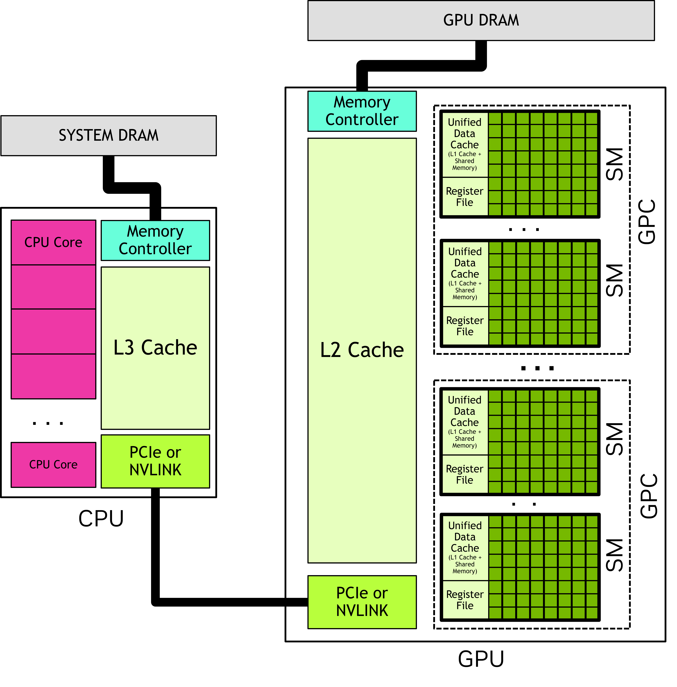
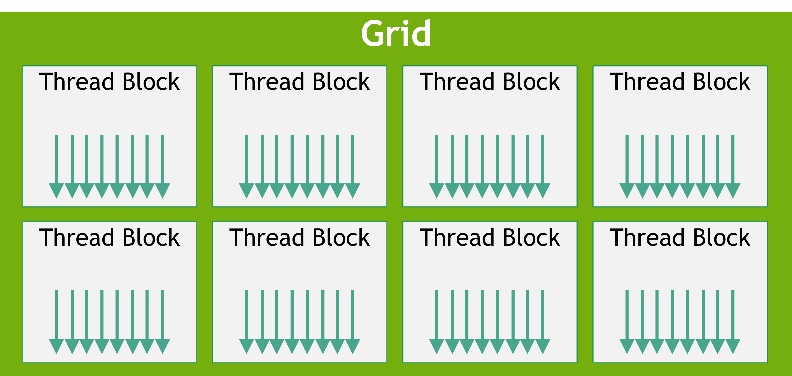
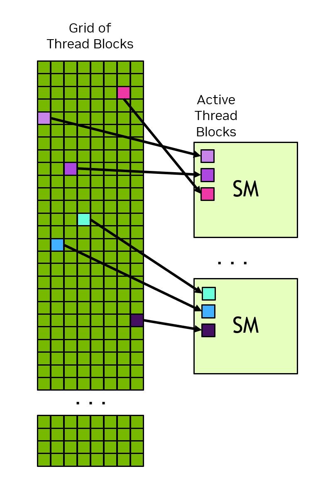
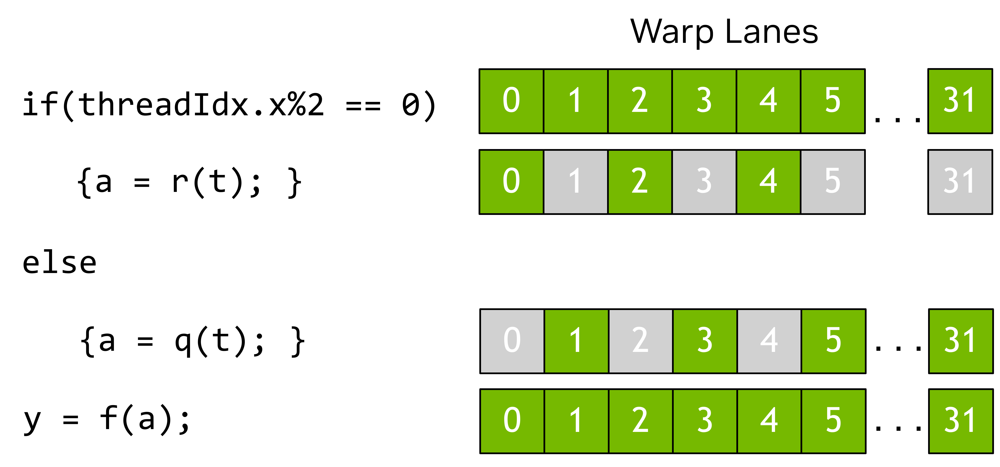

# YZM 513 – High-Performance Programming for AI

### Week 8: Writing Your First CUDA Kernel
### From CuPy to your own kernels: CUDA C/C++ and Numba CUDA

**İstanbul Medeniyet Üniversitesi**
AI Engineering M.Sc. – Fall 2026

Ammar Daşkın

> **Schedule note:** this is the original syllabus Week 6 topic, moved to **Week 8** after the midterm.

---

## Welcome Back: Where We Are in the Course

**Before midterm (Weeks 1–6):**
- Profile → vectorise → parallelise → distribute
- GPU architecture: SMs, CUDA cores, warps, SIMT
- CuPy: GPU computing with NumPy-like syntax

**After midterm (Weeks 8–13):**
- Write GPU kernels yourself (this week + next)
- Feed the GPU efficiently (Week 10)
- Train across GPUs (Weeks 11–12)
- Deploy efficiently (Week 13)

---

Week 6: you *used* the GPU through CuPy.
This week: you *program* the GPU directly. We start with a short review of Weeks 1–6,
because almost every idea from those weeks comes back today.

---


## Today's Arc

- Review: Weeks 1–6 in one story 
- Why write your own kernels? 
- Foundations: thinking in data-parallel terms
- The CUDA programming model + Examples
- The same kernels in Python: Numba CUDA and device memory 
- AI kernels: ReLU, fusion, softmax, attention
- Performance: when your kernel wins (and loses) 
- Wrap-up and lab 


---

# Review: Weeks 1–6 in One Story


| Topic | Key idea | Where it comes back today |
|---|---|---|
| Profiling, FLOP/s, Amdahl, memory wall | **Measure first**; the serial part limits speedup | Verify a kernel, then time it properly |
| NumPy vectorisation, Numba `@njit` / `prange` | Move the loop **out of the interpreter** | A kernel *is* the loop body; `@cuda.jit` is Numba for the GPU |
| Threads, processes, races, locks | Split → distribute → combine; shared writes need care | One thread per element; races on a shared output |
| GIL, `concurrent.futures`, async, pools | A **pool** of workers takes tasks from a queue | The GPU's block scheduler is a pool built in hardware |
| Dask / Ray, the four questions | Split, assign, move, wait; **granularity** | The same four questions, answered on the GPU |
| GPU architecture, SIMT, CuPy | A **throughput** machine; transfers are expensive | Today you write the kernels CuPy launched for you |


---

## One Loop, Six Ways: ReLU Through the Course
Here are the six slides with the numbering removed from the titles:

---

## Week 1: Pure Python

```python
for i in range(n):          # the interpreter runs the body n times
    out[i] = max(x[i], 0.0)
```

**The loop lives in the interpreter.** Every element costs a bytecode dispatch — slow, but explicit.

---

## Week 2: NumPy

```python
out = np.maximum(x, 0)      # one compiled loop in C
```

**Move the loop out of the interpreter.** One call, one compiled C loop over the whole array.

---

## Week 2: Numba

```python
@njit(parallel=True)        # your loop compiled; prange splits it over cores
def relu(x, out):
    for i in prange(x.size):
        out[i] = max(x[i], 0.0)
```

**Same loop, now compiled — and `prange` splits it across cores.**

---

## Weeks 3–5: Pools

```python
parts = ex.map(relu_chunk, np.array_split(x, 8))   # chunks handed to a pool of workers
```

**Split → distribute → combine.** A pool of workers takes chunks from a queue.

---

## Week 6: CuPy

```python
out_gpu = cp.maximum(x_gpu, 0)   # the GPU runs a kernel you did not write
```

**A throughput machine.** CuPy launches a kernel for you — but transfers are expensive.

---

## Today: Write the Kernel

```cpp
__global__ void relu(const float *x, float *out, int n) {   // you write the kernel
    int i = blockIdx.x * blockDim.x + threadIdx.x;
    if (i < n) out[i] = fmaxf(x[i], 0.0f);
}
```

**You write the kernel CuPy launched for you.** One thread per element; the block scheduler is the pool, in hardware.

> Same computation every time. What changes is **who runs the loop**: the interpreter, C, CPU cores, worker processes, or thousands of GPU threads.

---

## Two Laws We Will Use Today

**Amdahl's law (Week 1).** If a fraction `P` of the work is parallel and runs on `N` workers:

$$S(N) = \frac{1}{(1 - P) + P / N}$$

`P = 0.95` → at most **20×**, however many cores. On a GPU, the "serial part" includes host code, transfers and launches.

---

**Arithmetic intensity (Week 6).** FLOPs done per byte moved to or from memory.

| Operation (float32) | FLOPs | Bytes | Intensity | Bound by |
|---|:-:|:-:|:-:|---|
| ReLU, per element | 1 | 4 read + 4 written = 8 | 0.125 FLOP/byte | **memory bandwidth** |
| `n × n` matmul | `2n³` | `3 · 4n²` | about `n / 6` FLOP/byte | **compute** (large `n`) |

> Most of today's kernels are maps like ReLU: judge them in **GB/s**, not FLOP/s (Part VII).

---

## The Four Questions (Week 5), Asked of a GPU

| Question | Week 5: cluster (Dask / Ray) | Week 6: CuPy | Today: your kernel |
|---|---|---|:-:|
| **Split:** how is the work cut? | Partitions / chunks you choose | The library decides | **?** |
| **Assign:** who does which piece? | The scheduler picks a worker | The hardware block scheduler | **?** |
| **Move:** what data travels? | Over the network, via the object store | `cp.asarray` / `.get()` over PCIe | **?** |
| **Wait:** who waits for whom? | `.compute()` / `ray.get()` | `synchronize()`, or implicitly in `.get()` | **?** |

> Keep the question marks in mind. By the end of today you can fill in the last column
> yourself; 

---

## CPU and GPU in One Table (Recap of Week 6)

| | CPU | GPU |
|---|---|---|
| **Goal** | Finish **one** task as fast as possible (low latency) | Finish a **huge batch** of tasks (high throughput) |
| **Cores** | A few dozen, large and clever | Thousands of simple lanes, grouped into SMs |
| **Hides memory delay with** | Big caches, prediction | Switching to another ready group of threads |
| **Happy with** | Branchy, serial code | The same operation on huge arrays |
| **Colab T4** | n/a | 40 SMs, 2,560 CUDA cores |

> The GPU is not "a faster CPU". It is a machine that is fast **only if you give it
> a very large amount of independent work.** Part III is about how to describe that work.

---

## Warm-Up: Five Questions From Weeks 1–6

## Q1 — Amdahl's Law (Week 1)

> 95% of a program parallelises perfectly. What is the best possible speedup with unlimited cores?

**Answer: 20×** — the 5% serial part caps the speedup.

**Returns today as:** host code and transfers are the GPU's "serial part."

---

## Q2 — Interpreter vs. Compiled Loop (Week 2)

> Why is `for i in range(n): c[i] = a[i] + b[i]` slow in Python, while `c = a + b` in NumPy is fast?

**Answer:** Python runs the interpreter once **per element**; NumPy runs one compiled loop.

**Returns today as:** a kernel is that compiled loop body, run by thousands of threads.

---

## Q3 — Races (Week 3)

> Four threads each run `total += x[i]` on one shared `total`, without a lock. What goes wrong?

**Answer: Lost updates** — a race on shared, mutable state.

**Returns today as:** the same race when many GPU threads write one location.

---

## Q4 — Granularity (Weeks 4–5)

> Splitting 1,000 tiny tasks over 8 processes made a program *slower*. Why?

**Answer:** Per-task overhead outweighs the tiny work — **granularity**.

**Returns today as:** a kernel over 1,000 elements leaves the GPU idle.

---

## Q5 — Asynchronous Launch (Week 6)

> You time an 8192 × 8192 CuPy matmul with `time.perf_counter()` and get 0.02 ms. What went wrong?

**Answer:** The launch is **asynchronous** — you timed the launch, not the work.

**Returns today as:** kernel launches are asynchronous too — synchronize before timing.

---


# Writing GPU Kernels

> CuPy already runs kernels for you. Why write your own?

---

> CuPy already runs kernels for you. Why write your own?

-  **Custom operations**
   -  A new activation or fused residual operation not available as one library call
   - Most activations: e.g.`x * sigmoid(x)` (SiLU/Swish) exists in PyTorch, 
   - but what about a *new* activation you invented?
   - 
---

- **Kernel fusion** 
  - Combine several element-wise ops to avoid full-size intermediates and extra memory traffic 
  - Fused bias + activation + residual add 
  - Separate element-wise kernels create intermediates and extra memory traffic.

---

- **Understanding** 
  - You can't optimise what you don't understand. Week 9 profiles kernels. 

> `torch.compile` (Week 13) fuses kernels automatically.
> But you need to understand what fusion *does* to know when it helps.

---

## What CuPy Does Under the Hood

```python
c_gpu = a_gpu @ b_gpu       # one line
```

The call chain was:

```text
Your Python
  → CuPy dispatcher
    → cuBLAS GEMM kernel (hand-tuned, thousands of lines of CUDA)
      → CUDA runtime → driver → SMs
```

You got a fast matmul, but you cannot rewrite its internal thread mapping,
fuse its next operation into the same kernel, or change its memory-access pattern.

> This week: you write the kernel. You control the mapping and per-thread code.

---

## When You Need Your Own Kernel

> **Rule:** Use library kernels when they exist. Write your own when:
> (a) the operation doesn't exist, or
> (b) fusing multiple operations saves memory bandwidth.

---

## Kernel Fusion: The Key Motivation

From Week 6's roofline: element-wise ops are often **bandwidth-bound**.

```text
Unfused: three kernels and materialised intermediates
  t1 = x + bias       → read x, bias; write t1
  t2 = relu(t1)       → read t1;     write t2
  out = t2 + residual → read t2, residual; write out

Fused: one kernel, no full-size t1 or t2
  out = relu(x + bias) + residual
```

Benefits:
- Less global-memory traffic and fewer kernel-launch overheads.
- No large intermediate arrays to allocate and revisit.

> The speedup is **not automatically “3×”**: measure it. Normalisation and softmax
> also need reductions, so they are not a simple one-pass element-wise chain.

*To write a fused kernel, we first need a way to **think** about parallel work.

---


# Part III
# Foundations: Thinking in Data-Parallel Terms

*Before writing any code: how to see the parallel work inside a problem.*

---

## Where GPUs Come From: Pixels Before Tensors

A 1080p frame has about **2 million pixels**, redrawn 60 times a second.

- Each pixel's colour comes from the **same small program** (a *shader*) run on its own inputs.
- No pixel needs another pixel's answer → all can be computed **at the same time**.
- So the hardware has thousands of simple arithmetic units that switch to other work while waiting for memory.

---

| Year | Step |
|:-:|---|
| 2001 | Programmable shaders (GeForce 3), after fixed-function cards |
| 2007 | **CUDA**: the same hardware opened to general programs |
| 2012 | AlexNet trains on two GPUs and wins ImageNet |
| 2017+ | Tensor cores: hardware for matrix multiply (Volta) |

> A neural-network layer has the same shape: **one small computation on millions of independent numbers.**


---

## Dependencies Decide What Can Run in Parallel

```text
x = a + b            with a = 2, b = 3:      x = 5
y = b * 7                                    y = 21
z = (x - y) * (x + y)                        z = (5 - 21) * (5 + 21) = -416
```

```text
 a, b ──▶ x = a + b ──┐
   │                  ├──▶ z = (x - y) * (x + y)
   └────▶ y = b * 7 ──┘
```

- `x` and `y` need only `a` and `b`, not each other → they **can run at the same time**.
- `z` needs both → it **must wait**. Every arrow is a dependency.
- **No arrow between two operations ⇒ they may run in parallel.**

> `c[i] = a[i] + b[i]` for `i = 0 … N-1` is `N` operations with **no arrows between them**:
> the ideal GPU workload.

---

## Data-Parallel Thinking: Describe the Data, Not the Workers

Instead of "what does each worker do?", ask: **what happens to the whole sequence?**

| Primitive | Meaning | NumPy spelling | AI example |
|---|---|---|---|
| **map** | Apply the same function to every element | `np.maximum(x, 0)` | ReLU, bias add, GELU |
| **reduce** | Combine all elements into one value | `x.sum()`, `x.max()` | Loss, row max and row sum in softmax |
| **scan** | Running totals | `np.cumsum(x)` | Cumulative sums, stream compaction |
| **gather / scatter** | Read or write at computed positions | `x[idx]` | Embedding lookup |

- You already used these in Week 2 as "vectorisation". Libraries run them in parallel for you.
- **Today:** you write the GPU kernel behind a *map*. **Week 9:** reductions.

---

## Map: The Pattern Behind Today's Kernels

```text
input   :  -2    5   -1    3    0   -7    4    1
              f(x) = max(x, 0), applied to every element independently
output  :   0    5    0    3    0    0    4    1
```

- `f` has no side effects, and no element needs another element's result.
- So elements can be processed **in any order, by any number of workers**, and the answer never changes.
- A GPU uses that freedom: **one thread per element.**

> Vector add, ReLU, bias add, SiLU: all maps. Examples 1–4 and 6–7 in Part IV are maps.
> A kernel is just the body of the map; the launch supplies the elements.

---

## Reduce: Many Inputs, One Output

```text
Sequential: 7 additions, one after another        Tree: 7 additions, only 3 rounds

((((((3+8)+4)+6)+3)+9)+2)+8 = 43                  3   8   4   6   3   9   2   8
                                                   └11┘   └10┘   └12┘   └10┘     round 1
                                                      └──21──┘   └──22──┘       round 2
                                                           └───── 43 ─────┘     round 3
```

- Same total work (`N - 1` additions), but the tree's **longest chain** is `log2 N` steps.
- It requires an **associative** operator: `(a + b) + c = a + (b + c)`.
  Floating-point sums can change in the last digits when the order changes.
- Softmax (max, sum), layer norm and loss are all reductions. Threads must **cooperate**: Week 9.

---

## Scan (Prefix Sum): A Preview

```text
input      :  1   2   3   4   5   6   7   8
inclusive  :  1   3   6  10  15  21  28  36     out[i] = in[0] + ... + in[i]
exclusive  :  0   1   3   6  10  15  21  28     out[i] = in[0] + ... + in[i-1]
```

Looks sequential, since each output uses the previous one, yet it can be done in about `log2 N` rounds.

**Why it matters: stream compaction.** Keep only the positive numbers of `[3, -1, 4, -1, 5]`:

```text
flags      :  1   0   1   0   1
exclusive scan :  0   1   1   2   2     ← the output position of each kept element
result     :  [3, 4, 5]                 (3 → slot 0, 4 → slot 1, 5 → slot 2)
```

> Optional preview: you do not need scan for today's kernels.

---

## Work and Span: Why GPUs Need Lots of Parallelism

- **Work** = total number of operations. **Span** = the longest chain of dependent operations.
- Ideal running time with `P` workers is roughly `max(work / P, span)`.

| Pattern | Work | Span |
|---|:-:|:-:|
| map over `N` elements | `N` | 1 |
| reduce `N` elements (tree) | `N - 1` | `log2 N` |
| reduce `N` elements (one thread) | `N - 1` | `N - 1` |

**The GPU's appetite:** a Colab T4 has 40 SMs, each able to hold up to 1,024 resident threads, so about **40,960 threads in flight**, and it wants several times more waiting in line to hide memory delay.

> A kernel over 1,000 elements leaves most of the GPU idle, and launch cost dominates.
> This is the same lesson as Week 6's crossover: **enough work per launch.**

---

## From Map to CUDA: Same Idea, Explicit Threads

```python
# CPU, one worker walks the sequence
for i in range(N):
    c[i] = a[i] + b[i]
```

```text
# GPU, N tiny workers; each one runs the SAME code on its own i
kernel(a, b, c):
    i = my own index
    c[i] = a[i] + b[i]
```

- NumPy's `c = a + b` hides the loop. In CUDA **you write the body and the launch supplies the indices.**
- Unlike `map(f, sequence)`, the **number of threads is explicit in the launch**, not implied by the data size.
  So the launch can be larger than the data: that is why the **bounds check** exists (Example 3).
- The CPU program stays serial: it prepares data, **launches** work, then waits.

---

## CUDA Is SPMD: Same Program, Multiple Data

**SPMD** = *single program, multiple data*: one program text, many running instances, each knowing **its own ID**.

| Idea | Course connection |
|---|---|
| Many instances of one function | Week 3: `Pool(8)` on the CPU, here thousands in hardware |
| Each instance finds its data from its ID | `i = blockIdx.x * blockDim.x + threadIdx.x` |
| Instances grouped, executed 32 at a time | Week 6: warps and SIMT |

- A **CUDA thread** is a *logical* thread of control. Launching a million does **not** create a million operating-system threads.
- The hardware schedules **blocks** onto SMs as resources free up, in no guaranteed order.

> Part IV turns these ideas into code, one small program at a time.

---

## CUDA Vocabulary on One Page

| Term | One-line meaning |
|---|---|
| **Host** / **device** | The CPU (and its memory) / the GPU (and its memory) |
| **Kernel** | A function that runs on the device, launched from the host |
| **Launch** | The host command that starts a grid of threads running a kernel |
| **Thread** | One instance of the kernel, with its own `threadIdx` and registers |
| **Block** | A group of threads that can cooperate; runs on one SM |
| **Grid** | All blocks of one launch |
| **Warp** | 32 threads executed together by an SM |
| **SM** | Streaming multiprocessor: the unit that runs blocks |
| **Global memory** | GPU DRAM, visible to every thread |
| **Shared memory** | Fast on-chip memory shared by one block (Week 9) |

> Each term returns with code later. Come back here if a word feels fuzzy.


---

## Q1 — Maps, Reduces, Scans

> Which of these are **maps**? (a) ReLU on a tensor (b) the sum of a tensor (c) adding a bias (d) a running total.

**Answer: (a) and (c).** The sum is a reduce, the running total is a scan.

---

## Q2 — Independent Statements

> `x = a + b; y = c * d; z = x + y`. Which two statements can run at the same time?

**Answer: `x` and `y`** — they share no inputs. `z` waits for both.

---

## Q3 — Tree Reduction Depth

> A tree reduction sums 1,024 numbers. How many rounds does it need?

**Answer: 10 rounds**, since `2^10 = 1024`. (A single thread would need 1,023 dependent additions.)

---

## Q4 — Too Little Parallel Work

> You launch a kernel over only 100 elements. Why is the GPU a poor fit?

**Answer:** Too little parallel work — most SMs stay idle, and launch and transfer overhead dominate.

---

## Q5 — One Thread per Element ≠ N Threads

> Why is "one thread per element" **not** the same as "launch exactly `N` threads"?

**Answer:** Threads are launched in whole **blocks**, so the launch can contain more threads than elements. The extra threads must be stopped by a **bounds check** (Part IV, Examples 2 and 3).


---

# The CUDA Programming Model, with Worked Examples

*The rules of CUDA, each one followed by a small C/C++ program you can run.*

---

## From Week 6 Hardware to Today's Software

| Hardware view (Week 6) | Software view (this week) |
|---|---|
| Streaming multiprocessor (**SM**) | Thread **block** is assigned to one SM |
| CUDA cores / functional units | Threads perform arithmetic and memory operations |
| Warp scheduler | Hardware schedules warps from active blocks |
| Device memory and on-chip memory | Global, shared, and per-thread storage |

- You write the work for **one thread**.
- A launch creates a **grid of blocks**, not one fixed block per SM.
- Blocks may run in any order and in waves; launched threads are **not all simultaneously resident**.

> CUDA separates what you express (a grid of work) from how hardware schedules it.

---

## CUDA in One Picture

**CUDA is a heterogeneous programming model:** the CPU and GPU cooperate.

```text
HOST (CPU)                                      DEVICE (GPU)
Python / C++ starts the program
  │ allocate + initialise host data
  │ copy inputs to device memory
  │ launch kernel ───────────────────────────▶  a grid of threads runs
  │ optionally do other host work               the same kernel function
  │ synchronize / copy results ◀──────────────  writes output to memory
  ▼ verify, continue, or launch more work
```

- **Host:** CPU and its directly attached memory.
- **Device:** GPU and its directly attached memory.
- **Kernel:** a function launched for device execution.
- **Launch:** creates many threads executing that kernel.

---

## Conceptual Hardware: Host, Device, and SMs



*Source: NVIDIA CUDA Programming Guide, Fig. 2. Interconnect and sizes vary by system.*

---

## A CUDA Program in Six Steps

| Step | Where | CUDA C/C++ (Part IV examples) | Numba CUDA (Part V) |
|:---:|---|---|---|
| 1 | Host | `malloc`, fill `h_a`, choose `N` | Create NumPy inputs, choose `N` |
| 2 | Host → device | `cudaMalloc` + `cudaMemcpy(..., HostToDevice)` | `cuda.to_device(a_np)` |
| 3 | Host | `cudaMalloc` for the output `d_c` | `cuda.device_array(...)` |
| 4 | Host launches | `kernel<<<blocks, threads>>>(...)` | `kernel[blocks, threads](...)` |
| 5 | Device | Each thread computes an index, writes output | same |
| 6 | Device → host | `cudaMemcpy(..., DeviceToHost)`, `cudaFree` | `out_d.copy_to_host()`; verify with NumPy |

> A kernel does **not return a Python value**. It communicates by writing to memory.

---

## Software Hierarchy: Grid → Block → Thread



*Source: NVIDIA CUDA Programming Guide, Fig. 3; arrows represent threads.*

---

## The Launch Geometry Vocabulary

| Object | Question it answers | Numba CUDA name |
|---|---|---|
| `gridDim` | How many blocks in each grid dimension? | `cuda.gridDim.x/y/z` |
| `blockIdx` | Which block is this? | `cuda.blockIdx.x/y/z` |
| `blockDim` | How many threads in each block dimension? | `cuda.blockDim.x/y/z` |
| `threadIdx` | Which thread am I inside this block? | `cuda.threadIdx.x/y/z` |

Every block has the **same dimensions**; grids and blocks can be **1D, 2D, or 3D**.

**Total launched threads (1D):**

```text
gridDim.x × blockDim.x = blocks per grid × threads per block
```

> Launch geometry is part of the algorithm: it defines which threads exist.

---

## Hardware Schedules Blocks onto SMs



- A block executes on **one SM**.
- An SM can have multiple **active blocks**, resources permitting.
- The grid can contain far more blocks than the GPU has SMs.
- Blocks are scheduled in **no guaranteed order**.

<!-- _footer: "Source: NVIDIA CUDA Programming Guide, Fig. 4." -->

---

## The Scalability Contract

The same program can run on small and large GPUs because you do **not** specify:

- which SM receives a block;
- how many blocks are resident at once;
- the order in which blocks run.

Therefore:

1. Do not make one block depend on another block's intermediate result.
2. Do not assume block 0 finishes before block 1 starts.
3. Use separate kernel launches when you need a grid-wide completion boundary.

> Within a block, threads can cooperate. Across blocks, assume independence.

---

## CUDA C++ in four new things

A `.cu` file is ordinary C++ plus:

| New thing | Example | Meaning |
|---|---|---|
| **`__global__`** | `__global__ void k(...)` | A **kernel**: runs on the GPU, called from the CPU, returns `void` |
| **Launch syntax** | `k<<<blocks, threads>>>(args)` | Start `blocks × threads` copies of `k` |
| **Built-in variables** | `threadIdx.x`, `blockIdx.x`, `blockDim.x`, `gridDim.x` | Filled in by the hardware, different in every thread |
| **Runtime API** | `cudaMalloc`, `cudaMemcpy`, `cudaFree` | Manage GPU memory; the `cuda` prefix marks CUDA calls |

Everything else (`int`, `if`, `for`, `printf`, arrays) is the C/C++ you already know.

> `main()` runs on the **host** (CPU). Kernels run on the **device** (GPU).
> The two sides have **separate memories**. This is what makes CUDA feel new.

---

## Compile and run (Colab or your own GPU machine)

```bash
nvcc -o 01_hello_indices 01_hello_indices.cu    # compile host + device code
./01_hello_indices                               # run it
```

On Colab (Runtime → Change runtime type → **T4 GPU**):

```python
!git clone -q https://github.com/adaskin/hpc-for-ai-course
%cd hpc-for-ai-course/lectures/week08/cuda_c
!nvcc -o 01_hello_indices 01_hello_indices.cu && ./01_hello_indices
```

- `nvcc` splits the file: host code goes to your C++ compiler, kernels to the GPU compiler.
- Error `no kernel image is available`? Add `-arch=native` (or `-arch=sm_75` for a T4).
- All seven programs are in 📁 `week08/cuda_c/`.

---


## Thread Indexing: The Core Formula

```cpp
int i = blockIdx.x * blockDim.x + threadIdx.x;                    // CUDA C/C++
```

```python
i = cuda.blockIdx.x * cuda.blockDim.x + cuda.threadIdx.x          # Numba CUDA (or: i = cuda.grid(1))
```

| Symbol | Meaning | Example |
|--------|---------|---------|
| `blockIdx.x` | Which block am I in? | Block 3 |
| `blockDim.x` | How many threads per block? | 256 |
| `threadIdx.x` | Which thread within my block? | Thread 42 |
| **Global index** | `3 * 256 + 42 = 810` | Element 810 |

> **Think of a hotel.** A block is a floor with `blockDim.x` rooms. Your room number is
> *(floors below you × rooms per floor) + your place on your floor*: `3 * 256 + 42 = 810`.

> Write what thread `i` does—not the host-side `for i in range(N)` loop.
> Hardware schedules the launched threads in warps and waves.

---

## Example 1 ·  "Who am I?"

Launch 12 threads. Make every thread work out its own unique number, 0 to 11.

- All threads run **the same code**. 
  - The only way to give thread 7 different work from thread 3 is for each thread to compute *where it is* and act on that.

```text
blockDim.x = 4 threads in every block        gridDim.x = 3 blocks

            block 0           block 1           block 2
          ┌──┬──┬──┬──┐     ┌──┬──┬──┬──┐     ┌──┬──┬──┬──┐
threadIdx │ 0│ 1│ 2│ 3│     │ 0│ 1│ 2│ 3│     │ 0│ 1│ 2│ 3│     ← the hardware gives you this
          └──┴──┴──┴──┘     └──┴──┴──┴──┘     └──┴──┴──┴──┘
global i   0  1  2  3        4  5  6  7        8  9 10 11       ← we want to compute this
```

> The hardware tells each thread its block number and its position **inside the block**.
> It does **not** hand out a global number. We build it.

---


## Example 1 · Full code

> 📁 `week08/cuda_c/01_hello_indices.cu`

```cpp
#include <cstdio>

__global__ void hello_indices() {
    // The core formula: block number * threads per block + thread number in block
    int i = blockIdx.x * blockDim.x + threadIdx.x;

    printf("block %d, thread %d  ->  i = %d * %d + %d = %2d\n",
           blockIdx.x, threadIdx.x, blockIdx.x, blockDim.x, threadIdx.x, i);
}

int main() {
    // <<<blocks, threads_per_block>>> : 3 blocks x 4 threads = 12 threads in total
    hello_indices<<<3, 4>>>();

    // Kernel launches are asynchronous: wait here, otherwise main() may exit
    // before the GPU has printed anything.
    cudaDeviceSynchronize();
    return 0;
}
```

- `printf` works in kernels (tiny experiments only). `cudaDeviceSynchronize()` waits for the GPU:
  without it `main()` may exit first and you see **no output**.

---

## Example 1 · Expected output

```text
block 0, thread 0  ->  i = 0 * 4 + 0 =  0
block 0, thread 1  ->  i = 0 * 4 + 1 =  1
block 0, thread 2  ->  i = 0 * 4 + 2 =  2
block 0, thread 3  ->  i = 0 * 4 + 3 =  3
block 1, thread 0  ->  i = 1 * 4 + 0 =  4
block 1, thread 1  ->  i = 1 * 4 + 1 =  5
block 1, thread 2  ->  i = 1 * 4 + 2 =  6
block 1, thread 3  ->  i = 1 * 4 + 3 =  7
block 2, thread 0  ->  i = 2 * 4 + 0 =  8
block 2, thread 1  ->  i = 2 * 4 + 1 =  9
block 2, thread 2  ->  i = 2 * 4 + 2 = 10
block 2, thread 3  ->  i = 2 * 4 + 3 = 11
```

> **The order of lines may differ on your GPU.** Threads and blocks run in no guaranteed order,
> so the *same twelve lines* can appear shuffled. Sort by `i` and compare with the table.
> **Try it:** change `<<<3, 4>>>` to `<<<2, 5>>>`. Predict the 10 values of `i` first.

---

## Example 1 · Step by step

**Launch:** `hello_indices<<<3, 4>>>()` → `gridDim.x = 3`, `blockDim.x = 4`.

1. Thread asks: *how many threads sit in the blocks before mine?* → `blockIdx.x * blockDim.x`
   (block 2 has 2 full blocks before it: `2 * 4 = 8` threads)
2. Thread adds *my place inside my own block* → `+ threadIdx.x`

**`i = blockIdx.x * blockDim.x + threadIdx.x`**

| `blockIdx.x` | `blockIdx.x * blockDim.x` | `threadIdx.x` | `i` |
|:-:|:-:|:-:|:-:|
| 0 | `0 * 4 = 0` | 0, 1, 2, 3 | **0, 1, 2, 3** |
| 1 | `1 * 4 = 4` | 0, 1, 2, 3 | **4, 5, 6, 7** |
| 2 | `2 * 4 = 8` | 0, 1, 2, 3 | **8, 9, 10, 11** |

> **Check:** the last thread is block 2, thread 3 → `2*4 + 3 = 11 = gridDim.x * blockDim.x - 1`.
> Every number 0…11 appears exactly once: no gaps, no duplicates.

---

## Example 2 · add two vectors

Given `a = [0, 1, 2, …, 9]` and `b = [0, 10, 20, …, 90]`, compute `c[i] = a[i] + b[i]` **on the GPU** and print `c`.

Two things make this harder than "hello":

1. **Two memories.** The GPU cannot read CPU arrays, and the CPU cannot read GPU arrays.
   Data must be *allocated* on the GPU and *copied* across.
2. **`N = 10` is not a multiple of 4.** With blocks of 4 threads we need `⌈10/4⌉ = 3` blocks = 12 threads. Two threads have no element.

```text
thread i :   0  1  2  3 |  4  5  6  7 |  8  9 10 11
element  :   0  1  2  3 |  4  5  6  7 |  8  9  –  –      ( – = nothing to do: skip )
              block 0       block 1        block 2
```

---

## Example 2 · Step by step (1/2): the data

Convention: `h_` = **host** pointer (CPU memory), `d_` = **device** pointer (GPU memory).

| Step | Call | What it means |
|:-:|---|---|
| 1 | `malloc(bytes)` | CPU arrays. `bytes = N * sizeof(float) = 10 * 4 = 40` |
| 2 | `cudaMalloc(&d_a, bytes)` | Reserve 40 bytes **on the GPU**. It writes the GPU address into `d_a`, which is why we pass `&d_a` |
| 3 | `cudaMemcpy(d_a, h_a, bytes, cudaMemcpyHostToDevice)` | Copy CPU → GPU. Order: **destination, source**, size, direction (like `memcpy`) |
| 4 | `vector_add<<<3, 4>>>(d_a, d_b, d_c, N)` | Start 12 threads. Arguments are passed **by value**: pointers are GPU addresses, `N` is a plain `int` |
| 5 | `cudaMemcpy(h_c, d_c, bytes, cudaMemcpyDeviceToHost)` | Copy GPU → CPU. This call also **waits** until the kernel has finished |
| 6 | `cudaFree(d_a)` / `free(h_a)` | Give back both kinds of memory |

> A `d_` pointer is just a number that only means something **on the GPU**.
> The CPU must never dereference it (`d_c[0]` in `main` crashes).

---

## Example 2 · Step by step (2/2): what each thread does

Kernel: `i = blockIdx.x * blockDim.x + threadIdx.x;  if (i < n) c[i] = a[i] + b[i];`

| `i` | 0 | 1 | 2 | 3 | 4 | 5 | 6 | 7 | 8 | 9 | 10 | 11 |
|---|:-:|:-:|:-:|:-:|:-:|:-:|:-:|:-:|:-:|:-:|:-:|:-:|
| `blockIdx.x` | 0 | 0 | 0 | 0 | 1 | 1 | 1 | 1 | 2 | 2 | 2 | 2 |
| `threadIdx.x` | 0 | 1 | 2 | 3 | 0 | 1 | 2 | 3 | 0 | 1 | 2 | 3 |
| `i < 10` ? | ✓ | ✓ | ✓ | ✓ | ✓ | ✓ | ✓ | ✓ | ✓ | ✓ | ✗ | ✗ |
| `a[i]` | 0 | 1 | 2 | 3 | 4 | 5 | 6 | 7 | 8 | 9 | – | – |
| `b[i]` | 0 | 10 | 20 | 30 | 40 | 50 | 60 | 70 | 80 | 90 | – | – |
| **`c[i]`** | **0** | **11** | **22** | **33** | **44** | **55** | **66** | **77** | **88** | **99** | idle | idle |

- Threads 10 and 11 evaluate `10 < 10` and `11 < 10`: both false → they do **nothing**.
- Every other thread does exactly **one** addition: no loop anywhere.

---

## Example 2 · Full code (1/2)

> 📁 `week08/cuda_c/02_vector_add_small.cu`

<style scoped>pre { font-size: 14px; }</style>

```cpp
#include <cstdio>
#include <cstdlib>

__global__ void vector_add(const float *a, const float *b, float *c, int n) {
    int i = blockIdx.x * blockDim.x + threadIdx.x;   // 1. who am I?
    if (i < n) {                                     // 2. is there work for me?
        c[i] = a[i] + b[i];                          // 3. do my one piece of work
    }
}

int main() {
    const int N = 10;
    const size_t bytes = N * sizeof(float);          // 10 * 4 = 40 bytes

    // Step 1: allocate and fill the HOST (CPU) arrays
    float *h_a = (float *)malloc(bytes);
    float *h_b = (float *)malloc(bytes);
    float *h_c = (float *)malloc(bytes);
    for (int i = 0; i < N; i++) {
        h_a[i] = (float)i;            // 0, 1, 2, ...
        h_b[i] = 10.0f * i;           // 0, 10, 20, ...
    }

    // Step 2: allocate DEVICE (GPU) arrays
    float *d_a, *d_b, *d_c;
    cudaMalloc(&d_a, bytes);
    cudaMalloc(&d_b, bytes);
    cudaMalloc(&d_c, bytes);
```

---

## Example 2 · Full code (2/2)

<style scoped>pre { font-size: 14px; }</style>

```cpp
    // Step 3: copy the inputs host -> device
    cudaMemcpy(d_a, h_a, bytes, cudaMemcpyHostToDevice);
    cudaMemcpy(d_b, h_b, bytes, cudaMemcpyHostToDevice);

    // Step 4: choose the launch configuration and launch
    int threads = 4;
    int blocks  = (N + threads - 1) / threads;       // ceil(10 / 4) = 3
    printf("N = %d, threads/block = %d, blocks = %d, launched threads = %d, idle threads = %d\n",
           N, threads, blocks, blocks * threads, blocks * threads - N);
    vector_add<<<blocks, threads>>>(d_a, d_b, d_c, N);

    // Step 5: copy the result device -> host (this call waits for the kernel to finish)
    cudaMemcpy(h_c, d_c, bytes, cudaMemcpyDeviceToHost);

    printf("c =");
    for (int i = 0; i < N; i++) printf(" %.0f", h_c[i]);
    printf("\n");

    // Step 6: free everything we allocated
    cudaFree(d_a); cudaFree(d_b); cudaFree(d_c);
    free(h_a);     free(h_b);     free(h_c);
    return 0;
}
```

> Error checking is left out **on purpose** so the six steps stay visible. Example 5 adds it.

---

## Example 2 · Expected output

```text
N = 10, threads/block = 4, blocks = 3, launched threads = 12, idle threads = 2
c = 0 11 22 33 44 55 66 77 88 99
```

Check against the table: `c[9] = a[9] + b[9] = 9 + 90 = 99` ✓

**Classic memory mistakes** (and what you will see):

| Mistake | Symptom |
|---|---|
| `printf("%f", d_c[0])` in `main` (GPU pointer on the CPU) | Segmentation fault |
| Passing `h_a` (CPU pointer) to the kernel | "illegal memory access", reported *later* (Example 5) |
| `bytes = N` instead of `N * sizeof(float)` | Only ¼ of the array copied; the rest is garbage |
| Swapped `cudaMemcpy` source/destination or wrong direction flag | Error or wrong data |
| Forgetting `cudaFree` in a loop | GPU memory fills up, then `cudaMalloc` fails |

---

## Bounds Checking: Don't Read Past the Array

```cpp
int i = blockIdx.x * blockDim.x + threadIdx.x;
if (i < N) {                 // ← CRITICAL
    c[i] = a[i] + b[i];
}
```

Why? Grid size is rounded up:
- N = 1,000,000, blockDim = 256
- Grid = ⌈1,000,000 / 256⌉ = 3,907 blocks
- Total threads launched = 3,907 × 256 = 1,000,192
- **192 threads have no work.** Without the check → out-of-bounds access → crash or garbage.

> Always include the bounds check. It's nearly free (one comparison per thread).

---

## Example 3 · what if I skip the bounds check?

Fill `out[i] = i` for `n = 10` elements, launching `3 × 4 = 12` threads.
What do threads 10 and 11 do if nothing stops them?

- C and CUDA do **not** check array bounds. There is no exception. The write simply happens.
- To make the damage visible *and* safe, we allocate **12** ints and fill all of them with `-1`.
  Cells 10 and 11 are "guard cells": in real code they would belong to someone else.

```text
index          0  1  2  3  4  5  6  7  8  9 | 10 11
start         -1 -1 -1 -1 -1 -1 -1 -1 -1 -1 | -1 -1
               └────────── our n = 10 ──────┘  └ guard cells
```

> We run two kernels on the same launch `<<<3, 4>>>`: one **with** `if (i < n)`, one **without**.

---

## Example 3 · Step by step

**With the check** (`fill_safe`):

| thread `i` | 0 … 9 | 10 | 11 |
|---|:-:|:-:|:-:|
| `i < 10` ? | true | **false** | **false** |
| action | `out[i] = i` | skip | skip |

**Without the check** (`fill_unsafe`): every thread executes `out[i] = i`, so thread 10 writes `out[10]` and thread 11 writes `out[11]`.

Expected: guard cells stay `-1` in the safe run, and become `10` and `11` in the unsafe run.

> In a real program there are no guard cells. Those two writes land on whatever sits next to your array:
> another array, allocator bookkeeping, or unmapped memory. Typical results: **wrong answers
> somewhere else, a crash, or "works on my GPU, fails on yours".**

---

## Example 3 · Full code (1/2)

> 📁 `week08/cuda_c/03_bounds_check.cu`

<style scoped>pre { font-size: 14px; }</style>

```cpp
#include <cstdio>

__global__ void fill_safe(int *out, int n) {
    int i = blockIdx.x * blockDim.x + threadIdx.x;
    if (i < n) out[i] = i;            // threads 10 and 11 skip the write
}

__global__ void fill_unsafe(int *out, int n) {
    int i = blockIdx.x * blockDim.x + threadIdx.x;
    out[i] = i;                       // BUG: no bounds check -> threads 10, 11 write too
}

void show(const char *label, const int *h) {
    printf("%-24s", label);
    for (int i = 0; i < 12; i++) {
        if (i == 10) printf(" |");    // everything right of "|" is beyond n
        printf(" %2d", h[i]);
    }
    printf("\n");
}
```

---

## Example 3 · Full code (2/2)

<style scoped>pre { font-size: 14px; }</style>

```cpp
int main() {
    const int n = 10, total = 12;                    // 12 cells; only the first 10 are "ours"
    int h[total];
    int *d;
    cudaMalloc(&d, total * sizeof(int));

    // Run 1: with the bounds check
    cudaMemset(d, 0xFF, total * sizeof(int));        // every byte 0xFF -> every int is -1
    fill_safe<<<3, 4>>>(d, n);
    cudaMemcpy(h, d, total * sizeof(int), cudaMemcpyDeviceToHost);
    show("safe   (with i < n):", h);

    // Run 2: without the bounds check
    cudaMemset(d, 0xFF, total * sizeof(int));
    fill_unsafe<<<3, 4>>>(d, n);
    cudaMemcpy(h, d, total * sizeof(int), cudaMemcpyDeviceToHost);
    show("unsafe (no check):", h);

    cudaFree(d);
    return 0;
}
```

---

## Example 3 · Expected output

```text
safe   (with i < n):      0  1  2  3  4  5  6  7  8  9 | -1 -1
unsafe (no check):        0  1  2  3  4  5  6  7  8  9 | 10 11
```

- Left of `|`: the 10 elements we wanted. Right of `|`: the two guard cells.
- In the unsafe run the guard cells were **overwritten**: the program printed no error at all.

> **Rule:** whenever `blocks * threads` can exceed `N`, the first line after computing `i`
> is `if (i < n)`. It costs one comparison; skipping it costs a bug that may not show up on your machine.

---

## Launch Configuration: Choosing Block and Grid Size

| Parameter | Typical choice | Constraint |
|-----------|---------------|------------|
| `blockDim.x` (threads per block) | Start with 128 or 256 | Max 1024 threads/block; a multiple of 32 is a performance recommendation, not a syntax rule. |
| Grid size | `⌈N / blockDim⌉` | Can be very large (millions) |

```cpp
int threads = 256;
int blocks  = (N + threads - 1) / threads;       // integer ceil(N / threads)
my_kernel<<<blocks, threads>>>(d_a, d_b, d_c, N);
```

> **Starting point, not a law:** try 128 or 256 for simple element-wise kernels,
> then measure. Week 9 covers occupancy and tuning.

---

## Example 4 · how many blocks and threads?

You have `N` elements. Choose `threads` per block and `blocks` so that

1. there is **at least one thread per element** (nothing left uncomputed), and
2. the launch is **legal** on the hardware.

Questions this example answers:

- What is the integer-only formula for `blocks`?
- How many threads are wasted, and does it matter?
- What block size should I pick, and what is the maximum?
- What really happens if I round **down**?

> We run `c = a + b` for `N = 1,000,000` with several block sizes and count wrong elements.

---

## Example 4 · Step by step

1. **Pick `threads`:** 128 or 256 to start; limit **1024**; prefer a multiple of **32** (a warp).
   (`100` threads → 4 warps, the last with only 4 active lanes.)
2. **`blocks = (N + threads - 1) / threads`**: integer division truncates, so adding `threads - 1` first rounds **up**.
3. **Launched = `blocks * threads`**; idle = launched − `N` (always `< threads`).
4. **Keep `if (i < n)`** for the idle threads.


| `N` | `(N + 255) / 256` | `blocks` | launched | idle |
|---:|:-:|--:|--:|--:|
| 256 | `511 / 256 = 1.99` → | **1** | 256 | 0 |
| 257 | `512 / 256 = 2` → | **2** | 512 | 255 |
| 1,000 | `1255 / 256 = 4.9` → | **4** | 1,024 | 24 |
| 1,000,000 | `1,000,255 / 256 = 3907.2` → | **3,907** | 1,000,192 | 192 |

> **Round down by mistake:** `N / 256 = 3906` blocks → `999,936` threads → the last **64 elements are never computed**.

---

## Example 4 · Full code (1/3)

> 📁 `week08/cuda_c/04_launch_config.cu`
> `CUDA_CHECK(call)` = "run the call, stop if it failed". Example 5 explains it.

<style scoped>pre { font-size: 13px; }</style>

```cpp
#include <cstdio>
#include <cstdlib>

#define CUDA_CHECK(call) do { cudaError_t e_ = (call); if (e_ != cudaSuccess) {            \
    fprintf(stderr, "CUDA error at %s:%d: %s\n", __FILE__, __LINE__, cudaGetErrorString(e_)); \
    exit(EXIT_FAILURE); } } while (0)

__global__ void vector_add(const float *a, const float *b, float *c, int n) {
    int i = blockIdx.x * blockDim.x + threadIdx.x;
    if (i < n) c[i] = a[i] + b[i];
}

// ceil(n / threads) using integer arithmetic only
int ceil_div(int n, int threads) { return (n + threads - 1) / threads; }

// Run the kernel with `blocks` x `threads`, return how many elements are wrong.
int run_and_count_wrong(int n, int blocks, int threads,
                        const float *d_a, const float *d_b, float *d_c, float *h_c) {
    CUDA_CHECK(cudaMemset(d_c, 0, n * sizeof(float)));           // start from all zeros
    vector_add<<<blocks, threads>>>(d_a, d_b, d_c, n);
    CUDA_CHECK(cudaGetLastError());                              // was the launch valid?
    CUDA_CHECK(cudaMemcpy(h_c, d_c, n * sizeof(float), cudaMemcpyDeviceToHost));
    int wrong = 0;
    for (int i = 0; i < n; i++)
        if (h_c[i] != 3.0f * i) wrong++;                         // expected: i + 2i = 3i
    return wrong;
}
```

---

## Example 4 · Full code (2/3)

<style scoped>pre { font-size: 13px; }</style>

```cpp
int main() {
    // ---- Part A: the formula ------------------------------------------------
    printf("Part A: blocks = ceil(N / 256)\n");
    printf("%12s %8s %16s %6s\n", "N", "blocks", "launched threads", "idle");
    int ns[] = {1, 256, 257, 1000, 1000000, 10000000};
    for (int k = 0; k < 6; k++) {
        int n = ns[k], blocks = ceil_div(n, 256);
        printf("%12d %8d %16d %6d\n", n, blocks, blocks * 256, blocks * 256 - n);
    }

    // ---- Part B: hardware limits ---------------------------------------------
    cudaDeviceProp p;
    CUDA_CHECK(cudaGetDeviceProperties(&p, 0));
    printf("\nPart B: device 0 = %s\n", p.name);
    printf("  max threads per block : %d\n", p.maxThreadsPerBlock);
    printf("  warp size             : %d\n", p.warpSize);
    printf("  streaming multiprocs  : %d\n", p.multiProcessorCount);

    // ---- Part C: same answer, different launch configurations ---------------
    const int N = 1000000;
    size_t bytes = N * sizeof(float);
    float *h_a = (float *)malloc(bytes), *h_b = (float *)malloc(bytes), *h_c = (float *)malloc(bytes);
    for (int i = 0; i < N; i++) { h_a[i] = (float)i; h_b[i] = 2.0f * i; }   // c should be 3i
    float *d_a, *d_b, *d_c;
    CUDA_CHECK(cudaMalloc(&d_a, bytes));
    CUDA_CHECK(cudaMalloc(&d_b, bytes));
    CUDA_CHECK(cudaMalloc(&d_c, bytes));
    CUDA_CHECK(cudaMemcpy(d_a, h_a, bytes, cudaMemcpyHostToDevice));
    CUDA_CHECK(cudaMemcpy(d_b, h_b, bytes, cudaMemcpyHostToDevice));
```

---

## Example 4 · Full code (3/3)

<style scoped>pre { font-size: 14px; }</style>

```cpp
    printf("\nPart C: N = %d\n", N);
    printf("%10s %8s %16s %10s\n", "threads", "blocks", "launched threads", "wrong");
    int sizes[] = {32, 128, 256, 1024};
    for (int k = 0; k < 4; k++) {
        int t = sizes[k], b = ceil_div(N, t);
        int wrong = run_and_count_wrong(N, b, t, d_a, d_b, d_c, h_c);
        printf("%10d %8d %16d %10d\n", t, b, b * t, wrong);
    }

    // The classic mistake: floor division leaves the tail uncomputed.
    int b_floor = N / 256;                                       // 3906, NOT 3907
    int wrong = run_and_count_wrong(N, b_floor, 256, d_a, d_b, d_c, h_c);
    printf("\nfloor division: blocks = %d, launched threads = %d, wrong = %d\n",
           b_floor, b_floor * 256, wrong);

    CUDA_CHECK(cudaFree(d_a)); CUDA_CHECK(cudaFree(d_b)); CUDA_CHECK(cudaFree(d_c));
    free(h_a); free(h_b); free(h_c);
    return 0;
}
```

---

## Example 4 · Expected output


```text
Part A: blocks = ceil(N / 256)
           N   blocks launched threads   idle
           1        1              256    255
         256        1              256      0
         257        2              512    255
        1000        4             1024     24
     1000000     3907          1000192    192
    10000000    39063         10000128    128

Part B: device 0 = Tesla T4            <- your GPU's name and numbers will differ
  max threads per block : 1024
  warp size             : 32
  streaming multiprocs  : 40

Part C: N = 1000000
   threads   blocks launched threads      wrong
        32    31250          1000000          0
       128     7813          1000064          0
       256     3907          1000192          0
      1024      977          1000448          0

floor division: blocks = 3906, launched threads = 999936, wrong = 64
```

> Every block size gives the **same correct answer**; only speed can differ (Week 9).
> Rounding down gives **64 wrong elements**: exactly the tail that no thread covered.

---

## Example 5 · CUDA fails quietly

A CUDA program can go wrong and still print *something*. Kernel launches return nothing, and a crash inside a kernel is reported **later**, by a different call. How do we find the bug, and the line that caused it?

Three kinds of failure, three different places to look:

| Failure | Example | Where the error shows up |
|---|---|---|
| Bad **launch configuration** | 2048 threads per block | Immediately, but only if you ask: `cudaGetLastError()` |
| Failed **API call** | `cudaMalloc` of 1 TB | In the **return value** of that call |
| Crash **inside the kernel** | Writing through a null pointer | **Later**: at the next call that waits (`cudaDeviceSynchronize`, `cudaMemcpy` back) |

> Silent failures make wrong answers look like right answers. From now on **every** CUDA call is checked.

---

## Example 5 · Step by step

**The macro.** Run the call, test the returned code, report **file and line**, and stop:

```cpp
#define CUDA_CHECK(call) do { cudaError_t e_ = (call); if (e_ != cudaSuccess) {            \
    fprintf(stderr, "CUDA error at %s:%d: %s\n", __FILE__, __LINE__, cudaGetErrorString(e_)); \
    exit(EXIT_FAILURE); } } while (0)
```

- `cudaError_t`: every `cuda…` call returns one; `cudaSuccess` means fine.
- `cudaGetErrorString`: turns the code into words. `__FILE__`, `__LINE__`: where it happened.
- `do { … } while (0)`: standard C trick so the macro behaves like one statement.

**The recipe after every launch:**

```cpp
kernel<<<blocks, threads>>>(args);
CUDA_CHECK(cudaGetLastError());        // was the LAUNCH valid?
CUDA_CHECK(cudaDeviceSynchronize());   // did the kernel RUN without crashing? (debugging)
```

> A crash inside a kernel can be reported on the **next** `cudaMemcpy`: look *above* the reported line.

---

## Example 5 · Full code (1/2)

> 📁 `week08/cuda_c/05_error_checking.cu`

<style scoped>pre { font-size: 13px; }</style>

```cpp
#include <cstdio>
#include <cstdlib>

// The macro you will paste into every CUDA program from now on:
// run the call, and stop with file + line + message if it failed.
#define CUDA_CHECK(call) do { cudaError_t e_ = (call); if (e_ != cudaSuccess) {            \
    fprintf(stderr, "CUDA error at %s:%d: %s\n", __FILE__, __LINE__, cudaGetErrorString(e_)); \
    exit(EXIT_FAILURE); } } while (0)

// For this demo only: print the result instead of exiting, so we can see all three.
static void report(const char *what, cudaError_t err) {
    printf("%-46s -> %s\n", what, err == cudaSuccess ? "OK" : cudaGetErrorString(err));
}

__global__ void write_one(int *p) { p[0] = 1; }

int main() {
    int *d_ok = nullptr;

    // A normal, successful call -- this is the CUDA_CHECK pattern you will use in real code.
    CUDA_CHECK(cudaMalloc(&d_ok, 4 * 1024 * 1024));
    printf("%-46s -> OK\n", "cudaMalloc 4 MB (CUDA_CHECK)");

    // A valid launch: nothing wrong, both checks say OK.
    write_one<<<1, 1>>>(d_ok);
    report("valid launch, cudaGetLastError", cudaGetLastError());
    report("valid launch, cudaDeviceSynchronize", cudaDeviceSynchronize());
```

---

## Example 5 · Full code (2/2)

<style scoped>pre { font-size: 14px; }</style>

```cpp

    // 1. Invalid launch configuration: 2048 threads per block is above the 1024 limit.
    //    The launch statement itself returns nothing; the error is waiting in cudaGetLastError.
    write_one<<<1, 2048>>>(d_ok);
    report("bad launch (2048 threads/block)", cudaGetLastError());

    // 2. Allocation failure: ask for 1 TB. The error is in the return value.
    int *d_huge = nullptr;
    report("cudaMalloc 1 TB", cudaMalloc(&d_huge, 1ULL << 40));
    cudaGetLastError();               // clear the error we just handled, so it is not reported twice

    // 3. A crash inside the kernel: thread writes through a null pointer.
    //    The launch is accepted, the crash happens later, on the GPU.
    write_one<<<1, 1>>>(nullptr);
    report("null-pointer launch, cudaGetLastError", cudaGetLastError());
    report("null-pointer launch, cudaDeviceSynchronize", cudaDeviceSynchronize());

    // After an "illegal memory access" the CUDA context is broken ("sticky" error):
    // every later CUDA call fails too. The only fix is to end the process.
    report("cudaMalloc afterwards", cudaMalloc(&d_huge, 1024));
    return 0;
}
```

---

## Example 5 · Expected output

```text
cudaMalloc 4 MB (CUDA_CHECK)                   -> OK
valid launch, cudaGetLastError                 -> OK
valid launch, cudaDeviceSynchronize            -> OK
bad launch (2048 threads/block)                -> invalid configuration argument
cudaMalloc 1 TB                                -> out of memory
null-pointer launch, cudaGetLastError          -> OK
null-pointer launch, cudaDeviceSynchronize     -> an illegal memory access was encountered
cudaMalloc afterwards                          -> an illegal memory access was encountered
```

- Line 6 is the lesson: the launch **looked fine**; the crash only appears on line 7.
- Line 8: an "illegal memory access" is **sticky**. The context is broken, every later call fails.
- Exact wording of the messages can differ slightly between CUDA versions.

> Use `compute-sanitizer ./program` (ships with the CUDA toolkit) to find *which* thread read or wrote out of bounds.

---

## 2D Indexing: For Matrices

Use **x for columns** and **y for rows** so consecutive x-threads read adjacent columns.

```cpp
int col = blockIdx.x * blockDim.x + threadIdx.x;   // x → columns
int row = blockIdx.y * blockDim.y + threadIdx.y;   // y → rows

if (row < n_rows && col < n_cols)                  // check BOTH dimensions
    out[row * n_cols + col] = ...;                 // flat, row-major position
```

```cpp
dim3 threads(16, 16);                              // (x = columns, y = rows): 256 threads
dim3 blocks((n_cols + 15) / 16, (n_rows + 15) / 16);
kernel<<<blocks, threads>>>(...);
```

> For a 4096×4096 matrix, this launch creates 256×256 blocks and 16.7M threads.
> In Numba (Part V) the shortcut `col, row = cuda.grid(2)` returns `(x, y)`, **not** `(row, col)`.

---

## Example 6 · a 5 × 7 matrix

Fill a matrix with `out[row][col] = 10 * row + col` using **one thread per element**.

- A matrix lives in memory as **one flat array**, row after row (*row-major*).
  Element `(row, col)` is at position **`row * n_cols + col`**.
- 5 × 7 = 35 elements. Blocks of `4 × 4 = 16` threads. How many blocks do we need *in each direction*?

```text
 flat position:   0  1  2  3  4  5  6 | 7  8  9 10 11 12 13 | 14 …
 matrix row:     └───── row 0 ────────┘ └───── row 1 ───────┘ └ row 2 …
 (3, 6) → 3 * 7 + 6 = 27
```

> 1D launch → one index `i`. 2D launch → **two** indices: `col` from the **x** direction, `row` from **y**.

---

## Example 6 · Step by step (1/2): the launch

`dim3 threads(4, 4)` → `blockDim.x = 4` (columns), `blockDim.y = 4` (rows).

| Direction | size | `ceil(size / 4)` | blocks |
|---|:-:|:-:|:-:|
| x (columns) | 7 | `(7 + 3) / 4 = 2` | `blocks.x = 2` |
| y (rows) | 5 | `(5 + 3) / 4 = 2` | `blocks.y = 2` |

Launched threads: `(2 * 4) × (2 * 4) = 8 × 8 = 64`. Matrix has 35 elements → **29 idle threads**.

```text
                  cols 0–3        cols 4–7   ( col 7 does not exist )
rows 0–3        block (0,0)      block (1,0)
rows 4–7        block (0,1)      block (1,1)   ( rows 5–7 do not exist )
```

Formulas (the 1D formula, twice):

```cpp
col = blockIdx.x * blockDim.x + threadIdx.x;      // x → columns
row = blockIdx.y * blockDim.y + threadIdx.y;      // y → rows
```

---

## Example 6 · Step by step (2/2): follow six threads

<style scoped>table { font-size: 17px; } li { font-size: 22px; }</style>

| `blockIdx` (x,y) | `threadIdx` (x,y) | `col = bx*4 + tx` | `row = by*4 + ty` | In bounds? | flat `row*7 + col` | value `10*row + col` |
|:-:|:-:|:-:|:-:|:-:|:-:|:-:|
| (0,0) | (0,0) | 0 | 0 | ✓ | 0 | 0 |
| (1,0) | (2,3) | `4+2 = 6` | `0+3 = 3` | ✓ | `3*7+6 = 27` | **36** |
| (0,1) | (1,0) | 1 | `4+0 = 4` | ✓ | `4*7+1 = 29` | **41** |
| (1,1) | (2,0) | `4+2 = 6` | 4 | ✓ | `4*7+6 = 34` | **46** |
| (1,1) | (3,0) | `4+3 = 7` | 4 | ✗ `col ≥ 7` | n/a | idle |
| (1,1) | (0,1) | 4 | `4+1 = 5` | ✗ `row ≥ 5` | n/a | idle |

- **Both** conditions are needed: `row < n_rows && col < n_cols`.
- **Why x = columns?** Consecutive `threadIdx.x` then touch **consecutive memory** (`col`, `col+1`, …).
  That is the fast pattern on a GPU (Week 9: coalescing).

---

## Example 6 · Full code (1/2)

> 📁 `week08/cuda_c/06_matrix_2d.cu`

<style scoped>pre { font-size: 14px; }</style>

```cpp
#include <cstdio>
#include <cstdlib>

#define CUDA_CHECK(call) do { cudaError_t e_ = (call); if (e_ != cudaSuccess) {            \
    fprintf(stderr, "CUDA error at %s:%d: %s\n", __FILE__, __LINE__, cudaGetErrorString(e_)); \
    exit(EXIT_FAILURE); } } while (0)

__global__ void fill_matrix(int *out, int n_rows, int n_cols) {
    int col = blockIdx.x * blockDim.x + threadIdx.x;   // x -> columns
    int row = blockIdx.y * blockDim.y + threadIdx.y;   // y -> rows

    if (row < n_rows && col < n_cols) {                // check BOTH dimensions
        out[row * n_cols + col] = 10 * row + col;      // flat row-major position
    }
}
```

---

## Example 6 · Full code (2/2)

<style scoped>pre { font-size: 14px; }</style>

```cpp
int main() {
    const int n_rows = 5, n_cols = 7;
    const size_t bytes = n_rows * n_cols * sizeof(int);

    int *d_out;
    CUDA_CHECK(cudaMalloc(&d_out, bytes));
    CUDA_CHECK(cudaMemset(d_out, 0xFF, bytes));        // fill with -1 so untouched cells would show

    dim3 threads(4, 4);                                // (x, y) = 4 columns x 4 rows = 16 threads
    dim3 blocks((n_cols + threads.x - 1) / threads.x,  // ceil(7 / 4) = 2 blocks across
                (n_rows + threads.y - 1) / threads.y); // ceil(5 / 4) = 2 blocks down
    printf("grid = (%d, %d) blocks, block = (%d, %d) threads -> %d x %d = %d threads, %d do work\n",
           blocks.x, blocks.y, threads.x, threads.y,
           blocks.x * threads.x, blocks.y * threads.y,
           blocks.x * threads.x * blocks.y * threads.y, n_rows * n_cols);

    fill_matrix<<<blocks, threads>>>(d_out, n_rows, n_cols);
    CUDA_CHECK(cudaGetLastError());

    int h_out[n_rows * n_cols];
    CUDA_CHECK(cudaMemcpy(h_out, d_out, bytes, cudaMemcpyDeviceToHost));

    for (int r = 0; r < n_rows; r++) {
        for (int c = 0; c < n_cols; c++) printf("%3d", h_out[r * n_cols + c]);
        printf("\n");
    }

    CUDA_CHECK(cudaFree(d_out));
    return 0;
}
```

---

## Example 6 · Expected output

```text
grid = (2, 2) blocks, block = (4, 4) threads -> 8 x 8 = 64 threads, 35 do work
  0  1  2  3  4  5  6
 10 11 12 13 14 15 16
 20 21 22 23 24 25 26
 30 31 32 33 34 35 36
 40 41 42 43 44 45 46
```

- Row 3, column 6 is **36**, row 4, column 1 is **41**: exactly the threads we traced.
- No `-1` appears: every one of the 35 cells was written, none of the 29 idle threads wrote.

> `cuda.grid(2)` in Numba returns `(x, y)` = `(col, row)`. It does **not** return `(row, col)`.
> **Try it:** swap the roles (`row` from x, `col` from y) and watch what breaks.

---

## Optional Pattern: The Grid-Stride Loop

One thread per element is simple, but not the only valid mapping.

```cpp
int stride = blockDim.x * gridDim.x;               // total threads in the launch
for (int i = blockIdx.x * blockDim.x + threadIdx.x; i < n; i += stride)
    c[i] = a[i] + b[i];                            // first element, then every stride-th one
```

- Each thread handles several elements, `stride` positions apart.
- A fixed-size grid can process any `N` without launching one thread per element.
- Consecutive threads still access consecutive addresses in each iteration.

> Use one-thread-per-element for today's first kernels; remember grid-stride
> for larger or reusable kernels. The loop test `i < n` is the bounds check.

---

## Example 7 · one grid, any N

So far the launch size depended on `N` (`blocks = ceil(N / threads)`).
Can we launch a **fixed** number of threads and still process **any** array length?

Idea: each thread handles **several** elements, jumping ahead by the **total number of threads** each time.

```text
N = 20 elements, 2 blocks x 4 threads = 8 threads  →  stride = 8

element :   0  1  2  3  4  5  6  7 |  8  9 10 11 12 13 14 15 | 16 17 18 19
thread  :   0  1  2  3  4  5  6  7 |  0  1  2  3  4  5  6  7 |  0  1  2  3
             first lap                 second lap                third lap
```

> Part A shows **who handles which element**. Part B runs SAXPY (`y = a*x + y`),
> a classic AI building block, with the **same** launch for three very different `N`.

---

## Example 7 · Step by step

```cpp
int first  = blockIdx.x * blockDim.x + threadIdx.x;   // start at my global index
int stride = blockDim.x * gridDim.x;                  // jump by the total thread count
for (int i = first; i < n; i += stride) { ... }       // the bound check is the loop test
```

Here `stride = 4 * 2 = 8`. Trace **thread 3** (`first = 3`) with `n = 20`:

| lap | `i` | `i < 20` ? | work |
|:-:|:-:|:-:|---|
| 1 | 3 | ✓ | element 3 |
| 2 | `3 + 8 = 11` | ✓ | element 11 |
| 3 | `11 + 8 = 19` | ✓ | element 19 |
| 4 | `19 + 8 = 27` | ✗ | loop ends |

Threads 0–3 handle **3** elements each, threads 4–7 handle **2**: `4*3 + 4*2 = 20` ✓

- **One kernel covers every `N`**; the loop test `i < n` *is* the bounds check.
- Neighbouring threads still touch neighbouring addresses in every lap.
- For simple kernels one-thread-per-element is just as fast; grid-stride suits reusable kernels.

<style scoped>section { font-size: 22px; } table { font-size: 17px; } pre { font-size: 15px; }</style>

---

## Example 7 · Full code (1/3)

> 📁 `week08/cuda_c/07_grid_stride.cu`

<style scoped>pre { font-size: 14px; }</style>

```cpp
#include <cstdio>
#include <cstdlib>

#define CUDA_CHECK(call) do { cudaError_t e_ = (call); if (e_ != cudaSuccess) {            \
    fprintf(stderr, "CUDA error at %s:%d: %s\n", __FILE__, __LINE__, cudaGetErrorString(e_)); \
    exit(EXIT_FAILURE); } } while (0)

// Part A: record which thread processed element i
__global__ void who_did_it(int *owner, int n) {
    int first  = blockIdx.x * blockDim.x + threadIdx.x;   // my first element = my global id
    int stride = blockDim.x * gridDim.x;                  // total number of threads launched
    for (int i = first; i < n; i += stride) {
        owner[i] = first;
    }
}

// Part B: y = a * x + y, grid-stride version
__global__ void saxpy(float a, const float *x, float *y, int n) {
    int stride = blockDim.x * gridDim.x;
    for (int i = blockIdx.x * blockDim.x + threadIdx.x; i < n; i += stride) {
        y[i] = a * x[i] + y[i];
    }
}
```

---

## Example 7 · Full code (2/3): Part A

<style scoped>pre { font-size: 14px; }</style>

```cpp
int main() {
    // ---- Part A --------------------------------------------------------------
    const int n = 20;
    int *d_owner, h_owner[n];
    CUDA_CHECK(cudaMalloc(&d_owner, n * sizeof(int)));
    who_did_it<<<2, 4>>>(d_owner, n);                     // 2 blocks x 4 threads = 8 threads
    CUDA_CHECK(cudaGetLastError());
    CUDA_CHECK(cudaMemcpy(h_owner, d_owner, n * sizeof(int), cudaMemcpyDeviceToHost));

    printf("Part A: N = %d, 8 threads, stride = 8\n", n);
    printf("element:");
    for (int i = 0; i < n; i++) printf(" %2d", i);
    printf("\nthread :");
    for (int i = 0; i < n; i++) printf(" %2d", h_owner[i]);
    printf("\n");
    CUDA_CHECK(cudaFree(d_owner));
```

---

## Example 7 · Full code (3/3): Part B

<style scoped>pre { font-size: 13px; }</style>

```cpp
    // ---- Part B --------------------------------------------------------------
    printf("\nPart B: saxpy, always 32 blocks x 256 threads = 8192 threads\n");
    int sizes[] = {1000, 1 << 20, 5000000};
    for (int k = 0; k < 3; k++) {
        int N = sizes[k];
        size_t bytes = N * sizeof(float);
        float *h_y = (float *)malloc(bytes);
        float *d_x, *d_y;
        CUDA_CHECK(cudaMalloc(&d_x, bytes));
        CUDA_CHECK(cudaMalloc(&d_y, bytes));

        // x = 1 everywhere, y = 2 everywhere  ->  y = 2*1 + 2 = 4 everywhere
        float *h_x = (float *)malloc(bytes);
        for (int i = 0; i < N; i++) { h_x[i] = 1.0f; h_y[i] = 2.0f; }
        CUDA_CHECK(cudaMemcpy(d_x, h_x, bytes, cudaMemcpyHostToDevice));
        CUDA_CHECK(cudaMemcpy(d_y, h_y, bytes, cudaMemcpyHostToDevice));

        saxpy<<<32, 256>>>(2.0f, d_x, d_y, N);            // same launch for every N
        CUDA_CHECK(cudaGetLastError());
        CUDA_CHECK(cudaMemcpy(h_y, d_y, bytes, cudaMemcpyDeviceToHost));

        int wrong = 0;
        for (int i = 0; i < N; i++) if (h_y[i] != 4.0f) wrong++;
        printf("N = %8d: elements per thread ~ %5.1f, wrong elements = %d\n",
               N, (double)N / (32 * 256), wrong);

        CUDA_CHECK(cudaFree(d_x)); CUDA_CHECK(cudaFree(d_y));
        free(h_x); free(h_y);
    }
    return 0;
}
```

---

## Example 7 · Expected output

```text
Part A: N = 20, 8 threads, stride = 8
element:  0  1  2  3  4  5  6  7  8  9 10 11 12 13 14 15 16 17 18 19
thread :  0  1  2  3  4  5  6  7  0  1  2  3  4  5  6  7  0  1  2  3

Part B: saxpy, always 32 blocks x 256 threads = 8192 threads
N =     1000: elements per thread ~   0.1, wrong elements = 0
N =  1048576: elements per thread ~ 128.0, wrong elements = 0
N =  5000000: elements per thread ~ 610.4, wrong elements = 0
```

- Part A matches the picture: element 11 belongs to thread 3.
- Part B: **one launch configuration**, three array sizes, zero wrong results.

> Compare with Example 4: there the **grid grew with N**. Here the **loop grows with N**.

---

## Under the Hood: How the Threads Actually Run

The seven examples treated every thread as independent. Four facts about how they really run:

| Fact | Why it matters |
|---|---|
| Threads execute in **warps of 32** | A warp shares one instruction stream (SIMT) |
| Different branches in one warp → **divergence** | Correct, but both paths take time |
| Threads see **registers, shared, global** memory | Where data lives decides speed (Week 9) |
| Two kinds of **synchronization** | Inside a block vs. host waiting for the device |

> None of these change today's answers. They explain the timings in Part VII and next week's optimisations.

---

## Warps and SIMT: The Execution Granularity



- A **warp** contains 32 threads scheduled together on an SM.
- Under **SIMT**, one instruction stream is applied across thread lanes.
- If threads take different branches, subsets are active at different times: **divergence**.
- Modern GPUs support independent thread scheduling; do not write code that relies on implicit lockstep.

*Source: NVIDIA CUDA Programming Guide, Fig. 7 (even-indexed lanes active).*

---

## Divergence: Correctness vs. Performance

```cpp
__global__ void branchy(const float *x, float *out, int n) {
    int i = blockIdx.x * blockDim.x + threadIdx.x;
    if (i < n) {
        if (x[i] >= 0) out[i] = x[i];     // one subset of a warp's lanes
        else           out[i] = -x[i];    // the other subset
    }
}
```

- The code is correct: each thread follows its own path.
- A warp may spend time executing both paths with different active lanes.
- Occasional boundary checks are fine; highly irregular work can reduce efficiency.

> First make the mapping correct. Profile before redesigning around divergence.

---

## Memory in the Programming Model

| Storage | Visible to | Lifetime / role | This week |
|---|---|---|---|
| Registers / local variables | One thread | Intermediate values | Used implicitly |
| Shared memory | Threads in one block | Cooperation and reuse | Preview; Week 9 |
| Global device memory | All threads in the grid | Inputs, outputs, device arrays | Used explicitly |
| Host memory | CPU | NumPy arrays and application data | Copied to/from device |

**Important:** “local memory” is per-thread, but is not necessarily fast or on-chip.
“Shared memory” is on-chip scratchpad shared by a block.

> Correct scope and ownership first; memory optimisation next week.

---

## Two Different Synchronization Levels

| Mechanism (C++ · Numba) | Scope | Purpose |
|---|---|---|
| `__syncthreads()` · `cuda.syncthreads()` | Threads in **one block** | Barrier before/after shared-memory cooperation |
| `cudaDeviceSynchronize()` · `cuda.synchronize()` | Host waits for device work | Ensure completion before timing or using results |

Rules:

- Every thread in a block must reach the same block barrier.
- Do not place that barrier inside a condition that only some threads enter.
- Kernel launches are asynchronous with respect to the host (warm-up question 5).
- Operations in one stream are ordered; streams and overlap come later.

---

## Example summary: the seven recipes

| Need | Recipe |
|---|---|
| My global 1D index | `i = blockIdx.x * blockDim.x + threadIdx.x` |
| Enough blocks | `blocks = (N + threads - 1) / threads` |
| Don't touch what isn't mine | `if (i < n)` |
| Move data | `cudaMalloc` → `cudaMemcpy` (H→D) → kernel → `cudaMemcpy` (D→H) → `cudaFree` |
| Catch errors | `CUDA_CHECK(call)`; `CUDA_CHECK(cudaGetLastError())` after each launch |
| 2D index | `col = blockIdx.x*blockDim.x + threadIdx.x`, `row = blockIdx.y*blockDim.y + threadIdx.y`, flat `row*n_cols + col` |
| Any `N`, fixed grid | `for (i = first; i < n; i += blockDim.x * gridDim.x)` |

> You can now write and check a complete CUDA program.
> Next: the same recipes in **Python** (Numba CUDA). Only the spelling changes.

---

# The Same Kernels in Python: Numba CUDA

*Everything from Part IV, now written in Python, plus how to move data efficiently.*

---

## What Is Numba CUDA?

> Numba CUDA compiles a **restricted subset of Python** into device code
> that follows the CUDA execution model.

You met Numba in **Week 2**: `@njit` compiled your loop for the **CPU**.
Now `@cuda.jit` compiles a **kernel** for the GPU (no arbitrary Python objects or libraries inside).

```python
from numba import cuda

@cuda.jit
def my_kernel(a, b, c):
    i = cuda.grid(1)           # global thread index (1D)
    if i < c.size:
        c[i] = a[i] + b[i]
```

| Feature | CuPy | Numba CUDA |
|---------|------|-----------|
| Abstraction level | Array operations | Individual threads |
| You control | What to compute | How each thread computes |
| Use when | Standard operations | Custom / fused operations |

<style scoped>section { font-size: 22px; } table { font-size: 18px; } pre { font-size: 16px; }</style>

---

## Environment Setup: Numba CUDA

**Installation (choose the toolkit matching your environment):**

```bash
pip install "numba-cuda[cu12]"   # or: pip install "numba-cuda[cu13]"
```

<!-- Instructor ecosystem note, checked November 2026:
The Numba-CUDA documentation describes the project as maintenance mode through
CUDA 13; new feature development targets Numba-CUDA-MLIR. Keep this week's focus
on the stable SIMT concepts, which transfer to CUDA C++, Triton, and newer APIs.
Source: https://nvidia.github.io/numba-cuda/
-->

---

## The `@cuda.jit` Decorator

```python
from numba import cuda
import numpy as np

@cuda.jit
def vector_add(a, b, c):
    """Each thread adds one element."""
    i = cuda.grid(1)              # this thread's global index
    if i < c.size:                # bounds check
        c[i] = a[i] + b[i]
```

**Key Numba CUDA functions:**

| Function | Meaning |
|----------|---------|
| `cuda.grid(1)` | Global index in 1D (= `blockIdx.x * blockDim.x + threadIdx.x`) |
| `cuda.grid(2)` | `(x, y)` in 2D; this lecture maps `x→col`, `y→row` |

> `cuda.blockIdx`, `cuda.threadIdx`, `cuda.blockDim`, and `cuda.gridDim`
> expose the lower-level geometry from Part IV. The first launch triggers JIT compilation.

---

## Part IV Examples in Numba: New Spelling

| CUDA C/C++ (Part IV examples) | Numba CUDA |
|---|---|
| `__global__ void k(...)` | `@cuda.jit` `def k(...):` |
| `blockIdx.x * blockDim.x + threadIdx.x` | `cuda.grid(1)` (or the full formula) |
| `blockDim.x * gridDim.x` (stride) | `cuda.gridsize(1)` |
| `cudaMalloc` + `cudaMemcpy` (host → device) | `cuda.to_device(a_np)` |
| `cudaMalloc` only (output array) | `cuda.device_array(n, dtype=...)` |
| `cudaMemcpy` (device → host) | `d_arr.copy_to_host()` |
| `cudaFree` | automatic (freed when no longer referenced) |
| `dim3 threads(4, 4)` · `k<<<blocks, threads>>>(args)` | `threads = (4, 4)` · `k[blocks, threads](args)` |
| `CUDA_CHECK(...)`, `cudaGetLastError()` | a failed CUDA call raises a Python exception (`CudaAPIError`) |
| `__syncthreads()` · `cudaDeviceSynchronize()` | `cuda.syncthreads()` · `cuda.synchronize()` |

> 📁 `week08/06_indexing_numba.py` re-runs Examples 1, 2, 3, 6, 7. Numba, like C, does **not** bounds-check.

<style scoped>table { font-size: 16px; } blockquote { margin-top: 6px; }</style>

---

## Launching a Kernel

```python
# 1. Allocate arrays on GPU
N = 1_000_000
a = cuda.to_device(np.random.rand(N).astype(np.float32))
b = cuda.to_device(np.random.rand(N).astype(np.float32))
c = cuda.device_array(N, dtype=np.float32)     # allocate on GPU, uninitialised

# 2. Configure launch
threads_per_block = 256
blocks_per_grid = (N + threads_per_block - 1) // threads_per_block

# 3. Launch: kernel[grid, block](args)
vector_add[blocks_per_grid, threads_per_block](a, b, c)

# 4. Wait for completion and copy back
cuda.synchronize()
result = c.copy_to_host()
```

> The `[grid, block]` syntax is Numba's way of specifying launch configuration.
> The kernel is **asynchronous**: Python continues immediately after launch.
> `cuda.synchronize()` blocks until all GPU work is done.

---

## Full Working Example: Vector Addition

> 📁 `week08/01_vector_add.py`

```python
import numpy as np
from numba import cuda

@cuda.jit
def vector_add(a, b, c):
    i = cuda.grid(1)
    if i < c.size:
        c[i] = a[i] + b[i]

N = 10_000_000
a_np = np.random.rand(N).astype(np.float32)
b_np = np.random.rand(N).astype(np.float32)
a_d, b_d = cuda.to_device(a_np), cuda.to_device(b_np)
c_d = cuda.device_array(N, dtype=np.float32)  # uninitialised output

tpb = 256
bpg = (N + tpb - 1) // tpb
vector_add[bpg, tpb](a_d, b_d, c_d)  # asynchronous launch
c_np = c_d.copy_to_host()            # waits for the result
assert np.allclose(c_np, a_np + b_np)
```

---

## Try It: Run It on Colab

```python
# First: verify GPU is available
!nvidia-smi

# Check Numba sees the GPU
from numba import cuda
print(cuda.is_available())        # True
print(cuda.get_current_device())  # Tesla T4
```

> Run `01_vector_add.py`. Before it prints, answer for yourself:
> - "How many threads are launched?" → 39,063 × 256 = **10,000,128**
> - "How many blocks?" → **39,063**
> - "What does each thread do?" → One addition
> - "Where is the parallelism?" → In the launch, not in a loop

---

## Kernel Anatomy: Dissecting the Code

```python
@cuda.jit
def vector_add(a, b, c):
    i = cuda.grid(1)          # ① "Who am I?"
    if i < c.size:            # ② "Is there work for me?"
        c[i] = a[i] + b[i]   # ③ "Do my one piece of work"
```

| Step | What happens | Parallelism |
|------|-------------|-------------|
| ① | Each thread computes its unique index | Across the launched grid |
| ② | Threads beyond array size exit | 128 threads in the 10M example |
| ③ | Each in-bounds thread does ONE addition | In warps, blocks, and waves |

> **The mental shift:** you don't write `for i in range(N)`.
> You write what thread `i` does. The launch supplies the index space; hardware schedules it.

---

## Device Memory in Python: The Two Memory Spaces (Recap from Week 6)

```text
┌─────────────────────┐         ┌─────────────────────┐
│   CPU (Host)        │         │   GPU (Device)      │
│                     │  PCIe   │                     │
│   numpy.ndarray     │◄──────►│   cuda device array │
│   System RAM        │         │   Device DRAM      │
│                     │         │                     │
└─────────────────────┘         └─────────────────────┘
```

| Direction | Numba CUDA function | Cost |
|-----------|-------------------|------|
| Host → Device | `cuda.to_device(np_array)` | Allocation + copy; measure on your system |
| Device → Host | `device_array.copy_to_host()` | Synchronous by default without a stream |
| Allocate on GPU | `cuda.device_array(shape, dtype)` | Fast (no transfer) |

> **Rule from Week 6:** Upload once, compute a lot, download once.
> Avoid **unnecessary** transfers inside hot loops; interconnect bandwidth is system-dependent.

---

## Device Arrays in Numba CUDA

```python
import numpy as np
from numba import cuda

x_np = np.random.rand(1000).astype(np.float32)
x_d = cuda.to_device(x_np)                 # allocate + copy host→device
y_d = cuda.device_array(1000, dtype=np.float32)  # empty device array
z_d = cuda.device_array_like(x_d)          # empty; same shape/dtype

x_back = x_d.copy_to_host()                # copy device→host
assert np.allclose(x_np, x_back)
```

| Operation | Does it copy data? | Initialised? |
|---|:---:|:---:|
| `cuda.to_device(x_np)` | Yes, host→device | Yes, from `x_np` |
| `cuda.device_array(...)` / `device_array_like(...)` | No | **No** — like `np.empty` |
| `.copy_to_host()` | Yes, device→host | Yes, returned host array |

> Explicit transfers make costs visible and avoid accidental synchronous copies.

---

## The Transfer Cost: Think End-to-End

```text
T_total = T_upload + T_kernel + T_download
T_GPU_speedup_is_useful_only_if T_total < T_CPU
```

| Regime | Dominant issue | Design response |
|---|---|---|
| Tiny array | Launch and transfer latency | Keep work on CPU |
| Large array, trivial kernel | Data movement and memory bandwidth | Fuse operations; avoid transfers |
| Large array, substantial compute | GPU computation can amortise overhead | Reuse device data across launches |

For float32 inputs `a`, `b` and output `c`, vector addition moves at least
**3 × N × 4 bytes** inside device memory, in addition to any host↔device copies.

> Do not reuse a universal “crossover size.” It depends on the CPU, GPU,
> interconnect, dtype, allocation strategy, and whether data is already resident.
> Measure compute-only **and** end-to-end time, as in Week 6.

---

## Minimising Transfers: The Pattern

```python
# ❌ BAD when the CPU modification is unnecessary: transfer every iteration
for epoch in range(100):
    x_d = cuda.to_device(x_np)        # upload every time!
    my_kernel[bpg, tpb](x_d, y_d)
    y_np = y_d.copy_to_host()          # download every time!
    # ... modify y_np on CPU ...

# ✅ GOOD: upload once, compute many times, download once
x_d = cuda.to_device(x_np)             # upload ONCE
for epoch in range(100):
    my_kernel[bpg, tpb](x_d, y_d)     # stay on GPU
cuda.synchronize()
y_np = y_d.copy_to_host()              # download ONCE
```

> Same principle as Week 5's object store: put data once, use many times.
> Same principle as Week 6's CuPy: intermediates stay in VRAM.

---

## Synchronization: When Is the GPU Done?

```python
# Kernel launches are ASYNCHRONOUS:
my_kernel[bpg, tpb](a_d, b_d, c_d)   # returns immediately!
# GPU might still be computing...

cuda.synchronize()                     # NOW wait for all GPU work to finish
result = c_d.copy_to_host()            # safe to read
```

| Function | What it does |
|----------|-------------|
| `cuda.synchronize()` | Block until ALL GPU work is done |
| `.copy_to_host()` | Implicitly synchronises (must wait for data) |
| `cuda.stream` | Advanced: overlap transfers with compute (Week 9) |

> **Timing rule (from Week 6):** Always `cuda.synchronize()` before reading the clock.
> Without it, wall-clock timing may measure only the launch, not the kernel.

---

## Common Mistakes: Indexing, Launches, and Transfers

| Mistake | Symptom | Fix |
|---------|---------|-----|
| Forgetting bounds check | Illegal access, garbage, or later CUDA error | Check `i < N` when the launch is rounded up |
| Wrong grid size | Some elements uncomputed | Use `ceil(N / tpb)`, not floor division |
| Keeping an `N`-element loop in every thread | Duplicated work and possible races | Map indices to work; use per-thread loops intentionally |
| Passing host arrays implicitly | Hidden host↔device copies and synchronous behaviour | Use `cuda.to_device()` explicitly |
| Forgetting synchronization | Timing measures launch, not completion | Synchronize before reading elapsed time |

---

## Common Mistakes: Races, Barriers, and Debugging

| Mistake | Why it is wrong | Fix |
|---------|-----------------|-----|
| Many threads write one location | Race; result can depend on order | Use a reduction or an appropriate atomic |
| Early return before a block barrier | Not all block threads reach the barrier | Restructure so every thread reaches `syncthreads()` |
| Excessive kernel `print()` | Noisy output and timing distortion | Use small debug launches; avoid prints in benchmarks |
| Optimising before verification | Fast code may compute the wrong answer | Compare against a CPU reference first |

> Debugging order: **tiny input → correct result → synchronize → benchmark → profile**.

---


# AI Kernels: From ReLU to Attention

*From toy arrays to the operations inside a neural network.*

---

## AI Kernel A: Element-wise ReLU

```python
@cuda.jit
def relu_kernel(x, out):
    i = cuda.grid(1)
    if i < x.size:
        out[i] = max(0.0, x[i])
```

- One thread per element; each performs one comparison and at most one write.
- A 256×512 batch-hidden matrix launches **131,072 threads**, scheduled in waves.

```python
out_cupy = cp.maximum(x_gpu, 0)  # same operation using a library kernel
```

> For standard ReLU, use CuPy/PyTorch. This example exposes the mapping inside it.

---

## AI Kernel B: Fused ReLU + Bias

```python
@cuda.jit
def fused_relu_bias(x, bias, out):
    i = cuda.grid(1)
    if i < x.size:
        out[i] = max(0.0, x[i]) + bias[i % bias.size]
```

```text
Unfused: relu writes a full temporary; bias_add reads it again
Fused:   no full-size temporary; one launch writes the final output
```

- Fewer launches and less global-memory traffic; the bias is read in both versions.
- Actual speedup depends on size and hardware: **measure**.

> `03_fused_relu_bias.py` benchmarks both versions and verifies the result.

---

## AI Kernel C: Row-wise Softmax Needs Cooperation

```text
For each row r:
  m = max_c logits[r, c]
  s = Σ_c exp(logits[r, c] - m)
  out[r, c] = exp(logits[r, c] - m) / s
```

A natural mapping is **one block per row, one thread per column**, but:

- every output needs the row maximum and row sum;
- those are **reductions**, not independent element-wise operations;
- an efficient implementation needs shared memory and block barriers.

> `04_softmax_kernel.py` is deliberately naïve: each thread recomputes the same
> row maximum and sum. It is correct under its small-row assumptions, but slow.
> Week 9 introduces cooperative reductions.

---

## AI Kernel D: Attention Scores (The AI Workload)

```python
@cuda.jit
def attention_scores(Q, K, scores):
    col, row = cuda.grid(2)  # x=key, y=query
    if row < Q.shape[0] and col < K.shape[0]:
        dot = 0.0
        for d in range(Q.shape[1]):
            dot += Q[row, d] * K[col, d]
        scores[row, col] = dot
```

```python
threads = (16, 16)
blocks = ((K.shape[0] + 15) // 16,
          (Q.shape[0] + 15) // 16)
attention_scores[blocks, threads](Q, K, scores)
```

- Each thread computes **one score**; its per-thread loop reduces over `d`.
- Sequence length 512 → **262,144 outputs**.
- This naïve kernel has no tiling or data reuse. Use cuBLAS in practice; Week 9 introduces tiles.

---

## Comparing Your Kernel vs. CuPy

| Operation | Reasonable expectation | Main reason |
|-----------|------------------------|-------------|
| Vector add / ReLU | Can approach library performance | Simple mapping; usually bandwidth-bound |
| Naïve matmul | Usually much slower than cuBLAS | No tiling, reuse, or architecture tuning |
| Naïve softmax | Usually slower than optimised libraries | Reductions and synchronisation matter |
| Custom fused op | **May outperform separate library calls** | Less traffic and fewer intermediates |

> These are hypotheses, not universal benchmark numbers. Measure on your GPU.
>
> **Rule:** use libraries for standard ops; write kernels for custom operations,
> fusion, or learning. A first kernel does not need to beat cuBLAS to be useful.

---

# Performance: When Your Kernel Wins (and Loses)

*Correct first. Now: is it fast, and if not, why not?*

---

## Why Your First Kernel Is Slow (and That's OK)

Your vector_add kernel:
```python
c[i] = a[i] + b[i]    # 2 reads + 1 write per thread
```

Memory traffic per element: 4 + 4 + 4 = 12 bytes
FLOPs per element: 1

Arithmetic intensity = 1/12 ≈ 0.08 FLOP/byte → **extremely bandwidth-bound**

> On T4 (320 GB/s): theoretical max = 320 × 0.08 ≈ 27 GFLOP/s
> T4 FP32 peak is about 8 TFLOP/s, so this roofline is roughly 0.3% of peak.
> That is a model of the bottleneck, not a measured utilisation figure.
> The bottleneck is memory bandwidth, not arithmetic.

> This is the roofline model from Week 6, applied to your kernel.

---

## Occupancy: Keeping the GPU Busy

> The GPU hides memory latency by running **many warps simultaneously**.
> If too few threads are active, the GPU idles while waiting for memory.

| Factor | Effect on occupancy |
|--------|-------------------|
| Blocks too small for the workload | May underfill an SM and hit per-block limits |
| Registers per thread too high | Fewer threads fit per SM |
| Shared memory per block too high | Fewer blocks fit per SM |

> **For today:** 128 or 256 threads/block is a reasonable starting point, not a universal optimum.
**Week 9:** we'll use the CUDA occupancy calculator and tune.

---

## Memory Coalescing (Preview of Week 9)

```text
Good:  Thread 0 reads a[0], Thread 1 reads a[1], Thread 2 reads a[2], ...
       → A warp touches a contiguous region; hardware needs few transactions.

Bad:   Thread 0 reads a[0], Thread 1 reads a[1000], Thread 2 reads a[2000], ...
       → A warp touches many separate regions; more memory transactions.
```

> Your vector_add and ReLU kernels have **coalesced-friendly** access:
> consecutive threads read consecutive elements.
>
> The main problem in naïve attention/matmul is **lack of data reuse**: many
> threads reread the same row/column data from global memory. Week 9 uses shared
> memory tiling to reduce that traffic; coalescing and tiling are related but distinct.

---

## Benchmarking Your Kernel

```python
from numba import cuda

# Warm up (first call includes JIT compilation)
vector_add[bpg, tpb](a_d, b_d, c_d)
cuda.synchronize()

# Timed runs
start = cuda.event()
end = cuda.event()
start.record()
for _ in range(10):
    vector_add[bpg, tpb](a_d, b_d, c_d)
end.record()
end.synchronize()
elapsed = cuda.event_elapsed_time(start, end) / 10  # ms per call
```

> Use CUDA events for device-side timing. Warm up the JIT, repeat runs,
> report a mean or median, and inspect variability.

<!-- _footer: "Example: week08/05_benchmark_kernels.py" -->

---

# Wrap-Up and Lab

*What to remember, and what to do next.*

---

## The Four Questions, Answered (Week 5 → Today)

| Question | Week 6 (CuPy) | Today (your kernel) |
|----------|--------------|----------------------|
| **Split** | CuPy splits automatically | **You** choose: one thread per element, or a grid-stride loop |
| **Assign** | Hardware assigns blocks to SMs | Same: the block scheduler, in no guaranteed order |
| **Move** | `cp.asarray` / `.get()` | `cudaMemcpy` · `cuda.to_device` / `.copy_to_host()` |
| **Wait** | Implicit in `.get()` | `cudaDeviceSynchronize()` · `cuda.synchronize()`, or the copy back |

> Compare with the question marks from Part I. The questions don't change; the level of control does.
> CuPy: you say WHAT. A kernel: you say HOW (per thread).

---

## Where This Connects Forward

| This week | Where it reappears |
|-----------|-------------------|
| Thread indexing | Every CUDA kernel you'll ever read (Week 9, papers) |
| Bounds checking | `torch.compile` generated code (Week 13) |
| Kernel fusion | `torch.compile` does it automatically (Week 13) |
| Memory transfers | DataLoader → GPU (Week 10), DDP gradient sync (Week 11) |
| Coalescing | Shared memory tiling for matmul (Week 9) |
| Occupancy | Kernel resource and launch-configuration tuning (Week 9) |

> You now understand what happens inside `torch.matmul`, `F.relu`,
> and every CUDA kernel that PyTorch launches. Week 9 goes deeper.

---

## Key Takeaways: Model and Correctness

1. **One thread's code; a grid of work.** A launch supplies the index space.
   Per-thread loops remain valid for reductions and grid-stride mappings.

2. **Indexing:** `i = cuda.grid(1)` in 1D; `(col, row) = cuda.grid(2)` here.
   Always bounds-check when the launch is rounded up.

3. **Launch:** `kernel[blocks, threads](args)` (C++: `kernel<<<blocks, threads>>>(args)`);
   `blocks = ceil(N / threads)` so that launched threads ≥ `N`.

4. **Scheduling is not a guarantee.** Blocks run in any order.
   `cuda.syncthreads()` synchronises only within one block.

5. **Check errors.** In CUDA C/C++ wrap every call in `CUDA_CHECK` and call
   `cudaGetLastError()` after each launch; kernel crashes surface at the *next* synchronising call.

---

## Key Takeaways: Data and Performance

6. **Memory:** upload once, reuse device data, download once.
   Judge transfers end-to-end; avoid accidental host-array copies.

7. **Synchronize** before timing or reading results; use CUDA events for kernel time.

8. **Libraries first.** Write kernels for custom or fused operations.
   Do not expect a naïve kernel to beat cuBLAS.

9. **Fusion can reduce memory traffic** and intermediate allocations.
   Verify correctness, then measure; do not assume a fixed speedup.

---

## Lab: Four Exercises on Colab

> 📁 `week08/lab_week08_kernels.ipynb`

| # | Exercise | What you learn |
|---|----------|---------------|
| 1 | Vector addition (10M elements) | Thread indexing, launch config, transfers |
| 2 | Element-wise ReLU on a 256×512 matrix | Same pattern, AI-shaped data |
| 3 | Fused ReLU + bias add (one kernel vs two) | Fusion benefit: measure the speedup |
| 4 | Your kernel vs CuPy for vector add | When library wins, when yours matches |

**Deliverable:** Results table + one sentence:
"My kernel beats CuPy when... and loses when..."

**Warm-up:** `week08/lab_week08_cuda_c.ipynb`: run the seven CUDA C programs, predict first, then "Try it".

**Bonus:** Implement a 2D kernel for matrix transpose. Compare against `cp.transpose`.

---

## Before Next Week

- **Finish both labs:** the CUDA C warm-up (`lab_week08_cuda_c.ipynb`) and the Numba exercises, with your results table.
- **Re-run Examples 1–7** and change one thing in each. Predict the output *before* you run it.
- **Read:** NVIDIA CUDA Programming Guide, *Programming Model* (the figures used today).
- **Think ahead:** which of today's kernels would gain from threads in a block **sharing** data?
  (Hint: softmax and attention, Part VI.) That is next week's topic.

> Week 9: the CUDA memory hierarchy (shared memory, coalescing, tiling) and profiling kernels.

---

## Official References

- Foundations in Part III follow [Stanford CS149, Fall 2023](https://gfxcourses.stanford.edu/cs149/fall23): Lecture 7 (GPU Architecture & CUDA Programming) and Lecture 8 (Data-Parallel Thinking)
- [NVIDIA CUDA Programming Guide — Programming Model](https://docs.nvidia.com/cuda/cuda-programming-guide/01-introduction/programming-model.html)
- [Numba CUDA — Writing Kernels](https://nvidia.github.io/numba-cuda/user/kernels.html) · [Memory](https://nvidia.github.io/numba-cuda/user/memory.html) · [Installation](https://nvidia.github.io/numba-cuda/user/installation.html)
- [Numba CUDA project status](https://nvidia.github.io/numba-cuda/) · [Course repository](https://github.com/adaskin/hpc-for-ai-course)

**Official figures used:** NVIDIA Programming Guide Figures 2, 3, 4, and 7.
Local copies are in `img/`; full credits are in `img/CREDITS.md`.

---


# Thank You

### Next week: CUDA Memory Hierarchy & Profiling (Week 9)

*YZM 513 – İstanbul Medeniyet Üniversitesi – Fall 2026*

<!--
pre-class checklist:

- [ ] Verify Numba CUDA works on Colab:
  ```python
  from numba import cuda
  print(cuda.is_available())  # True
  ```
- [ ] Run the 5 Numba scripts and `06_indexing_numba.py` on Colab T4, record timings
- [ ] Compile and run the seven `cuda_c/*.cu` programs on Colab (`nvcc`); compare with the expected-output slides
  (Example 1 line order and Example 4 Part B values depend on the GPU; Example 5 message wording on the CUDA version)
- [ ] Prepare the Colab notebook with cells pre-written (students fill in kernels)
- [ ] Test `cuda.event_elapsed_time` for timing (more reliable than perf_counter)
- [ ] Have a CPU fallback ready in case Colab GPU quota is exhausted
-->
