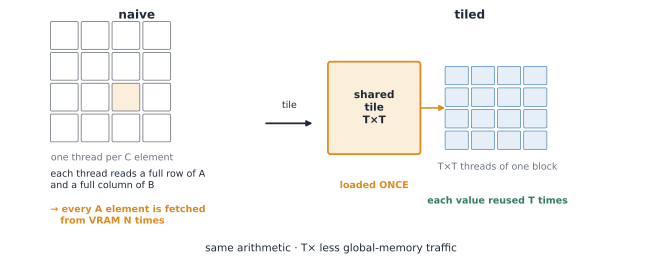
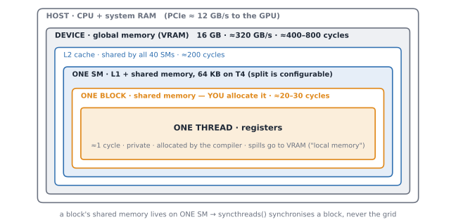
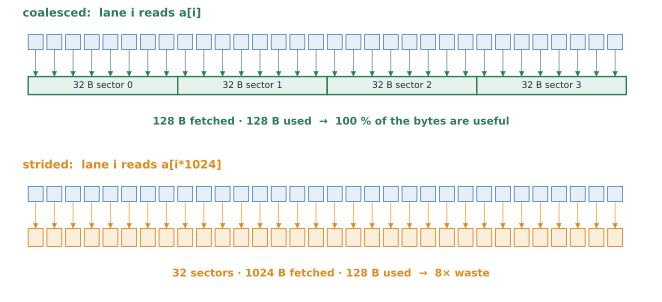
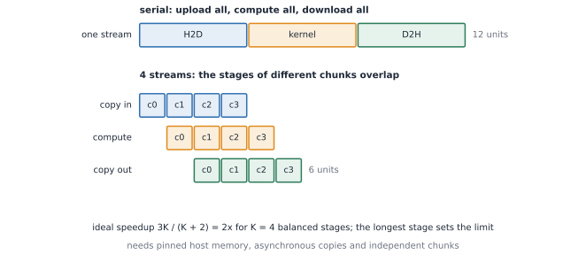

<!-- _class: lead -->
<!-- _paginate: false -->

# YZM 513 – High-Performance Programming for AI

### Week 9: The CUDA Memory Hierarchy & Profiling
### Coalescing, shared memory, tiling, reductions

**İstanbul Medeniyet Üniversitesi**
AI Engineering M.Sc. – Fall 2026

Ammar Daşkın

---

<!-- _footer: "Schedule note: original syllabus Week 8 topic, taught in Week 9." -->

## Where we are

```text
Week 1–2   one core, made fast        vectorise, Numba, BLAS
Week 3–4   one machine, many cores    threads, processes, async, pools
Week 5     many machines              Dask, Ray, cost of distribution
Week 6     one GPU, thousands of cores  architecture + CuPy
Week 7     midterm                    covers Weeks 1–6
Week 8     writing kernels            indexing, bounds, launches, transfers
Week 9     making kernels FAST        ← TODAY
Week 10    feeding the GPU            DataLoader pipelines
Week 11–12 many GPUs                  DDP, model parallelism
Week 13    deployment                 torch.compile
```

---
## The week in one sentence

> A kernel is fast when **each byte fetched from VRAM is used many times**.
>
> Tiling is how you arrange that.
> Profiling is how you prove it worked.
>
---


## Today's arc

| Part | Content |  
|---|---|
| I | Diagnosis: count the bytes |
| II | The memory hierarchy |  
| III | Coalescing |  
| IV | Shared memory + tiling | 
| V | Reductions (softmax redeemed) | 
| VI | Occupancy | 
| VII | Profiling | 
| VIII | Streams: overlap copies and compute | 
| IX | Lab + wrap |

---

<!-- _class: lead -->

# Part I
# Diagnosis: count the bytes

---

## Two numbers from Week 8

Your `vector_add` kernel:

```python
c[i] = a[i] + b[i]      # 2 reads + 1 write = 12 bytes, 1 FLOP
```

- Arithmetic intensity: **1 / 12 ≈ 0.08 FLOP/byte**
- On a T4: 320 GB/s × 0.08 ≈ **27 GFLOP/s**, out of 8,100 GFLOP/s peak.

That was not a bug. That was the memory wall.

---

## The only diagnostic you need first

$$\text{arithmetic intensity} = \frac{\text{FLOPs}}{\text{bytes moved from VRAM}}$$

T4: 8,100 GFLOP/s ÷ 320 GB/s ≈ **25 FLOP/byte** — the *ridge point*.

- Below 25 → **memory-bound**. More arithmetic units won't help.
- Above 25 → **compute-bound**. Now FLOPs matter.

---


<!-- _footer: "Course figure. Model ceilings, not measurements — you will add measured points in the lab." -->

---

## Naive matmul: what does one thread read?

```python
col, row = cuda.grid(2)
acc = 0.0
for k in range(A.shape[1]):
    acc += A[row, k] * B[k, col]     # both from VRAM, every iteration
C[row, col] = acc
```

Each output reads a whole row of A and a whole column of B.

**Every element of A is read by N different threads.**

The accesses themselves are coalesced (Part III); the problem here is **no reuse**.

---



---

## Count it (float32, no reuse)

| N | GB read | GFLOP | FLOP/byte | ms @320 GB/s | ms of arithmetic |
|---:|---:|---:|---:|---:|---:|
| 512 | 1.07 | 0.27 | 0.25 | 3.4 | 0.03 |
| 1024 | 8.59 | 2.15 | 0.25 | 26.8 | 0.27 |
| 2048 | 68.7 | 17.2 | 0.25 | 214.7 | 2.12 |

The arithmetic needs **0.27 ms**. The bytes need **26.8 ms**.

📁 `week09/01_traffic_accounting.py` — no GPU needed.

---

## Two caveats

- This is a **no-reuse model**. The L1 and L2 caches catch some of the repeated reads, so the real naive kernel can be faster than 26.8 ms.
- The *shape* of the argument is right: moving the bytes takes ~100× longer than the arithmetic, so bandwidth, not FLOPs, is the limit.


---

## The fix, in one sentence

> Load a piece of A and a piece of B into **fast on-chip memory once**,
> and let many threads reuse them.

That is **tiling**. 

---

## The four questions, refined

| Question | Week 8 | Today |
|---|---|---|
| **Split** | one thread per element | one **block per tile**, threads cooperate |
| **Assign** | block → any SM | block → one SM, **and its shared memory lives there** |
| **Move** | host ↔ VRAM | VRAM → **shared** → registers, once per tile |
| **Wait** | `cuda.synchronize()` (host) | `cuda.syncthreads()` — Week 3's barrier, in hardware |

---

## A new rung on cost ladder

```text
registers        ~1 cycle          ← the compiler manages these
shared memory    ~20–30 cycles     ← NEW: you manage this
L2               ~200 cycles
global (VRAM)    ~400–800 cycles
host RAM         PCIe, ~12 GB/s
network          ~ms               (Week 5)

approximate latencies, T4-class GPU
```

Week 5: *move computation to the data.*
Week 9: *move the data to fast memory, once, and reuse it.*

---

<!-- _class: lead -->

# Part II
# The memory hierarchy

---



---

## The spaces, by scope

| Space | Visible to | Lives as long as |
|---|---|---|
| **Registers** | one thread | the thread |
| **Local** | one thread | the thread |
| **Shared** | one block | the block |
| **Global (VRAM)** | grid + host | the allocation |
| **Constant** | grid, read-only | the allocation |

Scope is not a detail. It decides what can cooperate with what.

---

## Who manages it

| Managed by hardware | Managed by **you** |
|---|---|
| registers (compiler) | shared memory |
| L1 / L2 caches | global allocations |
| constant cache | host ↔ device transfers |

> Shared memory is a **user-managed cache**: you decide what to keep in it.
> (CUDA C++ Best Practices Guide, *Shared Memory*.)


---

## The trap: "local memory" is not fast

- Local memory is **per-thread**, but it lives in **VRAM**.
- It appears when the compiler spills registers, or when you index a
  per-thread array with a non-constant index.
- Same latency as global memory. The name misleads.

Check it: `kernel_resources()` in `gpu_utils.py` prints spill bytes per thread.

---

## Why shared memory is worth the trouble

| Path | Aggregate bandwidth on a T4 |
|---|---|
| global (VRAM) | ≈ 320 GB/s |
| shared memory | 32 banks × 4 B × 1.59 GHz × 40 SMs ≈ **8 TB/s** |

≈ **25×** faster on paper, *if* you avoid bank conflicts.

---

## Scope binds scheduling

- A block's shared memory is allocated on **one SM**.
- Therefore a block cannot migrate, and `cuda.syncthreads()` can only
  synchronise **within that block**.
- Across blocks: still no cooperation inside one launch (Week 8's contract).

Need a grid-wide boundary? **Launch a second kernel.**

---

<!-- _class: lead -->

# Part III
# Coalescing

---

## What the hardware actually fetches

- Global memory is served in **aligned 32-byte sectors** (four of them make a 128-byte cache line).
- A warp's 32 requests are merged into as few sectors as possible.
- Bytes fetched but not used are **wasted bandwidth**.

If every lane's 4-byte access needs its own 32-byte sector, only 4 of every 32 bytes
fetched are useful: **8× less effective bandwidth**.

---



---

## The arithmetic of waste

**Coalesced** — lane *i* reads `a[i]`:
32 lanes × 4 B = 128 B, in 4 sectors of 32 B. **100 % used.**

**Strided** — lane *i* reads `a[i*1024]`:
32 separate sectors × 32 B = 1024 B fetched, 128 B used. **8× waste.**

Same instructions. Same useful bytes. Eight times the traffic.

---

## Predict before we run

A 4096 × 4096 float32 matrix (64 MiB), stored row-major.

- Kernel A: each thread sums **one row**.
- Kernel B: each thread sums **one column**.

Same FLOPs. Same total bytes.

**Will they take the same time?** Write down your guess and a factor.

---

## Kernel A: one thread per row

```python
@cuda.jit
def row_sums(A, out):
    row = cuda.grid(1)
    if row < A.shape[0]:
        acc = 0.0
        for c in range(A.shape[1]):
            acc += A[row, c]        # lanes i and i+1 are N floats apart
        out[row] = acc
```

Each thread walks along *its own* row, which feels natural for a row-major matrix.
But at step `c`, consecutive lanes read `A[i, c]`, `A[i+1, c]`, ... : **N floats apart**.

---

## Kernel B: one thread per column

```python
@cuda.jit
def col_sums(A, out):
    col = cuda.grid(1)
    if col < A.shape[1]:
        acc = 0.0
        for r in range(A.shape[0]):
            acc += A[r, col]        # lanes i and i+1 are adjacent in memory
        out[col] = acc
```

At step `r`, consecutive lanes read `A[r, j]`, `A[r, j+1]`, ... : **consecutive addresses**.

The thread that *looks* less natural is the fast one.

---

## Run it

```bash
python 02_coalescing.py            # prints ms, achieved GB/s and % of peak for both kernels
```

- Both kernels are verified against NumPy's `A.sum(axis=...)` before they are timed.
- **Achieved GB/s = bytes touched ÷ time.** A measurement, not a model.
- Expect `col_sums` to sit much closer to the 320 GB/s ceiling. The 8× of the sector model
  is an upper bound: L1/L2 caches soften it, so the measured gap depends on the GPU.

📁 `week09/02_coalescing.py`

---


**The prediction:** `col_sums` (coalesced) should beat `row_sums` (strided) by a clear margin.

On a T4, `n = 4096`: **almost the same time.** Sometimes within 10 %.

**Was the model wrong?**

- The *model* describes the number of 32-byte sectors a warp requests **on a miss**.
- Whether that miss costs bandwidth depends on the **cache**.

Reads-with-reuse are the friendliest case for the memory system.
Modern GPUs are very good at the friendly case.
> Coalescing matters when the wasted bytes are never re-used. It doesn't matter when the cache will re-use them for you.

---


## The same lesson, different spelling: AoS vs SoA

```python
# Array of Structs: stride between lanes
particles[i].x        # x, y, z, x, y, z, ...

# Struct of Arrays: contiguous per field
x[i]                  # x, x, x, x, ...
```

Deep learning already prefers SoA: a tensor is one contiguous field,
not a list of records. Now you know why.

---

## The natural C layout: Array of Structs

```c
struct Particle {
    float x, y, z;            // 12 bytes
};
struct Particle particles[N];
```
```
addr:   0    4    8   12   16   20   24   28  ...
        x0   y0   z0   x1   y1   z1   x2   y2  ...
        └────particle 0────┘└────particle 1───┘
```
---

## The other layout: Struct of Arrays

```c
float x[N], y[N], z[N];
```
```
x:   x0   x1   x2   x3   x4   x5   ...    (contiguous)
y:   y0   y1   y2   y3   y4   y5   ...    (contiguous)
z:   z0   z1   z2   z3   z4   z5   ...    (contiguous)
```
One contiguous field per array. Access is `x[i], y[i], z[i]`.

> Same number of bytes. Same arithmetic. Only the layout differs.

---


## The stride between lanes

Almost every GPU kernel is *"`thread-i` handles `element-i`."*
Suppose each thread only needs the **x** field:

```c
i = cuda.grid(1)
val[i] = particles[i].x           # AoS
```
Lane `i` reads address `i × 12` bytes. **Consecutive lanes are 12 bytes apart**.

A warp (32 lanes) touches addresses `0, 12, 24, …, 372`:

| | |
|---|---:|
| useful bytes (32 × 4 B) | 128 B |
| cachelines touched | ~3 × 128 B = **384 B** |
| bytes fetched / useful | **≈ 3×** |

---

## SoA: the same warp, one cacheline

```c
val[i] = x[i]                     # SoA
```

Lane `i` reads address `i × 4` bytes. **Consecutive lanes are 4 bytes apart.**

Addresses `0, 4, 8, …, 124` → **one 128-byte cacheline.**

| | AoS `particles[i].x` | SoA `x[i]` |
|---|---:|---:|
| stride between lanes | 12 B | **4 B** |
| bytes fetched | ~384 B | **128 B** |
| useful fraction | ~33 % | **100 %** |
| verdict | strided ❌ | **coalesced** ✅ |

This is *exactly* Part III again — the lane-to-address map, nothing else.

---

## When AoS is fine

AoS is only wasteful when threads read **one field at a time**.

If every thread genuinely needs all three fields *together*:

```cuda
v = sqrt(particles[i].x * particles[i].x
       + particles[i].y * particles[i].y
       + particles[i].z * particles[i].z)     # touches every byte
```

then AoS uses every byte it fetches — **no waste.**


> SoA wins when the access pattern is **per-field**, 
>   - which is the overwhelming case in GPU kernels, DL, and physics simulations.


---
## AoS vs SoA is already in your tensors


A `(N, C, H, W)` tensor is not a list of records. It is a stack of
**contiguous per-field** planes:

```text
channel 0:  [ ... N×H×W floats, contiguous ... ]
channel 1:  [ ... N×H×W floats, contiguous ... ]
...
```

The **innermost dimension is contiguous** (`W`). Every conv / matmul / LayerNorm kernel processes one feature dimension at a time — the "read one field per lane" pattern.

A framework that stored images AoS-style (`[pixel: (r,g,b), …]`) would make every per-channel kernel strided. They do not. That is not an accident.

---

## Week 8's convention, vindicated

```python
col, row = cuda.grid(2)      # x → columns, y → rows
```

We chose `x → columns` in Week 8 for a reason we could not yet explain:
consecutive `threadIdx.x` then touch consecutive memory.

**That choice was coalescing.** Swap the roles and measure the cost.

---

## The unifying table


> **The layout of data in memory and the map of threads to that memory
> decide whether a warp's 32 lanes collapse to 1 transaction.**

| Situation | Layout | Thread → element | Result |
|---|---|---|---|
| `col_sums` | row-major matrix | lane → consecutive columns | ✅ |
| `row_sums` | row-major matrix | lane → consecutive rows (stride N) | ❌ |
| **SoA** | `x[N], y[N], z[N]` | lane → `x[i]` (stride 4 B) | ✅ |
| **AoS** | `[(x,y,z), …]` | lane → `particles[i].x` (stride 12 B) | ❌ |
| Week 8 `col, row` | row-major | `threadIdx.x` → column | ✅ |
| Week 8 `row, col` | row-major | `threadIdx.x` → row (stride N) | ❌ |

**Two levers, one bottleneck:** change the thread map (Week 8) **or** the memory layout (AoS → SoA). Real code often pulls both.

---


<!-- _class: lead -->

# Part IV
# Shared memory and tiling

---

## The idea, on paper first

One block computes a **T × T tile** of C. It walks along K in steps of T:

1. **Load** a T×T tile of A and of B into shared memory (one element per thread).
2. `cuda.syncthreads()` — the tile is complete.
3. **Compute** T multiply-adds per thread, all from shared memory.
4. `cuda.syncthreads()` — nobody overwrites the tile early.

Each loaded value is used **T times**.

---


---

## What that buys: traffic ÷ T

Global reads: $2N^3 \rightarrow \dfrac{2N^3}{T}$ &nbsp;&nbsp;·&nbsp;&nbsp; intensity: $0.25 \rightarrow \dfrac{T}{4}$

| T | GB read (N=1024) | FLOP/byte | shared / block |
|---:|---:|---:|---:|
| 1 (naive) | 8.59 | 0.25 | — |
| 8 | 1.07 | 2.0 | 0.5 KB |
| 16 | 0.54 | 4.0 | 2 KB |
| 32 | 0.27 | 8.0 | 8 KB |

---


Even T=32 is below the ridge of 25. **cuBLAS adds register blocking on top.**

---

## The two barriers are not optional

| Remove | What can happen |
|---|---|
| after **load** | a thread reads a tile element nobody has written yet |
| after **compute** | a fast thread overwrites the tile while a slow one still reads it |

This is Week 3's race condition, on silicon.

We will remove each one and look at the answer.

---

## Barrier rules (from Week 8, now load-bearing)

```python
for k0 in range(0, K, T):
    sA[ty, tx] = ...; sB[ty, tx] = ...
    cuda.syncthreads()               # every thread reaches this
    for k in range(T): ...
    cuda.syncthreads()               # and this
```

- **Every** thread in the block must reach the barrier.
- Never put it inside `if i < n:` or inside a divergent branch.
- It synchronises a **block**, never the grid.

---

## Numba: declaring shared memory

```python
from numba import cuda, float32

@cuda.jit
def kernel(A, B, C):
    sA = cuda.shared.array(shape=(16, 16), dtype=float32)
    sB = cuda.shared.array(shape=(16, 16), dtype=float32)
```

- Allocated per **block**, on chip, uninitialized.
- `shape` must be a **compile-time constant** (see the Numba CUDA memory docs).
- `cuda.local.array(...)` is the per-thread version; it lives in *local memory*, which is backed by VRAM.

---

## Consequence: to sweep T, use a factory

```python
def make_tiled(T):                      # T becomes a compile-time constant
    @cuda.jit
    def kernel(A, B, C):
        sA = cuda.shared.array(shape=(T, T), dtype=float32)
        ...
    return kernel

k16 = make_tiled(16)                    # two distinct compiled kernels
k32 = make_tiled(32)
```

You cannot pass the tile size as a runtime argument. This is the first thing you will hit.

---

## The kernel, part 1: who am I, and load

```python
def make_tiled(T):
    @cuda.jit
    def kernel(A, B, C):
        sA = cuda.shared.array(shape=(T, T), dtype=float32)
        sB = cuda.shared.array(shape=(T, T), dtype=float32)
        tx, ty = cuda.threadIdx.x, cuda.threadIdx.y
        bx, by = cuda.blockIdx.x, cuda.blockIdx.y
        row, col = by * T + ty, bx * T + tx
        acc = 0.0                                  # a register, per thread
        for k0 in range(0, A.shape[1], T):
            sA[ty, tx] = A[row, k0 + tx]           # one element per thread
            sB[ty, tx] = B[k0 + ty, col]
            cuda.syncthreads()                     # (1)
```

---

## The kernel, part 2: compute and store

```python
            for k in range(T):
                acc += sA[ty, k] * sB[k, tx]       # T reuses, all on chip
            cuda.syncthreads()                     # (2)
        C[row, col] = acc
    return kernel
```

Launch (N a multiple of T, so no bounds checks yet):

```python
k = make_tiled(16)
k[(N // 16, N // 16), (16, 16)](dA, dB, dC)
cuda.synchronize()
assert np.allclose(dC.copy_to_host(), A @ B, atol=1e-2)
```

📁 `week09/04_matmul_tiled.py` (it also takes a `drop_barrier` option, used in the race demo below)

---

## Predict, then run

At N = 1024 the naive kernel must read 8.6 GB: at least **27 ms** at 320 GB/s (Part I).

Tiling with T = 16 cuts global traffic by **16×**.

- Will the kernel be 16× faster?
- What else could limit it now?

Write a number down. Then run it.

---

## Run it

```bash
python 03_matmul_naive.py          # naive kernel, N = 1024
python 04_matmul_tiled.py          # tiled T = 16, then the same N with cuBLAS via CuPy
python 05_tile_sweep.py            # naive, T = 8, 16, 32 and cuBLAS for N = 512, 1024, 2048
```

Each line reports ms, GFLOP/s and the max error against `A @ B`.

Your tiled kernel will **not** beat cuBLAS. It should beat your naive kernel
by a clear margin. That is the win.

📁 `week09/03_matmul_naive.py`, `week09/05_tile_sweep.py`

---

## Now remove a barrier

```bash
python 04_matmul_tiled.py --race
```

The script runs each broken variant three times and prints the max error:

- drop the barrier **after the load**: threads may read tile elements nobody has written yet;
- drop the barrier **after the compute**: a fast thread may overwrite the tile while a slow one still reads it.

The error can differ from run to run, and sometimes it is **zero**.
A race is not a crash: it is a *nondeterministic* answer. That is what makes it dangerous.

---

## Shared memory is banked

- 32 **banks**, 4 bytes wide, accessible in parallel.
- *n* addresses in *n* distinct banks → served together.
- Two addresses in the same bank → **serialized**: an *n*-way bank conflict.
- Exception: all lanes reading the **same address** → one **broadcast**, no conflict.

---


---

## Banks of a 2D shared array

Shared memory is **32 banks × 4 bytes**. Word `w` lives in bank `w mod 32`.
The hardware serves **one word per bank per cycle**.

For a row-major `tile[R][C]`:

$$\text{bank}(tile[r][c]) = (r \cdot C + c) \bmod 32$$

The **row stride is the column count `C`**. That one number decides
whether the row index helps or vanishes:

| `C` | `C mod 32` | row index contributes? |
|---:|---:|---|
| 32 | 0 | **no** — bank = `c mod 32` |
| 33 | 1 | yes — every row shifts the banks by 1 |
| 34 | 2 | partly — only 16 distinct banks for 32 rows |
| 31 | 31 | yes, and coprime → sweeps all 32 |

---

## The three cases

A warp is 32 lanes. What they touch decides the cost:

| Pattern across the warp | Cost |
|---|---|
| 32 lanes → **32 distinct banks**, different words | **1** transaction ✅ |
| 32 lanes → **the same word** | **1** transaction (broadcast) ✅ |
| *n* lanes → **the same bank**, *n* different words | **n** serialized transactions ❌ |

Two of these are free. Only the third is a **bank conflict**.

Note the middle case: reading the *same address* from every lane is a
broadcast, not a conflict. That is what saves the matmul kernel.

---
## Important: our matmul does *not* conflict

In the inner loop, take a warp with `tx = 0..31` (T = 32, so one value of `ty`):

| access | addresses across the warp | result |
|---|---|---|
| `sA[ty, k]` | all the **same** address | **broadcast**, 1 request |
| `sB[k, tx]` | bank = `tx`, all distinct | conflict-free |

With T = 16 a warp spans two rows of the tile: two addresses 16 words apart, in different banks. Still no conflict.

The 32-way conflict belongs to the **transpose** pattern `tile[tx, ty]`.
Let's demonstrate it there.

---

## The transpose: which access is the problem

Block is `(T, T) = (32, 32)` = 1024 threads. Global reads and writes
are both coalesced. The shared-memory access is where it hurts.

```python
T = 32
@cuda.jit
def kernel(A, out):
    tile = cuda.shared.array(shape=(T, T), dtype=float32)
    tx, ty = cuda.threadIdx.x, cuda.threadIdx.y
    tile[ty, tx] = A[blockIdx.y*T + ty, blockIdx.x*T + tx]   # write
    cuda.syncthreads()
    out[blockIdx.x*T + ty, blockIdx.y*T + tx] = tile[tx, ty]  # READ ← strided
```

Two shared-memory accesses. They behave differently:

| access | across a warp (fixed `ty`, `tx` = 0…31) |
|---|---|
| **write** `tile[ty][tx]` | `tx` is the **column** index → sweeps banks, conflict-free |
| **read** `tile[tx][ty]` | `tx` is the **row** index → multiplies the stride |


---

## Warp layout: consecutive `tx`, one `ty`

A warp is 32 **consecutive linear thread ids**. With `blockDim = (32, 32)`:

$$\text{tid} = ty \cdot 32 + tx$$

So a warp is **32 consecutive `tx`, all with the same `ty`** (warp `w` ⇔ `ty = w`).

That is the layout of the transpose read:

```text
lane:  0    1    2    3   …   31
tx:    0    1    2    3   …   31
ty:    w    w    w    w   …    w      (same for all lanes)
reads: tile[0][w], tile[1][w], tile[2][w], …, tile[31][w]
```

**Column `w` of the tile.** Every lane touches a different **row**, same **column**.
That is the strided pattern — and shared memory charges for it, unlike VRAM.

---

## Unpadded (32): the `tx` term vanishes

`width = 32`. The read is `tile[tx][ty]`, word index `tx·32 + ty`:

$$\text{bank} = (tx \cdot 32 + ty) \bmod 32 = \underbrace{(tx \cdot 32) \bmod 32}_{=\,0} + ty = ty$$

The `tx` dependence **cancels** — every lane in the warp computes the same bank.

| lane `tx` | reads | word index | bank |
|---:|---|---:|---:|
| 0 | `tile[0][ty]` | `0·32 + ty` | `ty` |
| 1 | `tile[1][ty]` | `1·32 + ty` | `ty` |
| 2 | `tile[2][ty]` | `2·32 + ty` | `ty` |
| … | … | … | `ty` |
| 31 | `tile[31][ty]` | `31·32 + ty` | `ty` |

**1 distinct bank for 32 lanes, and all different words → 32-way conflict → 32 serialized cycles** for one transaction.

---

## Padded (33): the `tx` term returns

`width = 33`. Word index `tx·33 + ty`:

$$\text{bank} = (tx \cdot 33 + ty) \bmod 32 = \big(tx \cdot \underbrace{(33 \bmod 32)}_{=\,1} + ty\big) \bmod 32 = (tx + ty) \bmod 32$$

`tx` now contributes **linearly**, and `tx ↦ (tx + ty) mod 32` is a **rotation** of `Z₃₂` — a bijection. With `ty = 0`:

| lane `tx` | word index | bank |
|---:|---:|---:|
| 0 | `0` | `0` |
| 1 | `33` | `1` |
| 2 | `66` | `2` |
| … | … | … |
| 31 | `1023` | `31` |

**32 distinct banks → 1 transaction.** The rotation by `ty` is irrelevant; bijection is all that matters. (The **write** `tile[ty][tx]` was already conflict-free in both versions — see the table on the "which access" slide.)

---

## Why 33 — and why 32 is the unlucky number

The requirement is just: **`width` coprime to 32**, i.e. `width` odd.
- Then `tx ↦ tx·width mod 32` is a bijection on `Z₃₂`.

`width = 32` is the **worst** case because `32 ≡ 0 (mod 32)`:
- the row index **disappears** from the bank formula, so a column-strided
access (all lanes in one column) collapses to a single bank.

`width = 33` is the **smallest** odd stride, so it wastes the least shared memory:

| version | bank of lane `tx` | distinct banks | shared/block |
|---|---|---:|---:|
| `(T, T)`, T=32 | `(tx·32 + ty) % 32 = ty` | **1** | 4.00 KB |
| `(T, T+1)` = 33 | `(tx·33 + ty) % 32` | **32** | 4.12 KB |

**128 extra bytes** (one float × 32 rows) remove a **32-way serialization**
on the hot access. That is the trade.

📁 `week09/06_bank_conflicts.py` — both versions verified against `A.T`.

---

## One rule, one sentence

> **A warp is free when its lanes land in distinct banks (different words)
> or on the same word (broadcast).**
>
> **A row-major 2D array with a multiple-of-32 row stride makes the row
> index vanish from the bank formula — so a column-strided access
> collapses to one bank.**
>
> **Pad the stride to the next odd number.**

That single change — 32 → 33 — turns a 32-cycle serialization into 1 cycle
for 3 % more shared memory. 
The tiled matmul,the block reduction, the softmax are already bank-friendly; the transpose is the one kernel where the natural index order fights the bank layout.

---

## Three-way summary

| version | traffic | why it is where it is |
|---|---|---|
| naive | 2N³ reads | no reuse: bandwidth-bound at 0.25 FLOP/byte |
| tiled T=32 | 2N³/32 | reuse in shared memory: 8 FLOP/byte |
| cuBLAS | lower still | larger tiles + register blocking + per-architecture tuning |

Use the library for matmul. Write kernels for what the library does not have.

---

<!-- _class: lead -->

# Part V
# Reductions: softmax redeemed

---

## What was wrong with Week 8's softmax

```python
# Week 8, deliberately naive: EVERY thread did this
for j in range(n): row_max = max(row_max, logits[row, j])
for j in range(n): row_sum += exp(logits[row, j] - row_max)
```

Correct, but each of the *n* threads recomputed the whole row: **n× redundant work**.

The row max and row sum are **reductions**. Threads must cooperate.

---

## Tree reduction: same work, shorter chain

| | work | span (critical path) |
|---|---|---|
| one thread sums N | N−1 adds | N−1 |
| tree over N lanes | N−1 adds | **log₂N** |

Week 8's work-and-span slide, now implemented.

Requires an **associative** operator. Floating-point sums may differ in the
last digits when the order changes — that is expected, not a bug.

---


---

## Code: block sum in shared memory

```python
s = cuda.shared.array(shape=TPB, dtype=float32)
tid = cuda.threadIdx.x
i = cuda.grid(1)
s[tid] = x[i] if i < x.size else 0.0      # pad the tail with the identity
cuda.syncthreads()
stride = TPB // 2
while stride > 0:
    if tid < stride:
        s[tid] += s[tid + stride]
    cuda.syncthreads()                    # OUTSIDE the if
    stride //= 2
# s[0] holds this block's total
```

---

## Two details that matter

**1. `tid < stride`, not `tid % (2*stride) == 0`.**
Contiguous active lanes → whole warps go idle instead of diverging.
Same answer, better warp efficiency.

**2. The barrier is outside the `if`.**
Every thread must arrive, including the ones doing nothing this round.
Putting it inside the `if` is the classic deadlock/undefined-behaviour bug.

---

## Across blocks: two options

| option | how | cost |
|---|---|---|
| **atomic** | `cuda.atomic.add(total, 0, s[0])` once per block | serializes on one address |
| **second kernel** | write partials, launch a reduce kernel | an extra launch + a grid boundary |

Never one atomic **per thread**: that is Week 3's `sum += 1` race, "fixed"
by making every thread queue on one lock.

---

## One atomic per block vs one per thread

| version | atomics issued (n = 2²⁴) |
|---|---:|
| shared tree + 1 atomic per block (256 threads) | 65,536 |
| atomic per thread | 16,777,216 |

```bash
python 07_block_reduce.py          # ms, GB/s, result and error against a float64 sum, for both
```

📁 `week09/07_block_reduce.py`

Both results are "correct", and their last digits differ. Explain why.

---

## Softmax: three passes over shared memory

```text
one block per row, TPB threads (TPB ≥ n_cols, power of two)

pass 1   load row → shared, tree-reduce MAX      → row_max
pass 2   e = exp(val − row_max) → shared, tree-reduce SUM → row_sum
pass 3   out = e / row_sum
```

Padding lanes contribute `-1e30` to the max and `0.0` to the sum.

---

## Code: pass 1 (max)

```python
val = logits[row, tid] if tid < n else -1e30
s[tid] = val
cuda.syncthreads()
stride = TPB // 2
while stride > 0:
    if tid < stride:
        s[tid] = max(s[tid], s[tid + stride])
    cuda.syncthreads()
    stride //= 2
row_max = s[0]                 # every thread reads it...
cuda.syncthreads()             # ...before anyone overwrites s
```

That extra barrier is easy to forget. Without it, pass 2 races pass 1.

---

## Code: passes 2 and 3

```python
e = math.exp(val - row_max) if tid < n else 0.0
s[tid] = e
cuda.syncthreads()
stride = TPB // 2
while stride > 0:
    if tid < stride:
        s[tid] += s[tid + stride]
    cuda.syncthreads()
    stride //= 2
row_sum = s[0]
cuda.syncthreads()
if tid < n:
    out[row, tid] = e / row_sum     # e kept in a register: no re-read
```

📁 `week09/08_softmax_shared.py` — verified against `scipy.special.softmax`.

---

## Run it

| rows × cols | TPB | what it tests |
|---|---|---|
| 4096 × 64 | 64 | one thread per column |
| 4096 × 512 | 512 | a full-size block per row |
| 1024 × 37 | 64 | the padding path: 37 columns, 64 threads |

The script checks every case against `scipy.special.softmax` and prints ms, max error
and the mean row sum (it must be 1.000000).

Still slower than cuDNN for wide rows: that needs warp shuffles and more tiling.

---

## Optional: the last 32 lanes need no shared memory

```python
# Numba exposes the warp shuffle:
#   cuda.shfl_down_sync(membermask, value, delta)
val += cuda.shfl_down_sync(0xffffffff, val, 16)
val += cuda.shfl_down_sync(0xffffffff, val, 8)   # ... 4, 2, 1
```

Within a warp, lanes exchange **registers** — no shared memory, no barrier.
Name it, recognise it in papers; implement it as a bonus exercise.

---

<!-- _class: lead -->

# Part VI
# Occupancy

---

## Definition

$$\text{occupancy} = \frac{\text{resident warps per SM}}{\text{maximum warps per SM}}$$

Why it matters: the SM hides memory latency by switching to another
**ready warp**. Few resident warps → nothing to switch to → stalls.

It is a *latency-hiding proxy*, not a performance target.

---

## T4 (sm_75) limits

| resource | per SM |
|---|---:|
| threads | 1,024 |
| warps | 32 |
| blocks | 16 |
| shared memory | 64 KB |
| 32-bit registers | 65,536 |

Read them live: `gpu_utils.device_report()`.

---

## Worked calculation: our own kernels

| kernel | threads/block | shared/block | limiting resource | blocks/SM | occupancy |
|---|---:|---:|---|---:|---:|
| tiled T=8 | 64 | 0.5 KB | blocks (16) | 16 | 100 % |
| tiled T=16 | 256 | 2 KB | threads | 4 | 100 % |
| tiled T=32 | 1024 | 8 KB | threads | 1 | 100 % |

(Assuming at most 64 registers per thread.) All three can reach 100 %, **and their runtimes still differ.**

---


---

## Registers usually bite first

- 256 threads × 96 registers = 24,576 → only **2** blocks fit in 65,536 → 50 %.
- Check the register count instead of guessing.

See it:

```python
from gpu_utils import kernel_resources
kernel_resources(k)        # regs/thread and spill bytes, per compiled signature
```

Spills (`local` bytes > 0) mean VRAM traffic you did not ask for.

---

## Occupancy is not the goal

- Volkov's classic result: **more work per thread** (instruction-level
  parallelism) can win at *lower* occupancy.
- Bigger tiles → less traffic, but fewer independent instructions per thread.
- Our T=8/16/32 sweep is exactly this experiment.

**Recipe:** sweep the tile size {8, 16, 32} (the block is T × T threads);
for a 1D kernel, sweep the block size {64, 128, 256, 512, 1024}.
Keep the fastest one that is **correct**.

---

<!-- _class: lead -->

# Part VII
# Profiling

---

## Two tools, two different questions

| tool | question | scope |
|---|---|---|
| **Nsight Systems** (`nsys`) | where is the time going *overall*? | timeline: transfers, launches, gaps |
| **Nsight Compute** (`ncu`) | why is *this kernel* slow? | per-kernel counters |

Start with the timeline. A kernel that is 5 % of the runtime is not your problem.

---

## The first four metrics to read

| metric | tells you |
|---|---|
| DRAM throughput (% of peak) | are you bandwidth-bound? |
| compute throughput (% of peak) | are you compute-bound? |
| achieved occupancy | can the SM hide latency? |
| warp stall reasons | *what* is it waiting for? |

Everything else is detail until these four say something.

---

## Colab reality check

- `ncu` is often **not installed** on Colab.
- Even installed, counters are frequently blocked:
  `==ERROR== ERR_NVGPUCTRPERM` — the user lacks permission for GPU performance counters.
- `nvprof` is **deprecated** and replaced by the Nsight tools; do not build on it.

So: try the tool, then fall back. The fallback is real profiling.

---

## Try it 

```bash
which ncu                      # is Nsight Compute there at all?
ncu --set basic --launch-count 1 --target-processes all python 03_matmul_naive.py
```

Nsight Compute ships with the CUDA Toolkit; on Colab it is usually missing.

📁 `week09/09_profile_and_measure.py` tries `ncu`, detects `ERR_NVGPUCTRPERM`,
and falls back to measurement automatically.

---

## The fallback that always works

$$\text{achieved GB/s} = \frac{\text{bytes moved}}{\text{time}} \qquad
\text{achieved GFLOP/s} = \frac{2N^3}{\text{time}}$$

Compare with 320 GB/s and 8,100 GFLOP/s. Whichever ceiling you are near
**is your bottleneck** — and you can state it with a number.

Plus: sweep a parameter and watch the time. That is an experiment.

---

## Timing a kernel correctly

```python
start, end = cuda.event(), cuda.event()   # events record timing by default
start.record(); fn(); end.record()
end.synchronize()                         # launches are asynchronous: wait for `end`
ms = start.elapsed_time(end)              # same as cuda.event_elapsed_time(start, end)
```

- Warm up the JIT first: the first launch includes compilation.
- Report the **median** of at least 5 runs, not one sample.
- `time_ms(fn)` in `gpu_utils.py` does all of this.

---

## `torch.profiler`: the Week 10 preview

```python
from torch.profiler import profile, ProfilerActivity
with profile(activities=[ProfilerActivity.CPU, ProfilerActivity.CUDA]) as prof:
    for _ in range(10):
        a @ b
    torch.cuda.synchronize()
print(prof.key_averages().table(sort_by="cuda_time_total", row_limit=6))
prof.export_chrome_trace("week09_torch_trace.json")
```

Open the JSON in `chrome://tracing` or `ui.perfetto.dev`.
**Gaps between kernels = the GPU is idle.** Week 10 is about closing them.

---

<!-- _class: lead -->

# Part VIII
# Streams: overlapping copies and compute

---

## The GPU waits during copies

So far every program did the same three things, one after another:

```text
upload  →  kernel  →  download
```

- During the **copy**, the SMs are idle. During the **kernel**, the copy engines are idle.
- PCIe is ~12 GB/s (Week 6): for a light kernel, the copies can cost more than the compute.

Idea: **split the data into chunks and pipeline them**, like a factory line.

---



---

## What is a stream?

A **stream** is a queue of GPU work: copies and kernel launches.

- Operations in **one** stream run **in order**.
- Operations in **different** streams **may** overlap. Nothing forces them to.
- Everything you have launched so far went into the **default stream**.

```python
s = cuda.stream()                         # create a queue
d_in = cuda.to_device(h_chunk, stream=s)  # async upload into s
kernel[blocks, tpb, s](d_in, d_out)       # launch into s (third entry of the launch config)
d_out.copy_to_host(h_out_chunk, stream=s) # async download into s
s.synchronize()                           # wait for this stream; cuda.synchronize() waits for all
```

---

## The four questions, once more

| Question | With streams |
|---|---|
| **Split** | the array into K independent chunks |
| **Assign** | each chunk to its own stream |
| **Move** | async copies, in and out, queued in that stream |
| **Wait** | `cuda.synchronize()` once, after every chunk is queued |

Week 5's lesson again: *overlap communication with computation.*

---

## Three requirements for overlap

1. **Pinned (page-locked) host memory.** `cuda.pinned_array(n, dtype)` or `with cuda.pinned(a, b):`.
   Copies from ordinary pageable memory are staged and cannot overlap.
2. **Asynchronous copies in a stream** (`stream=s`). A plain `to_device` waits.
3. **Independent chunks.** Chunk *k*'s result must not be needed by chunk *k+1*.

Also: the kernel needs enough work. A kernel that is 1 % of the time leaves nothing to hide.

Pinned memory is a scarce resource; pin what you stream, not everything.

---

## Code: one stream per chunk

```python
h_in  = cuda.pinned_array(n, dtype=np.float32)   # page-locked
h_out = cuda.pinned_array(n, dtype=np.float32)
streams = [cuda.stream() for _ in range(K)]
chunk = n // K

for k, s in enumerate(streams):
    lo, hi = k * chunk, (k + 1) * chunk
    d_in  = cuda.to_device(h_in[lo:hi], stream=s)
    d_out = cuda.device_array(chunk, dtype=np.float32, stream=s)
    heavy[blocks, TPB, s](d_in, d_out, iters)
    d_out.copy_to_host(h_out[lo:hi], stream=s)
cuda.synchronize()                               # all streams
```

📁 `week09/10_streams_overlap.py`

---

## Run it

```bash
python 10_streams_overlap.py                  # serial vs 4 streams, verified against NumPy
python 10_streams_overlap.py --chunks 8       # more chunks: more overlap, more launch overhead
python 10_streams_overlap.py --iters 1        # a light kernel: nothing to hide
```

- With K balanced stages the ideal speedup is **3K / (K + 2)**: 2× for K = 4. The longest stage sets the limit.
- Predict first: what happens at `--iters 1`? At `--chunks 1`?
- A timeline (`nsys`, Part VII) shows copies and kernels side by side.
- **Returns as:** `pin_memory=True` + `non_blocking=True` (Week 10); DDP overlap (Weeks 11–12).

---

<!-- _class: lead -->

# Part IX
# Lab and wrap-up

---

<!-- _footer: "Lab notebook: week09/lab_week09_memory_hierarchy.ipynb" -->

## Lab: six experiments, one story

| # | task | file |
|---|---|---|
| 1 | thread-per-row vs thread-per-column sums, 4096² — achieved GB/s | `02_coalescing.py` |
| 2 | naive → tiled, T ∈ {8, 16, 32}, N ∈ {512, 1024, 2048} | `03`, `04`, `05` |
| 3 | remove each barrier, 3 runs each | `04 --race` |
| 4 | transpose: padded vs unpadded | `06_bank_conflicts.py` |
| 5 | block reduce → shared softmax; profile or measure | `07`, `08`, `09` |
| 6 | serial vs streams; chunks and kernel length | `10_streams_overlap.py` |

**Deliverable:** the results tables in the notebook, plus one paragraph per experiment.

---

## Answer sheet

1. **Bytes:** how many bytes did your kernel move from VRAM? Show the arithmetic.
2. **Intensity:** FLOPs ÷ bytes. Where does it sit on the roofline?
3. **What changed:** did tiling reduce *traffic*, raise *occupancy*, or both?
4. **Correctness:** which barrier can you remove safely? Justify it with your three runs from experiment 3.

Report the sentence: *"my kernel is ______-bound, because ______ GB/s
out of 320, and ______ GFLOP/s out of 8,100."*

---

## Forward map

| today | where it reappears |
|---|---|
| shared-memory tiling | FlashAttention-style tiling of attention (reading list) |
| coalescing | tensor layout, `.contiguous()`, channels-last in PyTorch |
| block reduction | softmax / layernorm kernels inside PyTorch |
| occupancy | batch-size and kernel tuning (Weeks 10–13) |
| achieved GB/s | LLM inference: tokens/s tracks memory bandwidth (Week 13) |
| profiler timelines | GPU idle time → DataLoader (Week 10) |
| streams, pinned memory | `non_blocking` copies and `pin_memory` (Week 10); DDP overlap (Weeks 11–12) |

---

## Takeaways: correctness first

1. **Shared memory is a user-managed cache.** You decide what to keep.
2. **Two barriers per tile**, both reached by every thread in the block.
3. A race gives a *nondeterministic* answer, not a crash. Verify against NumPy.
4. `cuda.shared.array` needs a constant shape → factory to sweep tile sizes.
5. Reductions: `tid < stride`, barrier outside the `if`, pad with the identity.

---

## Takeaways: then performance

1. **Count bytes before you optimise.** Intensity tells you which ceiling.
2. **Coalescing:** consecutive lanes → consecutive addresses (in a row-major matrix, one thread per *column*). 8× at stake.
3. **Tiling** divides global traffic by T and multiplies intensity by T.
4. **Bank conflicts** are about *stride*, not about using shared memory.
   Same address across a warp is a broadcast, not a conflict.
5. **Occupancy is a proxy**, not a goal. Sweep and measure.
6. Time with CUDA events: warm up, then take the median of ≥ 5 runs.
7. **Streams** overlap copies with compute, but only with pinned memory, async copies and independent chunks.

---

## Before Next Week

- **Finish the lab** (`lab_week09_memory_hierarchy.ipynb`) with your results tables and one paragraph per experiment.
- **Re-run** `04_matmul_tiled.py --race` a few more times. How often does a broken kernel look correct?
- **Read:** NVIDIA CUDA C++ Best Practices Guide, *Memory Optimizations*.
- **Think ahead:** a profiler timeline shows gaps between kernels. What could make a GPU wait for its *input*? Streams hide copies; Week 10 is about the CPU side of the same problem.

---

## References

- NVIDIA, *CUDA C++ Programming Guide* and *Best Practices Guide*: memory hierarchy, coalescing, shared memory, bank conflicts, effective bandwidth.
- Mark Harris, *Using Shared Memory in CUDA C/C++* and *An Efficient Matrix Transpose in CUDA C/C++*, NVIDIA Technical Blog, 2013.
- V. Volkov, *Better Performance at Lower Occupancy*, GTC 2010.
- [Numba CUDA: Memory](https://nvidia.github.io/numba-cuda/user/memory.html) · [Writing Kernels](https://nvidia.github.io/numba-cuda/user/kernels.html) · [Course repository](https://github.com/adaskin/hpc-for-ai-course)

Figures `img/w09-*.svg` are drawn by `week09/make_figures.py`; see `img/CREDITS.md`.

---

<!-- _class: lead -->
<!-- _paginate: false -->

# Thank You

### Next week: feeding the GPU — DataLoader pipelines (Week 10)

*YZM 513 – İstanbul Medeniyet Üniversitesi – Fall 2026*
