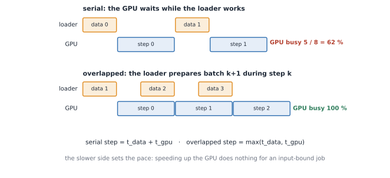
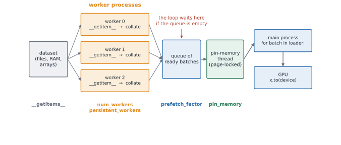
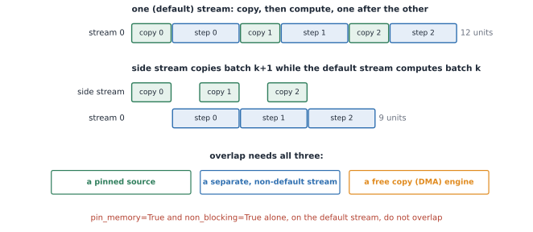
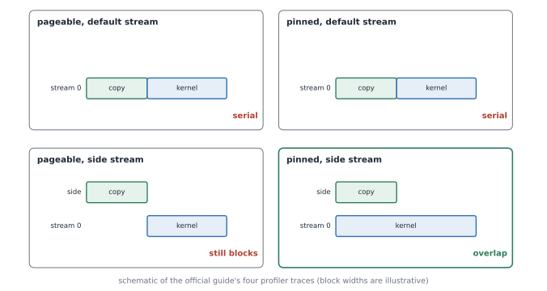
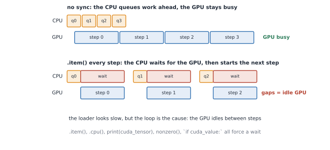

<!-- _class: lead -->
<!-- _paginate: false -->

# YZM 513 – High-Performance Programming for AI

### Week 10: Feeding the GPU 🚰
### DataLoader pipelines · pinned memory · measuring the wait

**İstanbul Medeniyet Üniversitesi**
AI Engineering M.Sc. – Fall 2026

Ammar Daşkın

---

## 🗺️ Where we are

```text
Week 1–2    one core, made fast           vectorise, Numba, BLAS
Week 3–4    one machine, many cores       threads, processes, async, pools
Week 5      many machines                 Dask, Ray, cost of distribution
Week 6      one GPU, thousands of cores   architecture + CuPy
Week 7      midterm
Week 8      writing kernels               indexing, bounds, launches, transfers
Week 9      making kernels FAST           memory hierarchy, tiling, profiling
Week 10     feeding the GPU               DataLoader pipelines     ← TODAY
Week 11–12  many GPUs                     DDP, model parallelism
Week 13     deployment                    torch.compile
```

> 🚰 A GPU that waits for its input is a GPU you paid for and did not use.

---

## 🔁 Last week 

| Last week | Today |
|---|---|
| 📏 **Count the bytes:** a kernel is fast when each byte from VRAM is used many times | bytes also cross the slower PCIe link (~12 GB/s) |
| 🧱 **Neighbours together:** coalescing and tiling, one big aligned fetch beats many scattered ones | one batched call beats many per-sample calls |
| 🌊 **Overlap:** streams and pinned memory hide copies behind compute | the same trick, for the input batch |
| 📈 **The timeline:** gaps between kernels mean an **idle GPU** | why are there gaps, and how do we close them? |

---

## Memory read review
### Global memory (VRAM): 32 lanes → 32-byte sectors → 128-byte cache line
**✅ Coalesced: lanes read consecutive floats**
```
Lane:      0      1      2      3    ...   31
Address:   0      4      8     12    ...  124    (byte offsets, 4 B each)
           │      │      │      │           │
           ▼      ▼      ▼      ▼           ▼
        ┌──────────────────────────────────────┐
        │         ONE 128-byte cache line       │
        ├────────┬────────┬────────┬───────────┤
        │sector 0│sector 1│sector 2│ sector 3  │
        │ 32 B   │ 32 B   │ 32 B   │  32 B     │
        │bytes   │bytes   │bytes   │  bytes    │
        │ 0–31   │32–63   │64–95   │ 96–127    │
        └────────┴────────┴────────┴───────────┘
        4 sectors × 32 B = 128 B fetched
        128 B useful                     → 1 transaction  ✅

```
---

**❌ Strided: lanes read floats far apart**
```
Lane:      0       1       2     ...    31
Address:   0    1024    2048    ...   (each 4 KB apart)

           ▼       ▼       ▼              ▼
        ┌───────┬───────┬───────┬─────┬───────┐
        │sect 0 │sect 1 │sect 2 │ ... │sect 31│  ← 32 different sectors
        │4 B used│4 B used│4 B used│   │4 B used│
        └───────┴───────┴───────┴─────┴───────┘
        32 sectors × 32 B = 1024 B fetched
        128 B useful                     → 8× waste  ❌
```
Rule: consecutive lanes → consecutive bytes. Otherwise you pay for sectors you don't use.

---

### Shared memory (SRAM): 32 lanes → 32 banks → 4 bytes per bank per cycle
Shared memory is a wall of 32 banks, each 4 bytes wide, each serving one word per cycle.
```
        Bank:   0     1     2     3    ...   31
              ┌─────┬─────┬─────┬─────┬─────┬─────┐
   word 0  →  │ [0] │ [1] │ [2] │ [3] │ ... │[31] │
   word 1  →  │[32] │[33] │[34] │[35] │ ... │[63] │
   word 2  →  │[64] │[65] │[66] │[67] │ ... │[95] │
              └─────┴─────┴─────┴─────┴─────┴─────┘
               4 B   4 B   4 B   4 B         4 B
              word w lives in bank (w mod 32)
```
---

**✅ 32 lanes → 32 distinct banks (1 cycle)**
```
Lane:   0    1    2    3   ...  31
Word:  [0]  [1]  [2]  [3]  ... [31]
Bank:   0    1    2    3   ...  31      ← every lane a different bank
                                          → 1 cycle  ✅
```

---

**✅ All 32 lanes read the same word → broadcast (1 cycle)**
```
Lane:   0    1    2    3   ...  31
Word:  [5]  [5]  [5]  [5]  ... [5]
Bank:   0    0    0    0   ...   0      ← all hit bank 0, SAME word
                                          → broadcast, 1 cycle  ✅
```
---

**❌ 32 lanes → same bank, different words (32 cycles)**

```
Lane:   0     1     2     3   ...  31
Word:  [5]  [37]  [69] [101] ... [5+32·31]
Bank:   0     0     0     0   ...   0   ← all hit bank 0, DIFFERENT words
                                          → serialized: 32 cycles  ❌
```
Rule: different banks → free. Same bank + same word → free (broadcast). Same bank + different words → pay one cycle per lane.

---

```
GLOBAL                              SHARED
──────                              ──────
unit  = 32-byte sector              unit  = 4-byte bank word (×32 banks)
free  = lanes → consecutive bytes   free  = lanes → distinct banks
                                    free  = all lanes → same word (broadcast)
bad   = lanes → far apart (1 sector bad   = lanes → same bank, different words
        per lane, 8× waste)                 (N-way serialized)
fix   = thread map / AoS → SoA      fix   = pad stride 32 → 33
```
---

## 🧠 PyTorch in one slide (if you are new to it)

```python
loader = DataLoader(dataset, batch_size=32)
model = nn.Linear(224, 10).to("cuda")

for x, y in loader:            # one pass = one epoch
    x, y = x.to("cuda"), y.to("cuda")
    loss = loss_fn(model(x), y)  # forward
    loss.backward()              # gradients
    optimizer.step()             # update weights
    optimizer.zero_grad()
```

**sample**: one example

**batch**: a group of samples

**step**: one loop pass, one batch

**epoch**: every sample once

The GPU cannot start a step until **its batch has arrived**.

---

<!-- _class: lead -->

# ⏱️ The idle GPU

---



> "Schematic: block widths are illustrative (30 ms of data work, 50 ms of GPU work)." 

---

## Cost model: who sets the pace?

| | step time | GPU busy |
|---|---:|---:|
| **serial** (load, then compute) | 30 + 50 = **80 ms** | 62 % |
| **overlapped** (load while computing) | max(30, 50) = **50 ms** | 100 % |

If the loader needs **more** than the GPU (say 80 ms vs 50 ms), the job is **input-bound**: a faster GPU changes nothing.

🎯 Two jobs for today:
- **Overlap** loading with compute
- **Shrink** the loading work itself

> "Try it: python week10/01_cost_model.py --t-data 80 --t-gpu 50" 

---

## 🧰 Anatomy of a DataLoader



- Workers are **processes** (Weeks 3–4: the GIL) building batches in parallel
- The main loop only **takes** ready batches, so it waits when the queue is empty

---

<!-- _class: lead -->

# 🪜 The optimisation ladder

### One change at a time, following PyTorch's official tutorial

---

## 🧪 Our test bench

Modelled on the official tutorial *Data Loading Optimization in PyTorch*: **512 samples, batch 32, a 5 ms fixed cost per call** (opening a file, calling a decoder).

```python
class SyntheticDataset(Dataset):
    def __getitem__(self, i):
        time.sleep(self.delay)                  # fixed cost of one call
        x = self.x[i]
        x = (x - x.mean()) / (x.std() + 1e-6)   # real per-sample work
        return torch.from_numpy(x), int(self.y[i])
```

Same training loop for every step. 🔒 **Correctness first:** the script checks every step saw **the same data** as the baseline.

>  "Full code: week10/pipeline_utils.py (dataset, loop, timing) · week10/02_ladder.py (the whole ladder)" 

---

## 🐢 Baseline: `num_workers=0`

```python
loader = DataLoader(dataset, batch_size=32)      # the default
```

The **main process** does everything, one after the other:

> load batch → train on it → load the next batch → …

- Each epoch: 512 samples × 5 ms ≈ **2.6 s of pure waiting**
- The profiler would show the GPU idle most of the time
- This is the number every other step is compared with

> "The default num_workers=0 means loading is synchronous and done in the main process (PyTorch Performance Tuning Guide)." 

---

## 🧵 Workers: `num_workers`

```python
loader = DataLoader(dataset, batch_size=32, num_workers=4)
```

- Each worker is a **separate process** that builds whole batches
- `prefetch_factor` (default 2): batches each worker prepares **ahead of time**
- Different processes, so **no GIL problem** (Weeks 3–4)

**Costs:** CPU cores, RAM, start-up time.

**How many?** About *(samples/s the GPU eats) ÷ (samples/s one worker makes)*. More workers than **cores** will not help: check `os.cpu_count()`.

> "Worker sizing: week10/01_cost_model.py" 

---

## 📌 Pinned memory: `pin_memory=True`

```python
loader = DataLoader(dataset, batch_size=32, num_workers=4, pin_memory=True)
```

- **Pageable** RAM can be moved by the OS, so the GPU cannot read it directly: the driver stages a copy first.
- **Pinned** (page-locked) RAM stays put: the GPU's copy engine (**DMA**) reads it straight away.
- The DataLoader pins each batch in a **separate thread**.

⚠️ Pinning does not make the loader faster. It makes the **copy** faster. When CPU work dominates, expect **no gain**. That is a normal result.

---

## ♻️ Persistent workers: `persistent_workers=True`

```python
loader = DataLoader(dataset, batch_size=32, num_workers=4,
                    pin_memory=True, persistent_workers=True)
```

- By default workers are **shut down after every epoch** and started again
- `persistent_workers=True` keeps them (and their dataset copies) alive
- 👍 Saves start-up time. Matters most with **many short epochs**
- 👎 Keeps the workers' memory in use between epochs

---

## 🌊 Copy on a side stream (prefetcher)



> "Week 9 streams, applied to the input batch. Official guide: A guide on good usage of non_blocking and pin_memory()." 

---

## 🌊 The prefetcher: the important parts

```python
class CudaPrefetcher:
    def __init__(self, loader, device):
        self.it, self.device = iter(loader), device
        self.stream = torch.cuda.Stream()              # the side stream
        self._preload()

    def _preload(self):                                # copy batch k+1 ...
        x, y = next(self.it)
        with torch.cuda.stream(self.stream):
            self.batch = (x.to(self.device, non_blocking=True),
                          y.to(self.device, non_blocking=True))

    def __next__(self):                                # ... while batch k computes
        torch.cuda.current_stream().wait_stream(self.stream)
        batch = self.batch
        self._preload()
        return batch
```

> "Full version (end of data, record_stream): week10/pipeline_utils.py" 

---

## 📦 `__getitems__`: ask for the whole batch

By default the DataLoader calls `dataset[i]` **once per sample**. If your dataset defines `__getitems__`, it is called **once per batch** with the list of indices.

```python
class BatchedDataset(SyntheticDataset):
    def __getitems__(self, indices):
        time.sleep(self.delay)                   # fixed cost: once per batch
        x = self.x[np.asarray(indices)]          # one fancy-indexing read
        x = (x - x.mean(1, keepdims=True)) / (x.std(1, keepdims=True) + 1e-6)
        return torch.from_numpy(x), torch.from_numpy(self.y[indices])

loader = DataLoader(ds, batch_size=32, num_workers=4, collate_fn=passthrough)
```

🔁 **Week 2 again:** vectorise. One big operation beats 32 small ones.

>  "collate_fn=passthrough because the batch is already built (a module-level function, so workers can pickle it). Full code: week10/pipeline_utils.py" 

---

## 📊 The ladder at a glance

| Rung | Spends | Helps when | Tutorial reports |
|---|---|---|---:|
| 🧵 workers | CPU cores, RAM | loading is slow | ≈ 3.4× |
| 📌 `pin_memory` | pinned RAM | the copy is slow | ≈ 1.0× |
| ♻️ persistent workers | RAM kept | many short epochs | ≈ 1.1× |
| 🌊 side-stream copy | a stream | copy visible in the trace | ≈ 1.0× |
| 📦 `__getitems__` | your code | per-call cost dominates | ≈ 4× more |

💡 Some rungs give **nothing**. A knob helps only if it hits the **actual bottleneck**.

> "Speedups as reported by the official tutorial. Your numbers will differ: the shape matters." 

---

<!-- _class: lead -->

# 🔒 Moving bytes safely

---

## `non_blocking=True`: what it does, and what it does not

- `x.to("cuda", non_blocking=True)` can **return before the copy finishes** when `x` is pinned
- ✅ **Copy/compute overlap on the GPU needs all three:**

📌 a **pinned** source

🛤️ a **separate, non-default** stream

🚚 a **free copy (DMA) engine**

- ❌ `pin_memory=True` + `non_blocking=True` on the default stream is **not** overlap
- ❌ `x.pin_memory().to(dev, non_blocking=True)` by hand can be **up to 2× slower** than a plain `.to(dev)`: `pin_memory()` blocks the host. Let the DataLoader pin.

> "Official guide measures 0.375 ms for pageable.to(cuda) and 0.428 ms for pageable.pin_memory().to(cuda) on one 1M-float tensor." 

---

## 🔬 Four cases, one winner



> "Schematic of the four profiler traces in the official guide: pytorch.org/tutorials/intermediate/pinmem_nonblock.html" 

---

## ⚠️ A race on the PCIe bus

```python
# host to device
dst = pinned.to("cuda", non_blocking=True)
pinned.zero_()        # ❌ copy may not
                      #    have happened yet

# device to host
host = result.to("cpu", non_blocking=True)
host.sum()            # ❌ may read garbage
torch.cuda.synchronize()   # ✅ wait first
```

🔁 **Week 3:** a data race.
🔁 **Week 9:** a missing barrier gives a **wrong answer, not a crash**.

Rules:
- never change a pinned source while a copy may be pending
- synchronise before you read a `non_blocking` result on the CPU

> "Demo with real failures on a GPU: week10/03_pinned_transfer.py." 

---

<!-- _class: lead -->

# 🔍 Measure before you tune

---

## 🚦 `nvidia-smi` is a hint, not a diagnosis

- "GPU-Util 90 %" only says **some kernel was running** during that interval
- It does not say the GPU was **well used**, or **what it waited for**

Better signals:
- ⏱️ **Time the data wait** separately from the step
- 📈 **Trace** one step with `torch.profiler`
- 🖼️ **images/s** (or samples/s) for the whole loop

---

## 🕵️ Hidden syncs make a loop look input-bound



---

## 🕵️ Which calls make the CPU wait for the GPU?

`.item()` · `.cpu()` · `print(cuda_tensor)` · `nonzero()` · `if cuda_value:` · copies back to the host

```python
total_loss += loss.item()          # ❌ waits for the GPU on every step
```

```python
running = running + loss.detach()  # ✅ stays on the GPU
if step % 50 == 0:
    print(running.item())          # ✅ look only now and then
```

The official tutorial's loop calls `loss.item()` every batch: fine for a tutorial, but **measure** it in your own loop.

> "PyTorch Performance Tuning Guide: avoid operations that require synchronisation. Demo: week10/04_hidden_syncs.py (on a GPU)." 

---

## ⏱️ Timing the wait correctly

```python
torch.cuda.synchronize(); t0 = time.perf_counter()
batch = next(it)
t1 = time.perf_counter()               # data wait: host time, no sync here
...                                    # forward, backward, optimizer step
torch.cuda.synchronize(); t2 = time.perf_counter()    # step time

data_wait += t1 - t0;  step_time += t2 - t1
```

- **Do not** synchronise before `t1`: that adds the previous step's GPU work to the data wait
- The sync before `t0` serialises CPU and GPU a little, so **the trace is the unperturbed view**

> "Full loop: run_epochs() in week10/pipeline_utils.py" 

---

## 📈 `torch.profiler`: label the wait

```python
from torch.profiler import profile, record_function, schedule, ProfilerActivity

sched = schedule(wait=1, warmup=1, active=4)       # skip 1, warm up 1, record 4
with profile(activities=[ProfilerActivity.CPU, ProfilerActivity.CUDA],
             schedule=sched) as prof:
    for _ in range(12):
        with record_function("data_wait"):
            x, y = next(it)
        with record_function("train_step"):
            ...                                    # forward, backward, update
        prof.step()                                # one step finished

prof.export_chrome_trace("week10_trace.json")      # open at ui.perfetto.dev
```

👀 Look for long **`data_wait`** blocks and **gaps** in the GPU row.

> "Official recipe: PyTorch Profiler. Full script: week10/05_profile_pipeline.py (also runs on CPU)." 

---

## ⚙️ Worker pitfalls (read the DataLoader docs)

- 🚀 **Start method:** Python **3.14+** uses `forkserver` on Linux. The dataset and `worker_init_fn` must be **picklable** (no lambdas). Guard scripts with `if __name__ == "__main__":`.
- 🎲 **Seeds and memory:** random augmentations must **differ** across workers. Big lists of Python objects can grow in every worker; **NumPy arrays** do not.
- 🏁 **`in_order=False`:** a slow worker no longer blocks the queue (a Week 5 straggler). The docs warn it **can harm reproducibility**.
- 🧱 **Shared memory:** batches travel through `/dev/shm`. A full one gives a **bus error** in a worker (Docker, Colab). See `set_sharing_strategy()`.

---

## 🧭 Tuning recipe

### Always
- 📏 measure: **is the GPU waiting?**
- 🪜 climb the ladder **in order**, re-measure each time
- 🛑 stop when the loader is no longer the bottleneck

### Also (tuning guide)
- `optimizer.zero_grad(set_to_none=True)`
- `torch.backends.cudnn.benchmark = True` for fixed-size conv inputs
- fewer syncs (`.item()`)

💡 Honest outcome: *"the job is not input-bound, so none of this helps."*

---

## 🗄️ Beyond the tutorial: where the data lives

Not covered by the official tutorial, so just know the names:

- 📁 **Many small files** are slow; large **shards** read sequentially are fast (WebDataset)
- 🧮 **Parquet / Arrow** for tables, `np.memmap` for big arrays
- 💾 **Cache** decoded, resized data once instead of decoding every epoch
- 🖥️ **GPU-side** decode and augmentation (NVIDIA DALI, shown at the end)

See each project's own documentation when you need them.

---

<!-- _class: lead -->

# 🌍 Not only PyTorch

---

## 🔁 The same three ideas everywhere

🧵 **parallel work** off the training thread · 🌊 **overlap** (prefetch batch *k+1* during step *k*) · 💾 **reuse** (cache)

| Idea | PyTorch `DataLoader` | `tf.data` (TensorFlow) |
|---|---|---|
| parallel per-sample work | `num_workers=N` | `.map(fn, num_parallel_calls=tf.data.AUTOTUNE)` |
| overlap with training | `prefetch_factor`, `pin_memory` | `.prefetch(tf.data.AUTOTUNE)` |
| reuse | cache decoded data yourself | `.cache()` |

> 📏 The names change. **Measure the wait first** still applies.

>  "Official guide: Better performance with the tf.data API (tensorflow.org/guide/data_performance)" 

---

## 🟧 TensorFlow: `tf.data`

```python
dataset = (
    dataset
    .map(mapped_function,
         num_parallel_calls=tf.data.AUTOTUNE)
    .cache()
    .prefetch(tf.data.AUTOTUNE)
)
```

`AUTOTUNE` lets the runtime pick the parallelism and buffer sizes.

The tf.data guide draws the same picture as our idle-GPU figure: without `prefetch` the consumer waits for the producer.

> "Each call is shown on the guide's page; this chain is our combination of them. Guide's toy benchmark: sequential map 0.517 s, parallel map 0.395 s." 

---

## 🟦 JAX: Grain

```python
dataset = (
    grain.MapDataset.source(data)
    .shuffle(seed=10)
    .map(lambda x: x + 1)
    .batch(batch_size=2)
)
```

**Grain** is a data-loading library for JAX; its tutorial prefetches with Python threads (`ReadOptions(num_threads=16, prefetch_buffer_size=500)`).

> "Docs: google-grain.readthedocs.io (basic tutorial)" 

---

## 🤗 Hugging Face `datasets`

```python
ds = Dataset.from_dict(
    {"data": data, "label": label}
).with_format("torch")
dataloader = DataLoader(
    ds, batch_size=32, num_workers=4)
```

Hugging Face datasets **plug into the `DataLoader` you know**; `streaming=True` reads without a full download.

> "Docs: huggingface.co/docs/datasets (use_with_pytorch, stream)" 

---

## 🟩 NVIDIA DALI: move the pipeline to the GPU

```python
@pipeline_def
def simple_pipeline():
    jpegs, labels = fn.readers.file(
        file_root=image_dir)
    images = fn.decoders.image(
        jpegs, device="cpu")
    return images, labels
```

🧩 A pipeline is a **graph of operators**: read, decode, augment.

🚀 Operators can run on the **GPU**, which helps when CPU decoding is the bottleneck.

🔌 It plugs into PyTorch, TensorFlow and JAX.

>  "Example adapted from DALI's 'Pipeline mode' page: docs.nvidia.com/deeplearning/dali/user-guide/docs/" 

---

## 🔗 Next week's link

Each **JAX process** shards its own data, then the batches are assembled into one global array:

```python
ds = ds.shard(num_shards=jax.process_count(),
              index=jax.process_index())
```

🔁 PyTorch does the same job with `DistributedSampler` (DDP, Weeks 11–12).

> "JAX docs: Distributed data loading (docs.jax.dev, 501/data-loading)" 

---


<!-- _class: lead -->

# 🧪 Lab

---

> "Scripts in week10/ · run 02_ladder.py first. Works on Colab (T4) and on a laptop; GPU-only rungs are skipped on CPU." 

## 🧪 Lab: your GPU is idle. Find out why and fix it

| Task | File |
|---|---|
| Run the whole ladder, fill in the table | `02_ladder.py` |
| Trace the baseline and the best loader, compare the `data_wait` blocks | `05_profile_pipeline.py` |
| Pinned vs pageable copies, then the two hazards (GPU) | `03_pinned_transfer.py` |
| `.item()` every step vs every 50 (GPU) | `04_hidden_syncs.py` |

**Predict first**, then run: which rung will give the biggest gain? Which will give **nothing**?

---

## 🧾 Answer sheet

For each rung: **time**, **speedup vs the previous rung**, **cumulative speedup**, **data-wait share**.

Then complete this sentence:

> *"My job was ______-bound, because ______ ms of each ______ ms step went to waiting for data. The rung that helped most was ______. ______ gave no gain because ______."*

Also report: Python and PyTorch versions, `os.cpu_count()`, and whether the GPU was a T4.

---

## ✅ Takeaways

- 📏 **Measure the wait first.** The knobs only help an input-bound job.
- 🪜 **Climb the ladder in order and re-measure.** Some rungs give nothing.
- 📦 The biggest lever is usually **less work per sample** (batched, cached, smaller dtypes), not more workers.
- 🌊 Overlap needs a **pinned source, a side stream and a free copy engine**; `non_blocking` without a sync is a **race**.
- 🌍 `tf.data`, Grain and DALI use the **same ideas** (parallel work, prefetch, cache) under other names.
- 🕵️ **Hidden syncs** can make an idle GPU look like a slow loader. Trust the **trace**.

---

## 🔭 Forward map and before next week

| Today | Returns in |
|---|---|
| per-GPU input throughput, `DistributedSampler` | DDP (Weeks 11–12) |
| copy/compute overlap, hidden syncs | DDP communication overlap, mixed precision, `torch.compile` |
| the measurement recipe | Project 2 reports (every track) |

**Before next week**
- ✍️ Finish the lab answer sheet; submit the **Project 2 proposal**
- 📖 Read the official *Data Loading Optimization in PyTorch* tutorial
- 🤔 With **2 GPUs**, how does each one get *different* data?

---

## 📚 References

- PyTorch tutorial: [Data Loading Optimization in PyTorch](https://docs.pytorch.org/tutorials/intermediate/intermediate_data_loading_tutorial.html)
- PyTorch docs: [`torch.utils.data`](https://docs.pytorch.org/docs/stable/data.html) · [Performance Tuning Guide](https://docs.pytorch.org/tutorials/recipes/recipes/tuning_guide.html)
- PyTorch guide: [Good usage of `non_blocking` and `pin_memory()`](https://docs.pytorch.org/tutorials/intermediate/pinmem_nonblock.html)
- PyTorch recipe: [Profiler](https://docs.pytorch.org/tutorials/recipes/recipes/profiler_recipe.html) · viewer: [ui.perfetto.dev](https://ui.perfetto.dev)
- Other libraries: [`tf.data` performance guide](https://www.tensorflow.org/guide/data_performance) · [Grain](https://google-grain.readthedocs.io/) · [🤗 datasets](https://huggingface.co/docs/datasets) · [NVIDIA DALI](https://docs.nvidia.com/deeplearning/dali/user-guide/docs/) · [JAX distributed data loading](https://docs.jax.dev/en/latest/501/data-loading.html)
- [Course repository](https://github.com/adaskin/hpc-for-ai-course) · scripts in `lectures/week10/`

Figures `img/w10-*.svg` are drawn by `week10/make_figures.py`; see `img/CREDITS.md`.

---

<!-- _class: lead -->
<!-- _paginate: false -->

# Thank You

### Next week: many GPUs, data parallelism with DDP (Week 11)

*YZM 513 – İstanbul Medeniyet Üniversitesi – Fall 2026*
